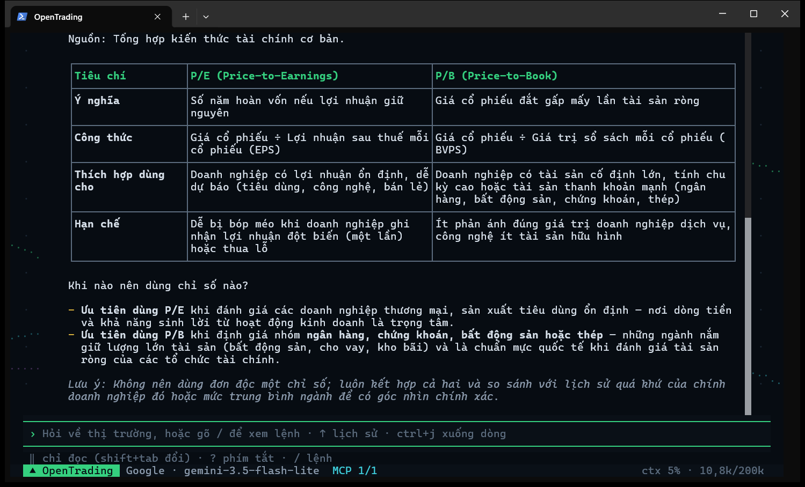

# OpenTrading

**English** · [Tiếng Việt](README.md)

A terminal AI harness for researching Vietnamese equities. It connects to 200+ LLM providers and to MCP servers for market data. The agent calls tools, hands work to subagents, runs multi-agent research playbooks (ultradesk) and cites its sources. The UI, prompts and most docs are in Vietnamese; this page is the English guide.

> **Demo release.** Working today: the TUI, LLM connections, a tool-calling agent loop, an MCP client (market data through the `opentrading-mcp` server), skills, subagents, ultradesk, reasoning effort, conversation compaction and saved sessions. It is not investment advice (see [Disclaimer](#disclaimer)). Progress: [docs/STATUS.md](docs/STATUS.md) (Vietnamese).




*A real, unedited answer from Google Gemini 3.5 Flash Lite in the prebuilt binary (asked in Vietnamese: how do P/E and P/B differ, and when to use which).*

## Install

OpenTrading ships as a single executable with Bun built in; you do not need Bun or Node first. Pick one:

**Windows** (PowerShell):

```powershell
powershell -ExecutionPolicy ByPass -c "irm https://raw.githubusercontent.com/FinDaHuman/OpenTrading/main/install.ps1 | iex"
```

**macOS and Linux**:

```bash
curl -fsSL https://raw.githubusercontent.com/FinDaHuman/OpenTrading/main/install.sh | bash
```

**npm** (any OS, Node 18 or later):

```bash
npm i -g @findahuman/opentrading
```

Then **open a new terminal** and run `ot` (or `opentrading`).

- The installers pick the build for your machine: Windows/macOS/Linux, x64/arm64, and a baseline build for older x64 CPUs without AVX2. They check the download against the release's `SHA256SUMS`. Then they put `opentrading` and `ot` in `~/.opentrading/bin` and add that folder to PATH: the user PATH on Windows, one marked line in `.zshrc`, `.bashrc` or `config.fish` on macOS/Linux.
- To install a given version:
  - PowerShell: set a variable first, `$env:OPENTRADING_VERSION="0.2.0"; irm … | iex`.
  - bash: `curl … | bash -s -- --version 0.2.0`.
  - Other options: `--dir`, `--no-modify-path`, `--uninstall` (see `install.sh --help`, or the top of `install.ps1`).
- The binaries are not code-signed yet. Windows SmartScreen may warn on the first run. On macOS, Gatekeeper blocks an archive downloaded with a browser; the installer uses `curl`, which avoids that.
- musl-based Linux (Alpine) has no prebuilt binary yet: [run from source](#run-from-source).
- All releases: [GitHub Releases](https://github.com/FinDaHuman/OpenTrading/releases).

## Update and uninstall

```bash
ot update            # update to the latest release
ot update --check    # only tell me whether there is one
ot update 0.2.0      # install that exact version (older ones too)
```

- When it opens, OpenTrading checks for a new release at most once a day and shows a notice in the top-right corner. Turn this off in `/config` → **Báo bản mới** ("new version notice"), or set `OPENTRADING_DISABLE_UPDATE_CHECK=1`.
- `ot update` downloads the new build, checks its checksum and runs it once before swapping it in. If any step fails, the version you have stays in place. On Windows the running files are renamed to `.old` and removed the next time OpenTrading starts.
- npm installs: `ot update` prints `npm i -g @findahuman/opentrading@latest` for you to run (close OpenTrading first).
- Uninstall:

  ```powershell
  & ([scriptblock]::Create((irm https://raw.githubusercontent.com/FinDaHuman/OpenTrading/main/install.ps1))) -Uninstall
  ```

  ```bash
  curl -fsSL https://raw.githubusercontent.com/FinDaHuman/OpenTrading/main/install.sh | bash -s -- --uninstall
  ```

  For npm installs, use `npm rm -g @findahuman/opentrading`. Your data in `~/.opentrading/` (keys, sessions, settings) is kept; delete that folder yourself if you want it gone.

## Usage

### First five minutes

1. Open a terminal in the folder you want to work in and run `ot`. That folder is the **workspace**, where the agent reads and writes files.
2. `/connect` → pick a provider and paste an API key. Keys are stored in `~/.opentrading/auth.json` and never shown again.
3. `/model` → pick a model (type to filter, `ctrl+f` marks a favorite). For a model with several effort levels you pick the level in the next step.
4. `/mcp` → add a market-data source (see [Market data](#market-data-mcp)).
5. Ask something, for example `phân tích cơ bản FPT` ("fundamental analysis of FPT"). To try several agents at once: `ultradesk so sánh FPT, MWG, VNM theo ROE` ("compare FPT, MWG, VNM by ROE").

`/effort` (or `ctrl+t`) sets the reasoning effort, `/help` lists every command, and `?` shows the shortcuts.

### Command line

```bash
ot                       # open the TUI; workspace = current folder
ot D:\Investing          # open it in another folder
ot -c                    # reopen this folder's latest session
ot -r <id>               # reopen a given session
ot mcp list              # manage MCP servers without the TUI (ot mcp --help)
ot update                # update
ot --version             # version and install location
ot --help                # every option
```

- Opened in your home folder, a drive root or a system folder, OpenTrading uses its own `~/.opentrading/workspace` instead of the whole drive.
- A folder's own skills and agents (`.opentrading/skills`, `.opentrading/agents`) become instructions for the model. So the first time you open such a folder, OpenTrading asks whether to trust it:
  - **Trust and load**: remembered in `~/.opentrading/folder-trust.json`. For a home folder or drive root, only for this run.
  - **Skip**: nothing is saved, and it asks again next time.

  A folder's `.mcp.json` still asks about each server separately.
- Data (keys, settings, sessions) lives in `~/.opentrading/`; set `OPENTRADING_HOME` to move it.
- No key but want to see ultradesk run? From source: `bun scripts/dev/desk-demo.tsx` (see [Demo without a key](#demo-without-a-key)).

## Contents

- [Install](#install)
- [Update and uninstall](#update-and-uninstall)
- [Usage](#usage)
- [Features](#features)
- [Ultradesk: multi-agent research](#ultradesk-multi-agent-research)
- [Reasoning effort](#reasoning-effort)
- [Commands in the TUI](#commands-in-the-tui)
- [Keyboard shortcuts](#keyboard-shortcuts)
- [Files, shell commands and permissions](#files-shell-commands-and-permissions)
- [Subagents](#subagents)
- [Market data (MCP)](#market-data-mcp)
- [Providers, models and keys](#providers-models-and-keys)
- [Sessions, compaction, memory](#sessions-compaction-memory)
- [Configuration](#configuration)
- [Run from source](#run-from-source)
- [Development and tests](#development-and-tests)
- [Layout](#layout)

## Features

| | |
| --- | --- |
| **200+ providers** | Groq, Gemini, NVIDIA, OpenAI, Anthropic, OpenRouter, DeepSeek… (list from [models.dev](https://models.dev)). `/model` has favorites, recent models, grouping by provider, and asks for the effort when a model has levels |
| **Tool-calling agent** | Built-in tools (market clock, charts, watchlist, web, files, shell, todos, asking you back) plus every MCP server's tools. Rarely used tools are loaded on demand (`tool_search`) |
| **Ultradesk** | Runs a multi-agent research *playbook* (screening, fact-checking, bull/bear debate, sector overview) with a live progress card in the chat and a `/desk` view |
| **Effort** | `/effort` and `ctrl+t` set the reasoning effort for the main agent, subagents and ultradesk; the status bar shows what the model actually receives |
| **Subagents** | Hand work to child agents that run in parallel or in the background, with a panel under the prompt |
| **Skills** | Analysis methods per sector and topic (`skills/`), suggested from your question |
| **Files and shell** | Reads text/CSV/PDF/images/Excel/Word, writes files and runs commands, with three permission modes and `/undo` |
| **Sessions** | Saved automatically, reopened, compacted near the context limit, exported to Markdown |
| **Claude Code–style UI** | `❯ ● ⎿` transcript, flicker-free streamed markdown, `@file`, pasted images, a message queue, a desktop notification when a turn ends |

## Ultradesk: multi-agent research

Ultradesk coordinates several subagents through a **playbook**. The playbook's code holds the loops, branches and intermediate results, and the main agent only receives the final result. The idea comes from Claude Code's dynamic workflows (`ultracode`), adapted to free API tiers (quota counted per request) and to conclusions written as scenarios rather than Buy/Sell calls. Full documentation: [docs/desk.md](docs/desk.md) (Vietnamese).

### Built-in playbooks

| Playbook | Use it to | Example | small (max agents / requests) |
| --- | --- | --- | --- |
| `sang-loc` | Compare, rank or screen two or more tickers on fundamentals/valuation | `ultradesk so sánh FPT, MWG, VNM, HPG theo ROE` | 6 / 36 |
| `kiem-chung` | Check the figures in an answer, a report or a claim | `/kiem-chung <paste the text>` | 6 / 22 |
| `tranh-bien` | Look at one ticker from both the bullish and the cautious side | `ultradesk FPT có đáng giữ qua quý 3 không, nhìn cả hai phía` | 6 / 30 |
| `nganh` | Overview of a Vietnamese sector: context and its leading companies | `ultradesk ngành thép đang thế nào` | 7 / 40 |

Every playbook has four sizes: `small` (default), `medium`, `large` and `unrestricted`. Larger sizes look at more tickers and add rounds of rebuttal and fact-checking. Agents and requests per size: [docs/desk.md](docs/desk.md#playbook-có-sẵn).

### Turning ultradesk on

| How | What it does |
| --- | --- |
| Type `ultradesk` in your question | Only that request may run a playbook; the word is highlighted in the prompt |
| `/desk on` · `/desk off` | On or off for the whole session; the mode line shows `desk ●` |
| `/sang-loc …` `/kiem-chung …` `/tranh-bien …` `/nganh …` | Run that playbook directly |

The model decides whether to call a playbook. A request that matches none (for example "write a .md file about notable tickers") gets an ordinary answer. The transcript then adds one line, `ultradesk: model không chạy playbook nào…` ("the model ran no playbook"), with the direct commands. Small models sometimes ignore the hint; use `/<playbook>` then.

### Approval card

Each run starts with a card: description, phases, `◂ size ▸` and `◂ effort ▸` (←→ to change them; the agent and request counts follow), and a △ warning when the run may use many requests. Choose **Chạy** (run), **Chạy, không hỏi lại** (run, and don't ask again for this playbook), **Xem tham số** (show parameters) or **Không** (no).

### Progress card in the chat

While a run is going, a card under the `desk_run` line updates live. This frame is from `desk-demo-frames.tsx --medium`, so the UI text is Vietnamese:

```
● desk_run(sang-loc) · 852ms
  ⎿  Đã bắt đầu run ultradesk dk-fmvc3o: playbook sang-loc, quy mô medium (~10 agent, ~60 request).
  ╭──────────────────────────────────────────────────────────────────────────────────────────────────╮
  │ ◆ ultradesk · sang-loc · dk-fmvc3o                                             ⠙ đang chạy · 11s │
  │ medium · 6 mã: FPT, MWG, VNM, … (+3) · ROE cao, nợ thấp                                          │
  │ ━━━━━━━━━━━━━━━━━━━━━╺──────────────  6/10 agent · 60%                                           │
  │ ✓ Thu thập    ━━━━━━━━━━  6/6 · 12s                                                              │
  │ ⠙ Kiểm chứng  ──────────  0/3                                                                    │
  │ ○ Tổng hợp    ──────────  0/0                                                                    │
  │ ⠙ phan-bien  phản biện MWG #1                                                                 0s │
  │ ◌ phan-bien  phản biện HPG #1                                             chờ lượt · 1 đang chạy │
  │ ◌ phan-bien  phản biện VCB #1                                             chờ lượt · 1 đang chạy │
  │ ✓ co-ban     thẻ điểm ACB                                                     2 req · 4s · ↓2,3k │
  │ ✓ co-ban     thẻ điểm VCB                                                     2 req · 3s · ↓1,9k │
  │ » Xếp hạng 6 mã theo điểm thẻ có trọng số.                                                       │
  │ 12 request · ↑85,6k ↓12,1k token · /desk chi tiết (p tạm dừng · x×2 dừng)                        │
  ╰──────────────────────────────────────────────────────────────────────────────────────────────────╯
```

- The top bar compares finished agents with the playbook's estimate; each phase has its own bar and running time.
- Running agents show the tool they are calling, their time and output tokens. Agents waiting for a slot in the run (`desk.maxConcurrent`) show `◌`. The two latest finished agents show `✓` (`✘` failed, `↺` taken from the journal).
- The `»` line is the playbook's latest log message (tickers cut, interim ranking…).
- When the run ends the card folds into one line (`◆ ultradesk sang-loc · xong · 14 agent · 61 request · …`); `ctrl+o` reopens the last card. The main agent receives the result and presents the ranking and scenarios.
- The panel under the prompt has **one row per run**: `↓` selects it, enter opens `/desk`, `x` twice stops the run.

### `/desk`

The session's runs → one run: the same card (progress, phases) plus **every agent by phase**, each row with its current task, requests, time and tokens → enter on an agent: the request it got, the tools it called, its result.

| Key | Action |
| --- | --- |
| `p` | Pause / resume (running agents finish, new ones wait) |
| `x` twice, `ctrl+x` | Stop the run |
| `r` | Resume a run that was cut short (quota, cap, stopped) from its journal, also after reopening the session; or `/desk resume <run>` |

### Demo without a key

```shell
bun scripts/dev/desk-demo.tsx
```

This opens the real TUI with a fake model. Type `ultradesk so sánh FPT, MWG, VNM, HPG, VCB, ACB theo ROE`, press enter on the approval card (←→ to `medium` shows the rebuttal phase too), then watch the card and `/desk`.

- The engine, the subagents and the UI are real; the numbers are random.
- The script uses a temporary `OPENTRADING_HOME`, removes key variables from its environment and blocks every network request except to the fake provider, so it never spends a real key.
- `bun scripts/dev/desk-demo-frames.tsx <folder> [--medium]` runs the same script without a terminal and writes the frames to text files.

## Reasoning effort

Effort tells the model how much to think before answering: `low` ○, `medium` ◐, `high` ●, `xhigh` ◉, `max` ◉ (the same names as Claude Code). Higher levels give more careful answers, but they are slower and use more tokens and quota. `auto` sends no effort, so the provider's default applies.

**`/effort`** opens a panel (UI text in Vietnamese):

```
Effort · Groq · openai/gpt-oss-120b
❯ Phiên chính      ◂ ◐ medium ▸        model nhận: low · medium · high
  Subagent         ◂ theo phiên ▸      loại agent có effort riêng thì dùng của nó
  Ultradesk        ◂ ● high ▸          agent trong mỗi run; đổi riêng từng run trên thẻ duyệt
  Quy mô ultradesk ◂ small ▸           mặc định trên thẻ duyệt (small → unrestricted)
↑↓ chọn · ←→ đổi (lưu ngay) · enter/esc đóng · ctrl+t đổi nhanh effort phiên chính
```

Rows: main session, subagents (follow the session unless the agent type sets its own), ultradesk agents (each run can override it on its approval card), and the default ultradesk size.

- `←→` changes a value and saves it at once; your next question uses it.
- `/effort high` (or `low`, `medium`, `xhigh`, `max`, `auto`) sets the main session directly.
- `/model`: after a model with several effort levels, a list of `auto` plus that model's levels appears.
  - Enter on the preselected row, before moving, keeps the saved effort.
  - Esc goes back to the model list.
  - `/config` → **Hỏi effort khi chọn model** ("ask for effort when picking a model") turns this step off.
- **`ctrl+t`** in the prompt cycles `auto` → the levels the current model takes → `auto`.
- The status bar shows the level the model really receives, e.g. `Groq · openai/gpt-oss-120b ● high`.
  - A level the model lacks runs as the nearest lower one (`xhigh` on a model that stops at `high` → `high`); `/effort` says so.
  - Models without effort levels (most non-reasoning models): `ctrl+t` says it cannot change; the value is still saved for other models.

Which model takes which level (Gemini 3/2.5, Claude, OpenAI, Groq gpt-oss): [docs/effort.md](docs/effort.md).

## Commands in the TUI

Type `/` for the list (keep typing to filter, `tab` completes, enter runs).

| Command | What it does |
| --- | --- |
| `/connect` | Enter an API key for any of 200+ providers |
| `/model` | Pick a model from every connected provider, then its effort if it has levels; `ctrl+f` favorite, ←→ jump between groups |
| `/effort [level]` | Reasoning effort: main session, subagents, ultradesk |
| `/desk [on\|off\|resume <run>]` | Ultradesk runs; on/off for the session; resume a run that was cut short |
| `/sang-loc` `/kiem-chung` `/tranh-bien` `/nganh` | Run one ultradesk playbook directly |
| `/skills`, `/skill <name>` | List skills; turn one on or off for the session |
| `/agents` | Subagent types (built-in, yours, the project's) and their tools |
| `/tasks` | The session's subagents, running and done; see results, stop (`ctrl+x`) |
| `/watchlist [name]` | Personal watchlists with prices; `new`/`add`/`rm`/`rename`/`del` to edit |
| `/profile` | Open your investor profile, `~/.opentrading/INVESTOR.md` |
| `/context` | The context layers sent to the model, with token counts |
| `/mcp` | MCP server status; enable/disable, allow project servers, reconnect, sign in |
| `/tools` | Every tool the model can call right now |
| `/sessions`, `/new` | Reopen a saved session; start a new one |
| `/compact [instructions]` | Compact the conversation (clear old tool results, summarize the start) |
| `/save` | Copy the whole conversation (Markdown, with tool input/output) to the clipboard |
| `/export [path] [--force]` | Save the conversation as `.md`; default `~/.opentrading/exports/<session id>.md` |
| `/add-dir [folder] [--luu]` | Add a folder to the workspace (where the agent may write); no argument: show the workspace |
| `/undo [n] [--force]` | Undo file changes the agent made |
| `/permissions` | Permission mode, workspace, allow/deny rules, what auto mode blocked |
| `/memory` | View, review and delete memories |
| `/config` | Settings, applied at once: memory, tool search, auto-compact, steps, subagents, side models, start-up permission mode, effort prompt, notifications, scrolling, new version notice |
| `/clear`, `/help`, `/exit` | Clear the screen and start a new session, help, quit |

An MCP server's prompts also become `/` commands.

## Keyboard shortcuts

`?` in an empty prompt opens the shortcut sheet; `/help` has the full list.

| Key | Action |
| --- | --- |
| `enter` · `ctrl+j` | Send · new line |
| `↑ ↓` · `ctrl+r` | Previous questions · search them |
| `@` | Attach a file (`@"name with spaces.md"#L3-4` for a line range) |
| `alt+v` / `ctrl+v` | Paste an image from the clipboard |
| `ctrl+s` · `ctrl+g` | Stash / restore a draft · write in your editor |
| `esc` | Stop the answer, close a panel; twice: clear the prompt |
| `enter` while it answers | Queue the next message |
| `ctrl+o` | Expand / collapse tool results, a finished ultradesk card, a compaction summary |
| `ctrl+t` | Change the main session's effort |
| `shift+tab` · `alt+m` | Change the permission mode |
| `↓` at the end of the prompt | Select a subagent / ultradesk run in the panel (enter to view, `x` twice to stop) |
| `pgup` `pgdn` · `ctrl+end` | Scroll the chat · jump to the end |
| `ctrl+c` twice · `ctrl+d` twice | Quit |

Drag with the mouse to select and copy (text only, without the `●`/`⎿` marks). UI details: [docs/ui.md](docs/ui.md).

## Files, shell commands and permissions

The agent can:

- read files you name or attach with `@`: text, CSV, PDF, images, Excel `.xlsx`, Word `.docx`;
- create or edit files, such as a `.md` plan, a `.csv` table or an `.html` page;
- run shell commands.

It may overwrite a whole file only after reading all of it (reading consecutive pages through to the end counts). Long shell output is saved in full to a file it can read on.

Three permission modes, switched with `shift+tab`:

| Mode | Behavior |
| --- | --- |
| `‖ chỉ đọc` (read-only, default) | Every file write or command asks you |
| `▸ sửa có hỏi` (edit with approval) | Asks, and can allow a whole folder for the session |
| `▸▸ tự động` (auto) | A side model approves each action for you (turned on once, explicitly) |

Files holding keys or passwords, OpenTrading's own settings, and writes outside the workspace always ask you. `/undo` reverts the agent's file changes. See [docs/permissions.md](docs/permissions.md).

## Subagents

The model can hand work to **subagents**:

- they run in parallel (10 at a time by default; more wait in a queue) or in the background;
- each has a type: `agents/*.md`, or your own in `~/.opentrading/agents/`;
- the panel under the prompt shows each agent and the tool it is calling, and `/tasks` shows their results;
- they may use write tools, and every approval appears in the main prompt.

See [docs/subagents.md](docs/subagents.md).

**On a free Gemini key?** Its daily and per-minute quotas are very low, and subagents and ultradesk use many requests. Read [docs/gemini-limits.md](docs/gemini-limits.md) first.

## Market data (MCP)

OpenTrading ships no market data. Figures come from the MCP servers you add (see [docs/mcp.md](docs/mcp.md)):

- The `opentrading` server in `/mcp` needs a token from whoever runs it. Without one, skip it.
- The server's source: [opentrading-mcp](https://github.com/DoanDuyLong212/opentrading-mcp). You can run it yourself, or add any other MCP server (stdio, Streamable HTTP, SSE, OAuth).
- With no MCP server, the agent works with its built-in tools only (web, files, charts, watchlist).

From the command line: `ot mcp add <name> <url>` or `ot mcp add <name> -- <command>`; `ot mcp list` to see them. Tabular results get an `[ref rN]` tag, and charts read the numbers from it, so the model never copies them by hand.

## Providers, models and keys

- Providers and models come from [models.dev](https://models.dev), the same source opencode uses, cached for an hour in `~/.opentrading/cache/models.json`. Models that cannot chat (embeddings, image, audio) are hidden from `/model`.
- Providers that need their own SDK or extra setup (Azure, Bedrock, Vertex…) are hidden (`isSupported()` in `src/core/providers.ts`).
- Keys live in `~/.opentrading/auth.json`, outside the repo. A provider without a key there reads its environment variable, e.g. `GROQ_API_KEY`, `GEMINI_API_KEY`, `NVIDIA_API_KEY`. The agent's shell commands never see key variables.
- The context uses the model's whole window; the status bar shows e.g. `ctx 42% · 54k/128k`.

## Sessions, compaction, memory

- Conversations are saved in `~/.opentrading/sessions/`, tied to the folder they were opened in. `/sessions` reopens one: this folder's by default, `tab` for every folder. A title is set automatically after the first turn.
- Near the context limit the conversation is compacted automatically (threshold in `/config`); `/compact` does it by hand.
- Memory: say `Ghi nhớ: …` ("remember: …") or let the model propose one, then review it in `/memory`. A broken memory file is skipped and reported in `/memory`; the other memories are kept.
- Your investor profile `INVESTOR.md` (`/profile`) is always in the context.

## Configuration

Most settings are changed in the TUI (`/config`, `/effort`, `/model`, `/permissions`) and apply at once. Files live in `~/.opentrading/`:

| File | Contents |
| --- | --- |
| `config.json` | Provider/model, `effort`, `subagents`, `desk` (size, agent/request caps, effort, keyword…), auto-compact, permissions, UI, `update` (new version notice) |
| `auth.json` | API keys (mode 600) |
| `mcp.json` (and a project's `.mcp.json`) | MCP servers, same format as Claude Code |
| `model.json` | Favorite and recent models |
| `watchlists.json` | Personal watchlists (locked while written, so several windows can edit without losing changes) |
| `INVESTOR.md` | Investor profile |
| `sessions/`, `exports/`, `memory/`, `agents/`, `skills/` | Sessions, exports, memories, your agent types and skills |
| `bin/` | `opentrading` and `ot` when installed by script (`OPENTRADING_INSTALL_DIR` moves them) |
| `bundled/`, `cache/` | Built-in skills/agents/prompts a binary unpacks per version; model list cache, last update check |

`desk` keys: [docs/desk.md](docs/desk.md#cài-đặt-configjson--desk).

## Run from source

Needs [Bun](https://bun.sh) 1.3 or later; runs on Windows, macOS and Linux.

```shell
git clone https://github.com/FinDaHuman/OpenTrading.git
cd OpenTrading
bun install
bun run dev                  # reopen the latest session: bun run dev -- --continue
```

### An `opentrading` command that runs the source (for developers)

```shell
bun run install:global
```

- Writes `opentrading` and `ot` to `~/.local/bin`. On Windows there is also a `.cmd` for PowerShell/cmd and an extensionless one for Git Bash.
  - `bun run install:global -- --dir <folder>` puts them elsewhere.
  - If that folder is not on PATH, the script prints the command to add it; it never edits PATH itself.
  - Files of the same name that OpenTrading did not write are never overwritten.
- These commands run this checkout's source:
  - Update with `git pull && bun install`.
  - After moving the repo, run `bun run install:global` again.
  - Remove them with `bun run uninstall:global`.
  - Don't install them next to the prebuilt binary: whichever `ot` comes first on PATH wins (the installer warns about it).
- They ignore the current folder's `bunfig.toml` and `.env`, which could run code or change `OPENTRADING_HOME`. Keys in a `.env` file are therefore not loaded: use `/connect` or real environment variables.
- They run whatever is checked out in that folder. If you also edit code or switch branches there, install from a separate worktree so `ot` does not follow your work in progress: `git worktree add ../OpenTrading-ot main`, then `bun install` and `bun run install:global` inside it.
- Try a provider without the TUI (built-in tools only): `bun src/core/chat.ts "mấy giờ rồi?"` ("what time is it?").

## Development and tests

```shell
bun run typecheck
bun test                     # includes a headless TUI smoke test; SHOW_FRAME=1 prints frames
bun test test/tui.test.tsx   # UI only
bun run build --single       # binary for this machine: dist/opentrading-<os>-<cpu>/bin/
```

Releasing a version (binaries, GitHub Releases, npm): [docs/release.md](docs/release.md).

Scripts in `scripts/dev/`:

| Script | What it does | Calls a real model? |
| --- | --- | --- |
| `desk-demo.tsx` | The real TUI with a fake model, to watch ultradesk | No |
| `desk-demo-frames.tsx <folder> [--medium]` | Same, without a terminal; writes frames to files | No |
| `routing-eval.ts` | Measures skill/tool suggestions on a labeled question set | No |
| `desk-eval.ts` | Compares ultradesk with an ordinary answer | Yes, only with `--yes` |
| `auto-mode-eval.ts --model <model>` | Measures the approval model of ▸▸ auto mode | **Yes**, as soon as it runs (uses quota) |

## Layout

```
src/core/     providers, auth, config, agent loop, investor profile (no UI imports)
  prompt/     layered prompt assembly, token budgets, market clock
  skills/     SKILL.md schema, 3-source loader, catalog, preroute
  memory/     MemoryProvider contract, FileMemory reference implementation
  session/    JSONL sessions, resume, transcript rebuild
  tools/      tool registry, limits/timeouts, built-in tools (files, shell, chart, watchlist, web…)
  subagents/  subagents: manager, slot limiter, own transcripts, background notices
  desk/       ultradesk: engine, journal, approval card, playbooks (playbooks/)
  agents/     subagent types (agents/*.md files)
  mcp/        MCP client: config, approval, tool naming, connection manager
  permission/ permission modes, rules, the ▸▸ auto approval model
src/tui/      UI: theme, transcript, ultradesk card, panels, dialogs
src/cli/      command line: arguments, mcp, update, install:global
scripts/      build, package, release notes, npm packages; scripts/dev/ demos and evals
examples/     sample MCP server (examples/mcp-demo)
prompts/      layered system prompt text (identity, tools, citations, style)
skills/       skills as skills/<name>/SKILL.md (see docs/contracts.md)
agents/       built-in subagent types (see docs/subagents.md)
market/       trading calendar (data, not yet verified)
handbook/     design documents
docs/         topic guides; docs/decisions/ architecture decisions
```

[docs/decisions/0001-typescript.md](docs/decisions/0001-typescript.md) explains why TypeScript, and where Python will be used.

## Disclaimer

OpenTrading is research software, not an investment advisory service, and it does not place orders.

- Answers are written by AI models and may be wrong, incomplete or based on stale data. Verify them against the original sources.
- You alone are responsible for your investment decisions and their risks.
- The software is provided "AS IS", without warranties; the authors and contributors are not liable for damages from its use (see sections 7–8 of `LICENSE`).

## License

[Apache License 2.0](LICENSE). Some files are adapted from opencode (MIT): see [THIRD_PARTY_NOTICES.md](THIRD_PARTY_NOTICES.md) and [NOTICE](NOTICE). By contributing code you agree to release it under the same license (see [CONTRIBUTING.md](CONTRIBUTING.md)).
