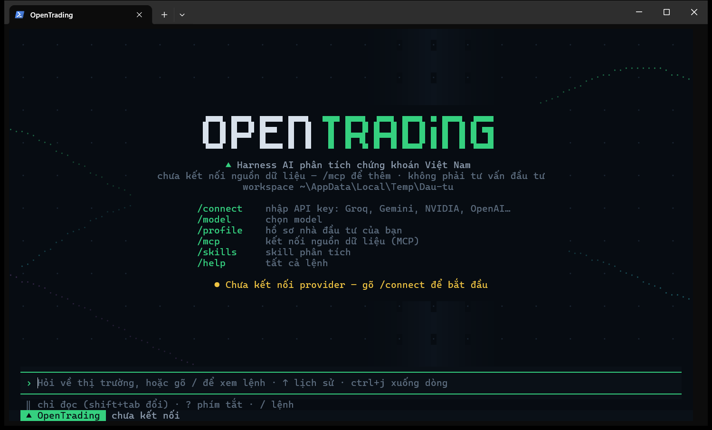

# OpenTrading

[English](README.en.md) · **Tiếng Việt**

Harness AI phân tích chứng khoán Việt Nam, chạy trong terminal. Kết nối hơn 200 nhà cung cấp LLM, gắn MCP server lấy dữ liệu thị trường, để agent gọi tool, giao việc cho subagent, chạy playbook nghiên cứu nhiều agent (ultradesk) và trích nguồn số liệu. Giao diện, prompt và tài liệu bằng tiếng Việt.

> **Bản demo.** Đã có TUI, kết nối LLM, agent loop gọi tool, MCP client (dữ liệu thị trường qua server `opentrading-mcp`), skills, subagent, ultradesk, effort suy luận, nén hội thoại và lưu phiên. Đây không phải tư vấn đầu tư (xem [Miễn trừ trách nhiệm](#miễn-trừ-trách-nhiệm--disclaimer)). Tiến độ: [docs/STATUS.md](docs/STATUS.md).



## Mục lục

- [Cài đặt](#cài-đặt)
- [Cập nhật và gỡ cài đặt](#cập-nhật-và-gỡ-cài-đặt)
- [Cách dùng](#cách-dùng)
- [Tính năng](#tính-năng)
- [Ultradesk: nghiên cứu nhiều agent](#ultradesk-nghiên-cứu-nhiều-agent)
- [Effort suy luận](#effort-suy-luận)
- [Lệnh trong TUI](#lệnh-trong-tui)
- [Phím tắt](#phím-tắt)
- [File, lệnh shell và quyền](#file-lệnh-shell-và-quyền)
- [Subagent](#subagent)
- [Dữ liệu thị trường (MCP)](#dữ-liệu-thị-trường-mcp)
- [Provider, model và key](#provider-model-và-key)
- [Phiên, nén hội thoại, memory](#phiên-nén-hội-thoại-memory)
- [Cấu hình](#cấu-hình)
- [Chạy từ mã nguồn](#chạy-từ-mã-nguồn)
- [Phát triển và kiểm tra](#phát-triển-và-kiểm-tra)
- [Cấu trúc](#cấu-trúc)

## Cài đặt

Bản cài là một file chạy duy nhất (Bun nằm sẵn bên trong), không cần cài Bun hay Node trước. Chọn một cách:

**Windows** (PowerShell):

```powershell
powershell -ExecutionPolicy ByPass -c "irm https://raw.githubusercontent.com/FinDaHuman/OpenTrading/main/install.ps1 | iex"
```

**macOS và Linux**:

```bash
curl -fsSL https://raw.githubusercontent.com/FinDaHuman/OpenTrading/main/install.sh | bash
```

**npm** (mọi hệ điều hành, cần Node 18 trở lên):

```bash
npm i -g opentrading
```

Cài xong, **mở terminal mới** rồi gõ `ot` (hoặc `opentrading`).

- Script cài chọn đúng bản cho máy (Windows/macOS/Linux, x64/arm64, CPU x64 đời cũ không có AVX2) và kiểm tra file tải về với `SHA256SUMS` của bản phát hành. Sau đó nó đặt `opentrading` và `ot` vào `~/.opentrading/bin` rồi thêm thư mục đó vào PATH: Windows sửa PATH của user; macOS/Linux thêm một dòng có ghi chú vào `.zshrc`, `.bashrc` hoặc `config.fish`.
- Cài một bản cụ thể:
  - PowerShell: đặt biến trước khi chạy, `$env:OPENTRADING_VERSION="0.2.0"; irm … | iex`.
  - bash: `curl … | bash -s -- --version 0.2.0`.
  - Tuỳ chọn khác: `--dir`, `--no-modify-path`, `--uninstall` (xem `install.sh --help`, hoặc phần đầu file `install.ps1`).
- Binary chưa ký số: lần đầu chạy, Windows SmartScreen có thể cảnh báo. Trên macOS, file nén tải bằng trình duyệt bị Gatekeeper chặn; script cài dùng `curl` nên không bị.
- Linux dùng musl (Alpine) chưa có bản dựng sẵn: [chạy từ mã nguồn](#chạy-từ-mã-nguồn).
- Mọi bản phát hành: [GitHub Releases](https://github.com/FinDaHuman/OpenTrading/releases).

## Cập nhật và gỡ cài đặt

```bash
ot update            # cập nhật lên bản mới nhất
ot update --check    # chỉ xem có bản mới không
ot update 0.2.0      # cài đúng một bản (kể cả bản cũ hơn)
```

- Khi mở, OpenTrading kiểm tra bản mới tối đa một lần mỗi ngày và hiện thông báo ở góc phải. Tắt trong `/config` → **Báo bản mới**, hoặc đặt `OPENTRADING_DISABLE_UPDATE_CHECK=1`.
- `ot update` tải bản mới, kiểm tra checksum và chạy thử trước khi thay; lỗi giữa chừng thì bản đang dùng giữ nguyên. Trên Windows, file đang chạy được đổi tên thành `.old` và bị xoá ở lần mở sau.
- Cài bằng npm: `ot update` in lệnh `npm i -g opentrading@latest` để bạn tự chạy (đóng OpenTrading trước).
- Gỡ cài đặt:

  ```powershell
  & ([scriptblock]::Create((irm https://raw.githubusercontent.com/FinDaHuman/OpenTrading/main/install.ps1))) -Uninstall
  ```

  ```bash
  curl -fsSL https://raw.githubusercontent.com/FinDaHuman/OpenTrading/main/install.sh | bash -s -- --uninstall
  ```

  Cài bằng npm thì gỡ bằng `npm rm -g opentrading`. Dữ liệu của bạn ở `~/.opentrading/` (key, phiên, cấu hình) được giữ lại; muốn xoá thì xoá thư mục đó.

## Cách dùng

### Bắt đầu trong 5 phút

1. Mở terminal ở thư mục bạn muốn làm việc rồi gõ `ot`. Thư mục đó là **workspace**, nơi agent đọc và ghi file.
2. `/connect` → chọn provider, dán API key. Key lưu ở `~/.opentrading/auth.json`, không hiện lại trên màn hình.
3. `/model` → chọn model (gõ để lọc, `ctrl+f` đánh dấu yêu thích). Model có nhiều mức effort thì chọn luôn mức suy luận ở bước tiếp theo.
4. `/mcp` → gắn nguồn dữ liệu thị trường (xem [Dữ liệu thị trường](#dữ-liệu-thị-trường-mcp)).
5. Đặt câu hỏi, ví dụ `phân tích cơ bản FPT`. Muốn thử nhiều agent: `ultradesk so sánh FPT, MWG, VNM theo ROE`.

`/effort` (hoặc `ctrl+t`) chỉnh mức suy luận; `/help` liệt kê mọi lệnh; `?` mở bảng phím tắt.

### Lệnh dòng lệnh

```bash
ot                       # mở TUI, workspace = thư mục hiện tại
ot D:\Dau-tu             # mở ở thư mục khác
ot -c                    # mở lại phiên mới nhất của thư mục này
ot -r <id>               # mở lại một phiên cụ thể
ot mcp list              # quản lý MCP server không cần mở TUI (ot mcp --help)
ot update                # cập nhật
ot --version             # phiên bản và nơi cài
ot --help                # mọi tuỳ chọn
```

- Mở ở thư mục home, gốc ổ đĩa hay thư mục hệ thống thì OpenTrading dùng thư mục riêng `~/.opentrading/workspace` thay vì cả ổ đĩa.
- Skill và agent riêng của một thư mục (`.opentrading/skills`, `.opentrading/agents`) trở thành chỉ dẫn cho model. Vì vậy lần đầu mở thư mục có chúng, OpenTrading hỏi **"Thư mục này có skill/agent riêng"**:
  - *Tin cậy và nạp*: lưu ở `~/.opentrading/folder-trust.json`. Với thư mục home hay gốc ổ đĩa thì chỉ áp dụng cho lần chạy này.
  - *Bỏ qua*: không lưu, lần sau hỏi lại.

  `.mcp.json` của thư mục vẫn hỏi riêng từng server.
- Dữ liệu (key, cấu hình, phiên) nằm ở `~/.opentrading/`; đổi chỗ bằng biến `OPENTRADING_HOME`.
- Không có key mà muốn xem ultradesk chạy? Từ mã nguồn: `bun scripts/dev/desk-demo.tsx` (xem [Demo không cần key](#demo-không-cần-key)).

## Tính năng

| | |
| --- | --- |
| **Hơn 200 provider** | Groq, Gemini, NVIDIA, OpenAI, Anthropic, OpenRouter, DeepSeek… (danh sách từ [models.dev](https://models.dev)); `/model` có yêu thích, dùng gần đây, nhóm theo provider, và hỏi effort ngay khi model có nhiều mức |
| **Agent gọi tool** | Tool có sẵn (giờ phiên, chart, watchlist, web, file, shell, todo, hỏi lại người dùng) và tool của MCP server; tool ít dùng được nạp khi cần (`tool_search`) |
| **Ultradesk** | Chạy một *playbook* nghiên cứu nhiều agent (sàng lọc mã, kiểm chứng số liệu, tranh biện, phân tích ngành) với card tiến độ trực tiếp trong chat và bảng `/desk` |
| **Effort** | `/effort` và `ctrl+t` chỉnh mức suy luận cho agent chính, subagent và ultradesk; thanh trạng thái hiện mức model thật sự nhận |
| **Subagent** | Giao việc cho agent con chạy song song hoặc chạy nền, có panel theo dõi dưới ô nhập |
| **Skills** | Phương pháp phân tích theo ngành và chủ đề (`skills/`), tự gợi ý theo câu hỏi |
| **File và shell** | Đọc text/CSV/PDF/ảnh/Excel/Word, ghi file, chạy lệnh, với 3 chế độ quyền và `/undo` |
| **Phiên** | Lưu tự động, mở lại, nén khi gần đầy ngữ cảnh, xuất Markdown |
| **Giao diện kiểu Claude Code** | `❯ ● ⎿`, stream markdown không nháy, `@file`, dán ảnh, hàng đợi tin nhắn, thông báo desktop khi xong việc |

## Ultradesk: nghiên cứu nhiều agent

Ultradesk điều phối nhiều subagent theo một **playbook**: code của playbook giữ vòng lặp, rẽ nhánh và kết quả trung gian; agent chính chỉ nhận kết quả cuối. Ý tưởng lấy từ dynamic workflows / `ultracode` của Claude Code, chỉnh cho gói API miễn phí (quota theo request) và kết luận ở dạng kịch bản, không khuyến nghị Mua/Bán. Tài liệu đầy đủ: [docs/desk.md](docs/desk.md).

### Playbook có sẵn

| Playbook | Dùng khi | Ví dụ | small (agent / request tối đa) |
| --- | --- | --- | --- |
| `sang-loc` | So sánh, xếp hạng, lọc từ 2 mã trở lên theo cơ bản/định giá | `ultradesk so sánh FPT, MWG, VNM, HPG theo ROE` | 6 / 36 |
| `kiem-chung` | Kiểm tra các con số trong một câu trả lời, báo cáo, nhận định | `/kiem-chung <dán văn bản>` | 6 / 22 |
| `tranh-bien` | Một mã, nhìn cả phe lạc quan lẫn thận trọng | `ultradesk FPT có đáng giữ qua quý 3 không, nhìn cả hai phía` | 6 / 30 |
| `nganh` | Toàn cảnh một ngành ở VN: bối cảnh và doanh nghiệp đầu ngành | `ultradesk ngành thép đang thế nào` | 7 / 40 |

Mỗi playbook có 4 quy mô `small` (mặc định) → `medium` → `large` → `unrestricted`; quy mô lớn hơn xét nhiều mã hơn, thêm vòng phản biện và kiểm chứng. Bảng số agent/request từng quy mô: [docs/desk.md](docs/desk.md#playbook-có-sẵn).

### Bật ultradesk

| Cách | Ý nghĩa |
| --- | --- |
| Gõ `ultradesk` trong câu hỏi | Chỉ yêu cầu đó được chạy playbook. Chữ được tô màu trong ô nhập |
| `/desk on` · `/desk off` | Bật/tắt cho cả phiên; dòng chế độ hiện `desk ●` |
| `/sang-loc …` `/kiem-chung …` `/tranh-bien …` `/nganh …` | Chạy thẳng đúng playbook đó |

Model quyết định có gọi playbook hay không. Yêu cầu không khớp playbook nào (ví dụ "tạo file .md phân tích mã nổi bật") thì model trả lời bình thường, và transcript có một dòng `ultradesk: model không chạy playbook nào…` kèm các lệnh chạy thẳng. Model nhỏ đôi khi bỏ qua: khi đó dùng lệnh `/<playbook>`.

### Thẻ duyệt

Trước mỗi run có một thẻ: mô tả, các phase, `◂ quy mô ▸` và `◂ effort ▸` (←→ để đổi, số agent/request cập nhật theo), cảnh báo △ khi run có thể tốn nhiều request. Chọn **Chạy**, **Chạy, không hỏi lại** playbook đó, **Xem tham số** hoặc **Không**.

### Card tiến độ trong chat

Khi run chạy, ngay dưới dòng `desk_run` là một card cập nhật liên tục (khung hình chụp từ `desk-demo-frames.tsx --medium`):

```
● desk_run(sang-loc) · 852ms
  ⎿  Đã bắt đầu run ultradesk dk-fmvc3o: playbook sang-loc, quy mô medium (~10 agent, ~60 request).
  ╭──────────────────────────────────────────────────────────────────────────────────────────────────╮
  │ ◆ ultradesk · sang-loc · dk-fmvc3o                                             ⠙ đang chạy · 11s │
  │ medium · 6 mã: FPT, MWG, VNM, … (+3) · ROE cao, nợ thấp                                          │
  │ ━━━━━━━━━━━━━━━━━━━━━╺──────────────  6/10 agent · 60%                                           │
  │ ✓ Thu thập    ━━━━━━━━━━  6/6 · 12s                                                              │
  │ ⠙ Kiểm chứng  ──────────  0/3                                                                    │
  │ ○ Tổng hợp    ──────────  0/0                                                                    │
  │ ⠙ phan-bien  phản biện MWG #1                                                                 0s │
  │ ◌ phan-bien  phản biện HPG #1                                             chờ lượt · 1 đang chạy │
  │ ◌ phan-bien  phản biện VCB #1                                             chờ lượt · 1 đang chạy │
  │ ✓ co-ban     thẻ điểm ACB                                                     2 req · 4s · ↓2,3k │
  │ ✓ co-ban     thẻ điểm VCB                                                     2 req · 3s · ↓1,9k │
  │ » Xếp hạng 6 mã theo điểm thẻ có trọng số.                                                       │
  │ 12 request · ↑85,6k ↓12,1k token · /desk chi tiết (p tạm dừng · x×2 dừng)                        │
  ╰──────────────────────────────────────────────────────────────────────────────────────────────────╯
```

- Thanh tổng so số agent đã xong với ước tính của playbook; mỗi phase có thanh riêng và thời gian chạy.
- Các agent đang chạy hiện tool đang gọi, thời gian và token ra; agent chờ lượt của run (`desk.maxConcurrent`) hiện `◌`; hai agent vừa xong hiện `✓` (lỗi `✘`, lấy lại từ journal `↺`).
- Dòng `»` là log mới nhất của playbook (cắt bớt mã, xếp hạng tạm…).
- Run xong thì card thu về một dòng (`◆ ultradesk sang-loc · xong · 14 agent · 61 request · …`); `ctrl+o` mở lại card cuối. Agent chính nhận kết quả và trình bày bảng xếp hạng, kịch bản.
- Panel dưới ô nhập có **một dòng cho cả run**; `↓` chọn dòng đó, enter mở `/desk`, `x` hai lần dừng run.

### `/desk`

Danh sách run của phiên → một run: cùng card ở trên (thanh tiến độ, phase) và **mọi agent theo phase**, mỗi dòng ghi việc đang làm, số request, thời gian, token → enter vào một agent: yêu cầu nó nhận, các tool đã gọi, kết quả.

| Phím | Việc |
| --- | --- |
| `p` | Tạm dừng / chạy tiếp (agent đang chạy làm nốt, agent mới chờ) |
| `x` hai lần, `ctrl+x` | Dừng run |
| `r` | Chạy tiếp run bị cắt (hết quota, chạm trần, bị dừng) từ journal, kể cả sau khi mở lại phiên; hoặc `/desk resume <run>` |

### Demo không cần key

```shell
bun scripts/dev/desk-demo.tsx
```

Mở TUI thật với một model giả: gõ `ultradesk so sánh FPT, MWG, VNM, HPG, VCB, ACB theo ROE`, enter trên thẻ duyệt (←→ chọn `medium` để thấy thêm phase phản biện), rồi xem card và `/desk`. Engine, subagent và giao diện là thật; số liệu là ngẫu nhiên. Script dùng một `OPENTRADING_HOME` tạm, xoá biến key khỏi môi trường và chặn mọi request mạng ngoài provider giả, nên không bao giờ tốn key thật. `bun scripts/dev/desk-demo-frames.tsx <thư mục> [--medium]` chạy cùng kịch bản không cần terminal và ghi các khung hình ra file text.

## Effort suy luận

Effort cho model biết nên suy nghĩ bao nhiêu trước khi trả lời: `low` ○, `medium` ◐, `high` ●, `xhigh` ◉, `max` ◉ (tên giống Claude Code). Mức cao: trả lời kỹ hơn nhưng chậm hơn và tốn token/quota hơn. `auto` = không gửi effort, provider dùng mặc định.

**`/effort`** mở một bảng:

```
Effort · Groq · openai/gpt-oss-120b
❯ Phiên chính      ◂ ◐ medium ▸        model nhận: low · medium · high
  Subagent         ◂ theo phiên ▸      loại agent có effort riêng thì dùng của nó
  Ultradesk        ◂ ● high ▸          agent trong mỗi run; đổi riêng từng run trên thẻ duyệt
  Quy mô ultradesk ◂ small ▸           mặc định trên thẻ duyệt (small → unrestricted)
↑↓ chọn · ←→ đổi (lưu ngay) · enter/esc đóng · ctrl+t đổi nhanh effort phiên chính
```

- `←→` đổi và lưu ngay; lượt hỏi tiếp theo dùng mức mới.
- `/effort high` (hoặc `low`, `medium`, `xhigh`, `max`, `auto`) đặt thẳng cho phiên chính.
- `/model`: chọn model có nhiều mức effort thì hiện bảng `auto` + các mức model đó nhận. Enter ngay trên dòng tô sẵn (chưa di chuyển) giữ effort đã lưu; esc quay lại danh sách model. Tắt bước này trong `/config` → **Hỏi effort khi chọn model**.
- **`ctrl+t`** ở ô nhập: xoay vòng `auto` → các mức model đang dùng nhận được → `auto`.
- Thanh trạng thái hiện mức model thật sự nhận, ví dụ `Groq · openai/gpt-oss-120b ● high`. Mức model không có thì chạy như mức thấp hơn gần nhất (`xhigh` trên model chỉ tới `high` → `high`); bảng `/effort` ghi rõ điều đó.
- Model không có mức effort (đa số model không suy luận): `ctrl+t` báo không đổi được; giá trị vẫn lưu cho model khác.

Model nào nhận mức nào (Gemini 3/2.5, Claude, OpenAI, Groq gpt-oss): [docs/effort.md](docs/effort.md).

## Lệnh trong TUI

Gõ `/` để xem danh sách (gõ tiếp để lọc, `tab` điền, enter chạy).

| Lệnh | Việc |
| --- | --- |
| `/connect` | Nhập API key cho hơn 200 provider |
| `/model` | Chọn model từ mọi provider đã kết nối, rồi effort nếu model có nhiều mức; `ctrl+f` yêu thích, ←→ nhảy nhóm |
| `/effort [mức]` | Effort suy luận: phiên chính, subagent, ultradesk |
| `/desk [on\|off\|resume <run>]` | Các run ultradesk; bật/tắt cho cả phiên; chạy tiếp run bị cắt |
| `/sang-loc` `/kiem-chung` `/tranh-bien` `/nganh` | Chạy thẳng một playbook ultradesk |
| `/skills`, `/skill <tên>` | Danh sách skill; bật hoặc tắt một skill cho cả phiên |
| `/agents` | Các loại subagent (có sẵn, cá nhân, dự án) và tool của từng loại |
| `/tasks` | Subagent của phiên: đang chạy, đã xong; xem kết quả, dừng (`ctrl+x`) |
| `/watchlist [tên]` | Watchlist cá nhân kèm giá; `new`/`add`/`rm`/`rename`/`del` để sửa |
| `/profile` | Mở hồ sơ nhà đầu tư `~/.opentrading/INVESTOR.md` |
| `/context` | Các tầng ngữ cảnh gửi cho model và số token |
| `/mcp` | Trạng thái MCP server; bật/tắt, cho phép server của project, kết nối lại, đăng nhập |
| `/tools` | Mọi tool model đang gọi được |
| `/sessions`, `/new` | Mở lại một phiên đã lưu; bắt đầu phiên mới |
| `/compact [hướng dẫn]` | Nén hội thoại (dọn kết quả tool cũ, tóm tắt phần đầu) |
| `/save` | Copy toàn bộ hội thoại (Markdown, kèm input/output tool) vào clipboard |
| `/export [đường dẫn] [--force]` | Lưu hội thoại ra `.md`; mặc định `~/.opentrading/exports/<id phiên>.md` |
| `/add-dir [thư mục] [--luu]` | Thêm thư mục vào workspace (nơi agent ghi file); không tham số: xem workspace |
| `/undo [số] [--force]` | Hoàn tác thay đổi file do agent ghi |
| `/permissions` | Chế độ quyền, workspace, quy tắc cho phép/chặn, các lần auto mode chặn |
| `/memory` | Xem, duyệt, xoá memory |
| `/config` | Cài đặt, có hiệu lực ngay: memory, tìm tool, tự nén, số bước, subagent, model phụ, chế độ quyền khi mở, hỏi effort khi chọn model, thông báo, cuộn, báo bản mới |
| `/clear`, `/help`, `/exit` | Xoá màn hình và bắt đầu phiên mới, trợ giúp, thoát |

MCP server có prompt thì prompt đó cũng thành lệnh `/`.

## Phím tắt

`?` trên ô nhập trống mở bảng phím tắt; `/help` có danh sách đầy đủ.

| Phím | Việc |
| --- | --- |
| `enter` · `ctrl+j` | Gửi · xuống dòng |
| `↑ ↓` · `ctrl+r` | Câu đã hỏi · tìm câu cũ |
| `@` | Gắn file (`@"có dấu cách.md"#L3-4` để lấy một đoạn dòng) |
| `alt+v` / `ctrl+v` | Dán ảnh từ clipboard |
| `ctrl+s` · `ctrl+g` | Cất / lấy lại bản nháp · soạn trong trình soạn thảo |
| `esc` | Dừng câu trả lời, đóng bảng; hai lần: xoá ô nhập |
| `enter` khi đang trả lời | Xếp hàng tin tiếp theo |
| `ctrl+o` | Mở rộng / thu gọn kết quả tool, card ultradesk đã xong, tóm tắt nén |
| `ctrl+t` | Đổi effort phiên chính |
| `shift+tab` · `alt+m` | Đổi chế độ quyền |
| `↓` ở cuối ô nhập | Chọn subagent / run ultradesk trên panel (enter xem, `x` hai lần dừng) |
| `pgup` `pgdn` · `ctrl+end` | Cuộn chat · về cuối |
| `ctrl+c` hai lần · `ctrl+d` hai lần | Thoát |

Kéo chuột để bôi đen và copy (chỉ copy chữ, bỏ ký hiệu `●`/`⎿`). Chi tiết giao diện: [docs/ui.md](docs/ui.md).

## File, lệnh shell và quyền

Agent đọc được file bạn đưa đường dẫn hoặc gắn bằng `@` (text, CSV, PDF, ảnh, Excel `.xlsx`, Word `.docx`), tạo hay sửa file (kế hoạch `.md`, bảng `.csv`, trang `.html`) và chạy lệnh shell. Ghi đè cả file chỉ được khi agent đã đọc toàn bộ file đó (đọc nhiều trang liên tiếp tới cuối file cũng tính); output shell dài được lưu đầy đủ ra file để đọc tiếp.

Ba chế độ quyền, đổi bằng `shift+tab`:

| Chế độ | Hành vi |
| --- | --- |
| `‖ chỉ đọc` (mặc định) | Mọi lần ghi file hay chạy lệnh đều hỏi |
| `▸ sửa có hỏi` | Hỏi, và cho phép được cả thư mục trong phiên |
| `▸▸ tự động` | Một model phụ duyệt từng hành động thay bạn (cần bật một lần) |

File chứa khoá/mật khẩu, cấu hình OpenTrading và việc ghi ra ngoài workspace luôn hỏi bạn. `/undo` hoàn tác thay đổi file của agent. Xem [docs/permissions.md](docs/permissions.md).

## Subagent

Model có thể giao việc cho **subagent**: chạy song song (mặc định tối đa 10, vượt thì xếp hàng), chạy nền, chọn loại agent (`agents/*.md`, hoặc của bạn ở `~/.opentrading/agents/`). Panel dưới ô nhập hiện từng agent kèm tool đang gọi; `/tasks` xem kết quả. Subagent có thể dùng tool ghi, và mọi lần duyệt hiện ở ô nhập chính. Xem [docs/subagents.md](docs/subagents.md).

**Dùng key Gemini miễn phí?** Quota theo ngày và theo phút rất thấp, subagent và ultradesk tốn nhiều request. Xem [docs/gemini-limits.md](docs/gemini-limits.md) trước khi dùng.

## Dữ liệu thị trường (MCP)

OpenTrading không kèm dữ liệu. Số liệu đến từ MCP server bạn gắn vào (xem [docs/mcp.md](docs/mcp.md)):

- Server `opentrading` trong `/mcp` cần token do người quản lý server cấp. Không có token thì bỏ qua mục này.
- Mã nguồn server: [opentrading-mcp](https://github.com/DoanDuyLong212/opentrading-mcp). Bạn có thể tự chạy server này, hoặc gắn bất kỳ MCP server nào khác (stdio, Streamable HTTP, SSE, OAuth).
- Không có MCP server thì agent chỉ còn các tool có sẵn (web, file, chart, watchlist) để làm việc.

Gắn bằng CLI: `ot mcp add <tên> <url>` hoặc `ot mcp add <tên> -- <lệnh>`; `ot mcp list` để xem. Kết quả dạng bảng số được gắn mã `[ref rN]`: chart đọc số trực tiếp từ đó, model không phải chép lại.

## Provider, model và key

- Danh sách provider và model lấy từ [models.dev](https://models.dev), cùng nguồn với opencode, cache 1 giờ ở `~/.opentrading/cache/models.json`. Model không chat được (embedding, ảnh, âm thanh) bị ẩn khỏi `/model`.
- Provider cần SDK riêng hoặc cấu hình thêm (Azure, Bedrock, Vertex…) bị ẩn (`isSupported()` trong `src/core/providers.ts`).
- Key lưu ở `~/.opentrading/auth.json`, ngoài repo. Provider chưa có key trong file này thì đọc từ biến môi trường của nó, ví dụ `GROQ_API_KEY`, `GEMINI_API_KEY`, `NVIDIA_API_KEY`. Lệnh shell của agent không nhìn thấy các biến key.
- Ngữ cảnh dùng cả cửa sổ của model; thanh trạng thái hiện `ctx 42% · 54k/128k`.

## Phiên, nén hội thoại, memory

- Hội thoại được lưu ở `~/.opentrading/sessions/`, gắn với thư mục đã mở; `/sessions` mở lại (mặc định phiên của thư mục này, `tab` xem mọi thư mục), tiêu đề được đặt tự động sau lượt đầu.
- Gần đầy ngữ cảnh thì tự nén (ngưỡng trong `/config`); `/compact` nén tay.
- Memory: nói `Ghi nhớ: …` hoặc để model đề xuất, duyệt trong `/memory`. File memory hỏng bị bỏ qua và được báo trong `/memory`, không làm mất các memory khác.
- Hồ sơ nhà đầu tư `INVESTOR.md` (`/profile`) luôn có trong ngữ cảnh.

## Cấu hình

Hầu hết cài đặt chỉnh trong TUI (`/config`, `/effort`, `/model`, `/permissions`) và có hiệu lực ngay. File nằm ở `~/.opentrading/`:

| File | Nội dung |
| --- | --- |
| `config.json` | Provider/model, `effort`, `subagents`, `desk` (quy mô, trần agent/request, effort, keyword…), tự nén, quyền, giao diện, `update` (báo bản mới) |
| `auth.json` | API key (quyền 600) |
| `mcp.json` (và `.mcp.json` của project) | MCP server, cùng dạng với Claude Code |
| `model.json` | Model yêu thích và dùng gần đây |
| `watchlists.json` | Watchlist cá nhân (khoá file khi ghi, nhiều cửa sổ cùng sửa không mất thay đổi) |
| `INVESTOR.md` | Hồ sơ nhà đầu tư |
| `sessions/`, `exports/`, `memory/`, `agents/`, `skills/` | Phiên, file xuất, memory, loại agent và skill của bạn |
| `bin/` | `opentrading` và `ot` khi cài bằng script (đổi chỗ bằng `OPENTRADING_INSTALL_DIR`) |
| `bundled/`, `cache/` | Skill/agent/prompt có sẵn mà binary giải ra cho mỗi phiên bản; cache danh sách model, kết quả kiểm tra bản mới |

Khoá của `desk`: [docs/desk.md](docs/desk.md#cài-đặt-configjson--desk).

## Chạy từ mã nguồn

Cần [Bun](https://bun.sh) 1.3 trở lên; chạy trên Windows, macOS và Linux.

```shell
git clone https://github.com/FinDaHuman/OpenTrading.git
cd OpenTrading
bun install
bun run dev                  # mở lại phiên gần nhất: bun run dev -- --continue
```

### Lệnh `opentrading` chạy thẳng mã nguồn (cho người phát triển)

```shell
bun run install:global
```

- Script ghi `opentrading` và `ot` vào `~/.local/bin`. Trên Windows có thêm bản `.cmd` cho PowerShell/cmd và bản không đuôi cho Git Bash.
  - Đổi chỗ bằng `bun run install:global -- --dir <thư mục>`.
  - Thư mục đó chưa có trong PATH thì script in lệnh để thêm, không tự sửa PATH.
  - File cùng tên không phải của OpenTrading không bị ghi đè.
- Lệnh chạy thẳng mã nguồn của repo này:
  - Cập nhật bằng `git pull && bun install`.
  - Dời repo sang chỗ khác thì chạy lại `bun run install:global`.
  - Gỡ bằng `bun run uninstall:global`.
  - Đừng cài cùng lúc với bản dựng sẵn: lệnh `ot` nào đứng trước trong PATH thì được chạy (script cài báo khi gặp trường hợp này).
- Lệnh bỏ qua `bunfig.toml` và `.env` của thư mục đang đứng, vì chúng có thể chạy code hoặc đổi `OPENTRADING_HOME`. Key để trong file `.env` vì vậy không được nạp: dùng `/connect` hoặc biến môi trường thật.
- Lệnh chạy đúng bản code đang checkout ở thư mục đã cài. Nếu bạn còn sửa code hay đổi nhánh trong repo đó, cài từ một bản riêng để `ot` không chạy theo nhánh đang làm dở: `git worktree add ../OpenTrading-ot main`, rồi chạy `bun install` và `bun run install:global` trong đó.
- Thử provider mà không mở TUI (chỉ dùng tool có sẵn): `bun src/core/chat.ts "mấy giờ rồi?"`.

## Phát triển và kiểm tra

```shell
bun run typecheck
bun test                     # có smoke test TUI chạy headless; SHOW_FRAME=1 để in khung hình
bun test test/tui.test.tsx   # chỉ phần giao diện
bun run build --single       # binary cho máy này: dist/opentrading-<hđh>-<cpu>/bin/
```

Phát hành bản mới (binary, GitHub Releases, npm): [docs/release.md](docs/release.md).

Script trong `scripts/dev/`:

| Script | Việc | Gọi model thật? |
| --- | --- | --- |
| `desk-demo.tsx` | TUI thật với model giả để xem ultradesk | Không |
| `desk-demo-frames.tsx <thư mục> [--medium]` | Như trên, không cần terminal, ghi khung hình ra file | Không |
| `routing-eval.ts` | Đo gợi ý skill/tool trên bộ câu hỏi gắn nhãn | Không |
| `desk-eval.ts` | So sánh ultradesk với cách trả lời thường | Có, chỉ khi thêm `--yes` |
| `auto-mode-eval.ts --model <model>` | Đo model duyệt của chế độ ▸▸ tự động | **Có**, ngay khi chạy (tốn quota) |

## Cấu trúc

```
src/core/     provider, auth, config, agent loop, hồ sơ nhà đầu tư (không import UI)
  prompt/     ghép prompt theo tầng, ngân sách token, đồng hồ phiên
  skills/     schema SKILL.md, loader 3 nguồn, catalog, preroute
  memory/     contract MemoryProvider, bản mẫu FileMemory
  session/    lưu phiên JSONL, mở lại, dựng lại transcript
  tools/      tool registry, giới hạn/timeout, tool có sẵn (file, shell, chart, watchlist, web…)
  subagents/  subagent: manager, giới hạn slot, transcript riêng, thông báo nền
  desk/       ultradesk: engine, journal, thẻ duyệt, playbook (playbooks/)
  agents/     loại subagent (file agents/*.md)
  mcp/        MCP client: config, cho phép, đặt tên tool, quản lý kết nối
  permission/ chế độ quyền, quy tắc, model duyệt của ▸▸ tự động
src/tui/      giao diện: theme, transcript, card ultradesk, panel, dialog
src/cli/      dòng lệnh: tham số, mcp, update, install:global
examples/     MCP server mẫu (examples/mcp-demo)
prompts/      nội dung system prompt theo tầng (identity, tools, citations, style)
skills/       skill dạng skills/<tên>/SKILL.md (xem docs/contracts.md)
agents/       loại subagent có sẵn (xem docs/subagents.md)
market/       lịch phiên giao dịch (dữ liệu, chưa kiểm chứng)
scripts/      build, đóng gói, ghi chú phát hành, gói npm; scripts/dev/ demo và đo đạc
handbook/     tài liệu thiết kế
docs/         hướng dẫn theo chủ đề; docs/decisions/ các quyết định kiến trúc
```

Xem [docs/decisions/0001-typescript.md](docs/decisions/0001-typescript.md) để biết vì sao chọn TypeScript và Python sẽ được dùng ở đâu.

## Miễn trừ trách nhiệm / Disclaimer

OpenTrading là phần mềm nghiên cứu. Nó **không phải dịch vụ tư vấn đầu tư chứng khoán** và không đặt lệnh giao dịch.

- Câu trả lời do model AI viết, có thể sai, thiếu hoặc dựa trên số liệu cũ. Hãy kiểm tra lại với nguồn gốc trước khi dùng.
- Mọi quyết định đầu tư và rủi ro đi kèm là của bạn.
- Tác giả và người đóng góp không chịu trách nhiệm về thiệt hại phát sinh từ việc dùng phần mềm (xem điều 7–8 của `LICENSE`).

OpenTrading is research software, not an investment advisory service, and it does not place orders. Answers are written by AI models and may be wrong, incomplete or based on stale data; verify them against the original sources. You are solely responsible for your investment decisions. The software is provided "AS IS", without warranties (see sections 7–8 of `LICENSE`).

## Giấy phép / License

[Apache License 2.0](LICENSE). Một số file được chuyển thể từ opencode (MIT): xem [THIRD_PARTY_NOTICES.md](THIRD_PARTY_NOTICES.md) và [NOTICE](NOTICE). Khi đóng góp code, bạn đồng ý phát hành đóng góp đó theo cùng giấy phép (xem [CONTRIBUTING.md](CONTRIBUTING.md)).
