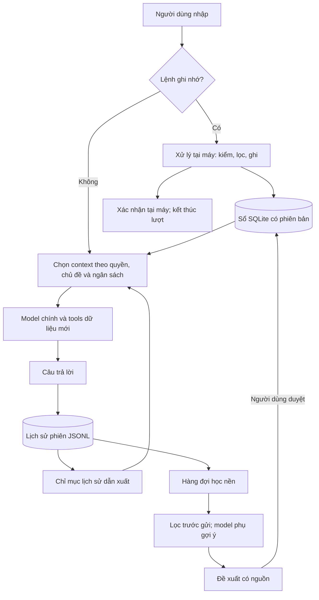
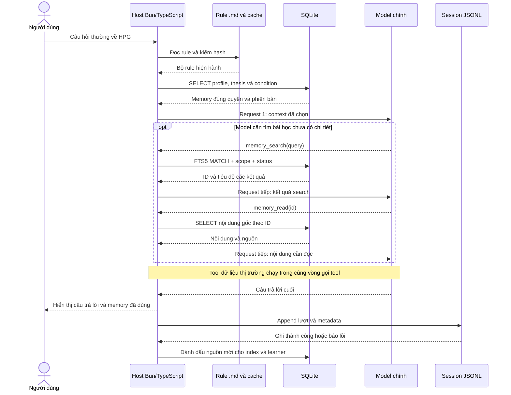
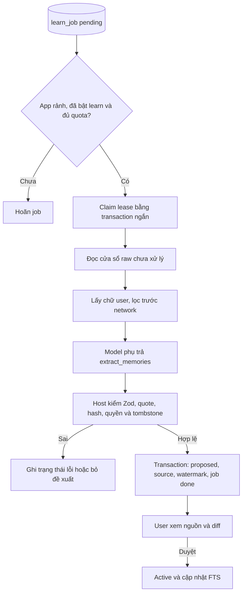

# Memory v3 — Sổ nghiên cứu có nguồn, nhớ đúng và dùng đúng lúc

> **Trạng thái:** `specified` — bản thiết kế, chưa triển khai. **Ngày:** 27/10/2026.  
> Kế thừa thiết kế v2 trong [PR #159](https://github.com/FinDaHuman/OpenTrading/pull/159), bổ sung các quyết định còn thiếu và sửa các điểm yếu đã review. Đây là thiết kế đích; không mô tả các khả năng đã chạy trên `main`.

> **Tên phiên bản:** v3 của tài liệu thiết kế. Các ký hiệu thesis v1/v2/v3 trong ví dụ là phiên bản từng ghi nhớ, không phải phiên bản thiết kế. File này bổ sung mới; tài liệu v2 của PR #159 được giữ nguyên.

**Đọc nhanh:** §1–3 xem ý tưởng; **§15 đi từng bước từ nhập câu hỏi đến worker ghi SQLite**; §5–10 xem quy tắc chi tiết; §12 xem hơn–thua với bốn hệ; §13 xem triển khai và nghiệm thu.

## Mục tiêu chính

Người dùng mở phiên mới vẫn được phục vụ theo lời dặn đã lưu, tiếp tục đúng luận điểm nghiên cứu và xem lại được lý do quyết định cũ. Agent phải phân biệt ghi chú với dữ liệu đã kiểm, nhận ra điều đã lỗi thời và không tự biến nội dung đọc được thành trí nhớ có hiệu lực.

**Lựa chọn cốt lõi:** một sổ SQLite có phiên bản, lịch sử phiên giữ riêng làm nguồn, đường đọc bằng luật và FTS5; bộ học nền chỉ đề xuất để người dùng duyệt. Không cần gọi thêm model ở mỗi câu hỏi.

## 1. Hình dung toàn hệ trong một phút



| Thành phần | Nói dễ hiểu | Vì sao cần? |
|---|---|---|
| **Sổ ghi nhớ** | Điều người dùng đã chọn để nhớ. | Nhỏ, có phiên bản; không phải đọc lại cả hội thoại. |
| **Lịch sử phiên** | Những gì đã xảy ra, gắn thời điểm. | Có căn cứ để xem lại; compaction không phải xóa nguồn. |
| **Bộ chọn context** | Lấy đúng phần cần cho câu hỏi hiện tại. | Giảm nhiễu và token; kiểm quyền trước khi đưa dữ liệu cho model. |
| **Bộ học nền** | Gợi ý điều đáng nhớ bị bỏ sót. | Giảm công gõ; không được tự thay lời dặn hoặc tự tạo active memory. |

## 2. Những quyết định được chọn

| Vấn đề | Quyết định | Lý do / đánh đổi |
|---|---|---|
| Phạm vi | Đủ năm loại memory, lịch sử phân tích và learner; triển khai theo giai đoạn. | Giữ đủ mục tiêu, tránh giao một thay đổi lớn không kiểm được. |
| Quyền ghi | Người dùng tạo/sửa active; learner chỉ proposed; model chính chỉ có tool đọc. | Thu hẹp đường đưa nội dung bên ngoài vào trí nhớ. User vẫn có thể tự lưu điều sai; nguồn lưu không chứng minh tính đúng. |
| Số trong memory | Cho phép ngưỡng do user đặt và số trong nhật ký có ngày; không tạo kho số liệu thị trường hiện hành. | “P/E tối đa 20” là quy tắc; “P/E hiện là 20” là dữ liệu cần lấy lại. |
| Profile vượt ngân sách | Giữ đủ profile có hiệu lực; giảm phần tùy chọn. Vẫn không vừa thì hoãn lượt, đề nghị dọn hoặc đổi model. | Không âm thầm bỏ ràng buộc để đạt số token đẹp. |
| Đổi luận điểm | Điều kiện cũ chuyển thành **cần xem lại**, không tự có hiệu lực với bản mới. | Tránh đem tiêu chí của luận điểm cũ áp cho luận điểm khác. |
| Truy hồi | Luật theo chủ đề + FTS5 trước; chưa dùng vector/reranker LLM. | Chi phí và vận hành thấp; phải đo ca diễn đạt khác từ trước khi thêm embedding. |
| Xóa | Chặn dùng ngay; dọn DB/chỉ mục/WAL có kiểm chứng sau. | Xóa logic và dọn byte trên đĩa là hai việc khác nhau. |
| Tương thích | Giữ FileMemory opt-in; không tự nhập dữ liệu hoặc đổi provider. | Tránh lặng lẽ thay quyền ghi và phạm vi memory cũ. |

## 3. Năm loại ghi nhớ và quy tắc sử dụng

| Loại | Nội dung / ví dụ | Cách đưa vào context | Điều cần giữ |
|---|---|---|---|
| `profile` | “Không dùng margin”; “đơn vị tỷ đồng, nêu rõ kỳ”. | Đủ nội dung ở mọi request trong phạm vi có hiệu lực. | Không nâng sở thích thành quyền công cụ; không ghi đè yêu cầu hiện tại, INVESTOR hoặc luật hệ thống. |
| `lesson` | Bài học có điều kiện áp dụng và cách kiểm. | Tiêu đề ngắn; mở chi tiết khi liên quan. | Giữ điều kiện, ngoại lệ và nguồn; không khái quát từ một lần thành công. |
| `thesis` | Luận điểm về `HPG`, `NGANHANG`, `VNINDEX`… | Khi đúng chủ đề; có bản, ngày viết, hạn xem lại. | Mỗi chủ đề/phạm vi có một luận điểm hiện hành. |
| `condition` | “Luận điểm sai nếu biên gộp giảm hai quý”. | Đi cùng đúng phiên bản luận điểm; giữ nguyên câu. | Là tiêu chí do user đặt, không phải cảnh báo đã được xác minh. |
| `decision` | Quyết định, lý do, thesis/bộ điều kiện lúc ghi. | Không vào index, recall hay search memory thông thường. | Chỉ qua yêu cầu đọc rõ ràng và quyền chia sẻ đang bật. |

**Giới hạn đầu:** profile 200 ký tự; tiêu đề/condition/decision 120; body 2.000; tối đa 100 profile + lesson active, 10 condition mỗi bộ, 20 đề xuất chờ duyệt. Đây là giới hạn sản phẩm ban đầu, không phải kết quả benchmark.

**Nguồn dữ liệu:** giá, báo cáo và dự báo do tool/model tạo không được tự chuyển thành memory. User có thể ghi luận điểm chứa số, nhưng lúc trả lời hiện tại agent phải kiểm lại số liệu, đơn vị, kỳ và nguồn.

## 4. Kho dữ liệu, phạm vi và phiên bản

### 4.1. Một nguồn thật cho mỗi loại dữ liệu

| Nơi lưu | Giữ gì? | Không được làm gì? |
|---|---|---|
| `~/.opentrading/memory.db` | Memory, phiên bản, nguồn, job, tombstone, chỉ mục dẫn xuất. | Không trở thành kho giá/BCTC có hiệu lực vô thời hạn. |
| `sessions/YYYY/MM/*.jsonl` hiện có | Transcript gốc, thời điểm, lượt, tool calls/results và metadata quyền. | Không dùng summary compaction để thay thế căn cứ gốc. |
| Chỉ mục FTS5 | Bản tra cứu có thể dựng lại từ nguồn được phép. | Không được phục hồi nội dung đã bị chặn/xóa khi rebuild. |
| Context/cache | ID + version + quyền + nội dung đang cần. | Không là nguồn sự thật độc lập. |

Giữ JSONL hiện có giúp tránh di chuyển toàn bộ session vào một DB mới. Nội dung được sao vào FTS vẫn là bản sao do ứng dụng quản lý, phải chịu cùng quyền và quy trình dọn dữ liệu.

### 4.2. Các thực thể tối thiểu

| Thực thể | Trường/quan hệ quan trọng | Bất biến |
|---|---|---|
| `memory` | ID, kind, scope/workspace, subject, status, current_version, origin. | Unique thesis hiện hành theo `(scope, workspace, subject)`; trạng thái được kiểm tại mọi đường đọc. |
| `memory_version` | Title/body, review_at, thời điểm; quyết định tham chiếu thesis_version + condition_set. | Bản đã lưu không sửa đè; thao tác sửa thêm bản mới. |
| `condition_set` | Thesis ID/version, revision, danh sách ID/version condition, trạng thái review. | Không chép body condition sang bảng khác; quyết định trỏ tới đúng revision lúc ghi. |
| `source_ref` | Session, turn/message, span, hash; hoặc operation ID của lệnh tại máy. | Citation phải mở đúng nguồn; nguồn mất/đổi thì hiển thị rõ, không dựng lại bằng trí đoán. |
| `learn_job` | Phạm vi nguồn, watermark, trạng thái, lease, attempt, error. | Một cửa sổ nguồn chỉ được commit kết quả một lần. |
| `tombstone` / source suppression | ID đã xóa, fingerprint các bản và nguồn bị chặn học lại. | Có hiệu lực trước mọi read/commit/reindex. Không hứa nhận diện mọi cách diễn đạt đồng nghĩa. |
| `memory_fts`, `history_fts` | Chỉ mục memory active và đoạn lịch sử đủ quyền. | Không index decision hoặc lượt mang nhãn decision-private vào chỉ mục thông thường. |
| `meta` | Schema version, revision dữ liệu/quyền/chỉ mục, generation của worker. | Cache phải khớp revision; kết quả từ worker đã đóng không được commit. |

Memory dùng `proposed → active → deleted`; không thêm archived trong bản đầu. `needs_review` thuộc quan hệ condition với thesis, không phải trạng thái có hiệu lực của mọi memory. Từ chối/hết hạn proposal cũng xóa body/quote và chỉ mục theo quy trình purge, giữ fingerprint/nguồn bị chặn để tránh đề xuất lại.

**Scope được chọn:** các prefix từ PR mặc định lưu `user`, đúng thói quen sổ cá nhân. `/memory` có bộ chọn `user` hoặc workspace hiện tại cho các lệnh tiếp theo và luôn hiển thị phạm vi đang ghi. Model chỉ đọc `user + workspace hiện tại`; lịch sử mặc định giới hạn workspace hiện tại, mở phạm vi khác phải do user chọn trên host. Subject không phải một cơ chế phân quyền.

Đường dẫn workspace được chuẩn hóa bởi host theo quy tắc filesystem hiện có; `workspace_key` của scope user là chuỗi rỗng, không NULL, để unique constraint vẫn có hiệu lực. Model không được tự truyền một workspace ID để mở rộng quyền. Hai profile mâu thuẫn chưa được user sửa thì giữ cả hai và báo mâu thuẫn, không âm thầm cho “mới nhất thắng”.

**Chống trùng:** fingerprint dùng HMAC-SHA256 với khóa ngẫu nhiên 32 byte trong `memory.salt`, trên kind + scope/workspace + subject + payload chuẩn hóa Unicode NFC/khoảng trắng, giữ dấu tiếng Việt. FTS có thể bỏ dấu để tìm; bỏ dấu không được dùng làm bằng chứng hai ý có cùng nghĩa. Metadata có ý nghĩa như review_at hoặc bộ điều kiện thay đổi vẫn tạo revision. Khóa riêng giảm khả năng đoán từ DB đơn lẻ, không bảo vệ nếu cả khóa và DB đều bị lấy.

**Ghi đồng thời:** mỗi thay đổi là transaction, tăng revision cùng commit; unique constraints chặn hai thesis hiện hành. Sửa/duyệt gửi expected_version; bản đã đổi thì báo stale, yêu cầu xem lại, không ghi đè.

## 5. Đường ghi: xử lý tại máy từ đầu

| Hành động | Giao diện | Hành vi |
|---|---|---|
| Tạo profile / lesson | `Ghi nhớ: …` / `Bài học: tiêu đề — chi tiết` | Tạo active sau kiểm/lọc tại máy. |
| Tạo/đổi luận điểm | `Luận điểm HPG đến 31/03/2027: … — Sai nếu: x; y` | Thesis và bộ điều kiện mới trong cùng transaction. Thiếu `đến` nghĩa bản mới không đặt hạn. |
| Thêm điều kiện | `Sai nếu HPG: …` | Thêm revision của bộ điều kiện bản thesis hiện hành. Chưa có thesis thì từ chối, hướng dẫn tạo luận điểm trước. |
| Ghi quyết định | `Quyết định HPG: việc — lý do` | Ghi nối; gắn thesis/bộ điều kiện hiện hành trong cùng transaction; chưa có thì để trống và báo rõ. |
| Sửa profile/lesson/condition | `/memory` → chọn ID → Sửa | Form tại máy, hiện bản cũ và phạm vi; lưu bằng expected_version. Không đoán câu nào thay câu nào. |
| Duyệt/từ chối/xóa | `/memory` | Xem đủ nội dung, nguồn và ảnh hưởng trước thao tác. |

**Thứ tự bắt buộc:** nhận diện lệnh → kiểm quyền/đầu vào → commit hoặc báo lỗi → kết thúc local. Thực hiện trước `addHistory`, mở rộng file đính kèm, auto-compaction, log duyệt quyền, resolve model và request mạng. Prefix được dành riêng; nhận diện rồi nhưng sai cú pháp, memory tắt hoặc DB lỗi đều trả lời tại máy. Các prefix không dấu được hỗ trợ; không dò “ý muốn nhớ” bằng một model khác.

Lệnh chỉ lấy từ phần user nhập, không parse notice subagent/tool/attachment như lệnh. Nội dung raw của lệnh và form sửa không ghi vào prompt-history, transcript hoặc error log; lỗi chỉ nêu loại vi phạm. Thành công có thể hiện bản xem trước tại máy, không tự gửi lại bản đó vào chat.

**Bộ lọc:** chặn mẫu key/PEM/OTP, số tài khoản, email/link và ký tự điều khiển theo chính sách nội dung; phân biệt ngưỡng do user đặt với số liệu thị trường. Regex là hàng rào giảm rủi ro, không phải bộ phát hiện bí mật hoàn hảo. Không tự chuyển đầu vào bị từ chối sang chat thường.

## 6. Đường đọc: đủ ràng buộc, chỉ thêm phần cần

### 6.1. Một request được dựng như thế nào?

| Lớp | Nội dung | Cách giữ ngắn và đúng |
|---|---|---|
| Policy tĩnh | Memory là ghi chú, ưu tiên thấp; lấy dữ liệu mới và tìm phản chứng khi đánh giá thesis. | Không chèn ngày/tuổi; không chứa nội dung memory người dùng. |
| Profile bắt buộc | Đủ profile active trong phạm vi. | Dựng lại mỗi request; kiểm mâu thuẫn và ngân sách trước gọi model. |
| Index tùy chọn | Tiêu đề lesson + chủ đề có nhật ký; dòng “còn N, dùng search”. | Thứ tự ổn định; không nhét toàn kho vào mọi lượt. |
| Recall theo câu hỏi | Thesis, tuổi/hạn, bộ condition đúng bản; mục cần review ghi riêng. | Tối đa 3 chủ đề ưu tiên theo thứ tự xuất hiện; không cắt giữa thesis và điều kiện. |
| Đọc sâu | Nội dung lesson, lịch sử thesis, lịch sử phiên. | Tool chỉ đọc, có địa chỉ nguồn, giới hạn output và phân trang. |

Mục tiêu mềm cho **phần tùy chọn**: A 1.500 / B 700 / C 300 token, kế thừa phân hạng model của harness. Đủ profile và nhóm điều kiện cần dùng có thể vượt mục tiêu mềm nếu còn vừa tổng context. Nếu toàn request không vừa: bỏ index/đoạn cũ tùy chọn, prune/compact history; vẫn không vừa thì hoãn lượt, không lặng lẽ bỏ ràng buộc. Model preview phải tính đủ tools, output reserve và các lớp khác, không chỉ riêng memory.

**Khớp chủ đề:** chỉ tìm chủ đề đã có; khớp cả từ với biên rõ ràng, alias thị trường được khai báo. Các mã dễ nhầm từ thường như TIN/BAN/CEO chỉ khớp viết hoa hoặc `@MÃ`. Không gọi LLM để khớp ở mỗi lượt. Trường hợp nói vòng vo do model dùng search/read; ghi nhận miss để đánh giá sau.

**Mới/cũ:** review_at được hiểu theo ngày ở múi giờ cấu hình, mặc định UTC+7. Quá ngày thì đánh dấu cần review; không đặt hạn thì sau 180 ngày ghi “đã lâu chưa cập nhật”, không tự xóa hoặc kết luận sai. Khi đánh giá thesis, condition được trả kết quả **đủ bằng chứng / bị bác bỏ / chưa đủ dữ liệu**, có nguồn và kỳ; không mặc định số thiếu bằng 0.

### 6.2. Các tool của model chính

| Tool | Đầu vào chính | Đầu ra / quyền |
|---|---|---|
| `memory_search` | Query, kind tùy chọn, cursor. | Tối đa 10 hit active, ID/loại/subject/title; không trả decision/proposed. |
| `memory_read` | ID hoặc subject; history/decisions, cursor tùy chọn. | Current + tối đa 2 bản thesis trước; condition đúng bản; trang tối đa 12.000 ký tự. Decision cần cả `decisions=true` và `shareDecisions=true`; đọc ID không vòng qua được. |
| `history_search` | Query/subject, from/to, cursor. | Tối đa 10 hit có session/turn/ngày/nguồn; lọc quyền trước xếp hạng cuối. |
| `history_read` | Session + turnRef; cursor của phần dài. | Một lượt có thứ tự tool/câu trả lời; mỗi trang tối đa 12.000 ký tự; báo phần còn thiếu và cách đọc tiếp. |

Memory tools nạp sẵn; history tools có thể deferred. Tool output giữ nguyên phủ định, số, kỳ và đơn vị. Kết quả quá dài được chia có nhãn: mỗi phần giữ tên/lời gọi cùng đoạn kết quả và cursor, không giả là đã đọc đầy đủ. Nhóm thesis-condition được ưu tiên giữ trọn. Câu chuyện quá khứ luôn có nhãn thời điểm. Không gọi lại tool hiện tại chỉ để kể lịch sử; chỉ lấy dữ liệu mới khi user yêu cầu so sánh hiện tại.

TUI hiện **memory ID/version/phạm vi nào đã dùng**, mục bị bỏ do ngân sách và nút mở nguồn. Dòng trạng thái không hiện nội dung decision khi chưa có quyền. Escape ký tự chỉ bảo vệ cấu trúc prompt; không được quảng bá như chống được mọi prompt injection.

## 7. Luận điểm, điều kiện và quyết định: giữ đúng thời điểm

```text
HPG thesis v1 + condition set r1 ──► quyết định D1 trỏ v1/r1
             │
             └── sửa luận điểm ──► thesis v2
                                  ├─ có Sai nếu mới: tạo set r1 cho v2
                                  └─ không có: điều kiện v1 chờ xác nhận

Xác nhận điều kiện cũ cho v2 ──► tạo set của v2; không sửa set lịch sử v1
```

| Tình huống | Cách xử lý | Vì sao? |
|---|---|---|
| Thesis đổi, không nhập condition mới | Giữ tham chiếu cũ dưới `needs_review`; recall nói rõ chưa có condition được xác nhận cho v2. | Đúng lựa chọn user; không tạo cảnh báo sai từ logic cũ. |
| User xác nhận/chỉnh condition | Tạo revision mới trong `/memory`; giữ bản đã dùng cho quyết định cũ. | Truy nguyên được điều đã biết lúc quyết định. |
| Ghi quyết định khi condition chưa xác nhận | Lưu cùng trạng thái thiếu xác nhận; không tự lấy điều kiện cũ làm hiện hành. | Nhật ký ghi đúng thực tế. |
| Thesis nguồn bị xóa | Quyết định còn ID/version và nhãn “nội dung nguồn đã xóa”; không phục hồi body cũ. | Quyền xóa thắng nhu cầu tái dựng lịch sử. |

Model được gợi ý tối đa một lệnh hoàn chỉnh ở cuối câu trả lời khi user đã nêu ý lâu dài/luận điểm hoặc thiếu condition. Không gợi ý lệnh `Quyết định` thành khuyến nghị giao dịch; không tự lưu; không lặp cùng gợi ý đã bị bỏ qua trong phiên.

## 8. Lịch sử, chia sẻ và context qua nhiều lượt

### 8.1. Lịch sử có nguồn, chỉ mục có thể bỏ và dựng lại

Đọc entries JSONL gốc để giữ thứ tự, timestamp và ranh giới lượt. Mỗi lượt mới có turnId; phiên cũ được gán turnRef ổn định theo số thứ tự lượt trong file ghi nối. Span nguồn có hash để phát hiện nội dung thay đổi. Không lập chỉ mục lại summary như một lần user phát biểu mới.

FTS5 history lập chỉ mục tăng dần sau khi ghi phiên **thành công**, giữ source offset/version và watermark. Nguồn mới chưa index vẫn được kiểm qua phần đuôi raw liên quan; không báo “không có” chỉ vì index chậm. Nguồn hỏng/mất thì trả trạng thái thiếu, không tìm một phiên khác để thay thế.

Lượt private chỉ được tra theo metadata subject/ngày và mở trực tiếp khi đủ quyền; không có full-text decision search trong v3. Việc này giảm bản sao nhạy cảm trong chỉ mục, đổi lại tìm nhật ký theo câu chữ sẽ hạn chế hơn.

### 8.2. Một chính sách cho mọi đường đọc

| Đường dữ liệu | Quy tắc |
|---|---|
| Index/recall/search/read | Active, đúng scope, chưa bị xóa; quyết định qua cửa riêng. |
| History, session tools cũ, source preview | Cùng bộ kiểm scope/tombstone/sensitivity; không có đường tắt qua `session_get`. |
| Recall/index trong request | Là context tạm dựng lại, **không ghi nguyên nội dung vào transcript**. Đây là thay đổi so với recall của PR #159. |
| Kết quả memory tool trong session | Lưu ref/version và placeholder; payload gửi model được dựng lại theo quyền tại thời điểm đọc. Giữ đúng toolCallId và thứ tự protocol. |
| Manifest mỗi lượt | Lưu ID/version memory và source refs đã đưa vào request, kể cả refs kế thừa từ history; summary kế thừa manifest. Không lưu body memory vào manifest. |
| Lượt đã đọc decision | Gắn nhãn `decision_private`; câu trả lời dẫn xuất và summary dùng lượt đó kế thừa nhãn. Không index nội dung vào history search thường. |
| Tắt shareDecisions | Dựng lại request, gỡ các lượt/summary mang nhãn; tái dựng summary từ phần còn quyền. Không chỉ thêm câu “hãy quên”. |
| Cache và request đang chạy | Đổi quyền/xóa tăng permission revision, hủy request khi khả thi; kiểm lại trước request và hành động tiếp theo. |
| UI và export tại máy | Xem/duyệt được khi user chủ động; export mặc định che phần private và nguồn đã xóa, muốn xuất phần private phải chọn rõ. |

Manifest và nhãn được truyền tiếp nếu request mới dùng history dẫn xuất; khi một nguồn bị xóa hoặc mất quyền, che cả lượt/summary phụ thuộc nếu không tách chính xác được nội dung. Nếu renderer không thể dựng chuỗi tool messages hợp lệ sau lọc thì bỏ cả nhóm lượt và báo thiếu, không gửi một chuỗi lỗi protocol.

`shareDecisions` chỉ kiểm soát nhật ký được nhận diện trong v3; không tự phân loại mọi câu mua/bán user gõ trong chat. Không thu hồi được bản provider đã nhận, file export hay backup ngoài quyền quản lý. Host filter cũng không phải sandbox chống một chương trình khác chạy cùng quyền OS.

### 8.3. Qua nhiều turn, compaction và resume

| Thời điểm | Dựng lại gì? | Lý do |
|---|---|---|
| Turn kế | Profile hiện hành + recall đúng câu hỏi + history đã lọc. | Sửa/xóa có hiệu lực ngay; không tích lũy mọi recall cũ. |
| Đổi chủ đề | Thay recall; history được prune/compact theo ngân sách. | Context chủ đề cũ không trở thành memory dài hạn. |
| Sau compaction | Profile/index/recall dựng lại; summary giữ source manifest và nhãn. | Summary không được che mất nguồn gốc hoặc quyền riêng tư. |
| Resume | Kiểm scope, quyền, memory version và source hash trước replay. | Không phát lại mù quáng context của thời điểm cũ. |

Cache theo `(dataRev, permissionRev, workspace, querySubjects, budget)`; index tĩnh không chứa tuổi/ngày. Đúng phiên bản và quyền ưu tiên hơn prefix cache. Không khẳng định giảm payload đồng nghĩa giảm tiền theo cùng tỷ lệ.

## 9. Bộ học nền: tiện nhưng không tự có quyền ghi

```text
Ghi phiên thành công → đánh dấu cửa sổ nguồn cần xét
    → lúc rảnh: lọc phần user nhập → gọi model đã cấu hình
    → kiểm nguồn/hash/nội dung → proposed
    → user xem nguồn và diff → approve bằng expected_version
```

| Phần | Thiết kế được chọn | Lý do |
|---|---|---|
| Đầu vào | Chỉ chữ user trong turn thường; bỏ memory commands, file, tool, notice, summary và nguồn bị chặn. | Giảm đưa nội dung bên ngoài thành sở thích của user. User có thể dán nội dung ngoài vào chat; role user không chứng minh tác giả là user. |
| Trước network | Lọc mẫu bí mật/PII; gặp vi phạm thì bỏ cả message, không log nội dung; thông báo số đoạn bỏ qua. | Không đợi model trả xong mới phát hiện dữ liệu không nên gửi. |
| Chọn model | `learn=false` mặc định; bật cùng provider/model riêng rõ ràng; thiếu model thì giữ job, không dùng main làm fallback. | Chi phí và nơi nhận dữ liệu phải nhìn thấy được. |
| Output | Chỉ profile/lesson, title/body, source span/quote, optional supersedes. | Learner không tự tạo thesis/condition/decision thay user. |
| Kiểm nguồn | Quote khớp nguyên văn, giữ dấu; hash và span còn đúng; nội dung qua filter. | Kiểm này xác minh trích dẫn, không chứng minh suy diễn đúng; UI phải cho so với nguồn. |
| Thay memory | Similarity chỉ gợi ý đối tượng; approve hiện diff và pin version. | Một từ “không” có thể đảo nghĩa dù phần lớn từ giống nhau. |
| Job | Một job active mỗi data home; lease 120s, timeout model 60s, heartbeat 15s; retry tối đa 3 lần. | Tránh hai tiến trình cùng học một đoạn; worker chết có thể phục hồi. |
| Chống trùng | Unique source-window + phiên bản extractor; commit job, proposal và watermark trong transaction. | Retry không sinh đề xuất lặp. |
| Cuộc đua với xóa/sửa | Kiểm lại tombstone, nguồn và expected_version ngay trong commit. | Kết quả model cũ không làm sống lại memory đã xóa. |

**Mặc định khởi đầu:** chờ rảnh 120 giây; tối đa 20.000 ký tự/job, 3 đề xuất/job, 20 proposed chờ duyệt, hết hạn sau 30 ngày. Trần 10 lần gọi và 50.000 input token/ngày, output tối đa 1.000 token/lần; retry cũng tính trần. Đây là mức đề xuất để pilot điều chỉnh, chưa có số đo chứng minh tối ưu.

Chỉ advance watermark phần thực sự đã xét; cửa sổ dài chia theo message/span, không bỏ phần đầu mà vẫn đánh dấu đã đọc hết. Job được tạo sau append thành công; startup đối soát phiên chưa xét để phục hồi khi crash trước enqueue. `session-end` chỉ là tín hiệu bổ sung, không là điểm ghi duy nhất. Không dùng `turn-end` hiện có như bằng chứng phiên đã lưu.

Lượt foreground bắt đầu thì dừng lên lịch việc mới và hủy request nền khi khả thi. Mọi đường done/abort/error/handled đều giải phóng trạng thái busy trong `finally`. Hết quota thì hoãn job, không mất nguồn và không ảnh hưởng lệnh lưu thủ công.

## 10. Xóa, lỗi và vòng đời provider

| Tình huống | Hành vi bắt buộc | Câu báo nên dùng |
|---|---|---|
| Xóa memory | Transaction đặt tombstone; làm rỗng tất cả phiên bản; xóa FTS; tăng revision; chặn source học lại. | “Đã ngừng dùng ghi nhớ #N.” |
| Dọn vật lý | `secure_delete=ON` và FTS5 secure-delete phù hợp SQLite; checkpoint kiểm kết quả busy; retry nếu còn reader. | “Đã xóa khỏi sổ trên máy” chỉ khi dọn xong; nếu chưa thì “đang chờ dọn dữ liệu”. |
| Bản sao phiên cũ | Các lượt dẫn xuất bị lọc khỏi prompt/search; UI nói rõ raw cũ có thể còn câu đã trích. Xóa session là thao tác riêng. | “Phiên, bản xuất hoặc provider đã nhận trước đó có thể còn bản sao.” |
| DB hỏng/khóa/schema mới | Lệnh memory trả lỗi local; giữ nguyên file, không tự reset DB. Profile bắt buộc không đọc được thì hoãn lượt cần memory. | Nêu lỗi và cách tắt memory có chủ đích; không giả vờ đã nhớ. |
| Chỉ mục history lỗi | Đọc nguồn có giới hạn hoặc báo chưa tra cứu được; chat không phụ thuộc lịch sử có thể tiếp tục. | Phân biệt “không tìm thấy” và “chưa tìm được”. |
| Đổi/tắt provider | Ngừng nhận job mới → cancel/drain → đóng DB → gỡ hook/tool → chuyển provider. | Chỉ xác nhận đổi khi lifecycle hoàn tất. |

SQLite kiểm migration qua `user_version`; từ chối schema mới hơn. Cần SQLite có FTS5 secure-delete hỗ trợ, kiểm capability khi mở DB. Mất salt thì không tự sinh salt khác trên DB đã có: báo lỗi cần khôi phục, tránh mất tính nhất quán chống trùng. File DB/salt dùng quyền owner-only khi OS hỗ trợ; không tuyên bố “xóa pháp y tuyệt đối” trên SSD/backup chỉ từ việc SQL thành công.

## 11. Tích hợp vào harness: có sẵn và phải bổ sung

Các API dưới đây được xác minh tại commit merge `25bd2f7`; checkout local cũ hơn. Các mục **MỚI** là đề xuất, không gọi như API đã tồn tại.

| Điểm tích hợp | Hiện có | Bổ sung / lý do |
|---|---|---|
| MemoryProvider | instructions/index/recall/tools/register và quản lý list/approve/reject/remove. | **MỚI:** edit theo version, budget/provenance/permission context, async close. Vẫn giữ adapter cho FileMemory. |
| Lệnh đầu vào | UI ghi prompt-history trước dispatch; user-prompt hook chạy sau. | **MỚI:** local dispatcher trước cả hai nhánh nhập/chọn lệnh; không giao bảo mật lệnh cho hook best-effort. |
| ToolContext | Có signal/callId; chưa có session/turn/workspace. | **MỚI:** host truyền trusted context và nhãn sensitivity; model không chọn authority. |
| Session | JSONL format 1, appendTurn và loadSession. | **MỚI:** turn/source metadata, successful append receipt, raw-entry reader và shared visibility projection. `loadSession().display` không là raw corpus. |
| Hook/lifecycle | Hook timeout 5s; turn-end không chờ hoàn tất. | Dùng hook làm notification; owner riêng quản lý job/close. Không coi `flush()` đang nuốt lỗi cũ là commit thành công. |
| Prompt assembly | Index/recall có cap; reminder có lưu. | **MỚI:** context memory tạm, reference results và dựng lại history theo quyền; thay cap cắt chuỗi bằng renderer theo nhóm. |
| Cấu hình | provider none/file; UI toggles. | Thêm sqlite, learn, model, shareDecisions; hiện trạng thái lỗi/backlog/quyền. Nội bộ proposed map thành pending ở adapter UI cũ. |

Nguồn/mẫu để dùng lại: [MemoryProvider](https://github.com/FinDaHuman/OpenTrading/blob/25bd2f75c0d5931b99668533810ba06e30292306/src/core/memory/types.ts#L28), [dispatch TUI](https://github.com/FinDaHuman/OpenTrading/blob/25bd2f75c0d5931b99668533810ba06e30292306/src/tui/app.tsx#L1289), [session persistence](https://github.com/FinDaHuman/OpenTrading/blob/25bd2f75c0d5931b99668533810ba06e30292306/src/core/session/store.ts#L145), [runtime switch](https://github.com/FinDaHuman/OpenTrading/blob/25bd2f75c0d5931b99668533810ba06e30292306/src/core/runtime.ts#L190).

**Tổ chức logic:** dispatcher; repository/transactions; content + fingerprint; subjects + renderer; history index/reader; visibility policy; learner + scheduler; provider adapter. SQL chỉ nằm trong repository; visibility policy dùng chung, không sao chép thành nhiều bộ lọc lệch nhau. Production mở DB ở composition root duy nhất; test dùng DB RAM/home tạm.

Subagent trong thiết kế v3 mặc định không có tool hoặc journal memory; main có trách nhiệm đưa ràng buộc cần thiết vào task. Shared memory/host-enforced constraint bundle cho child là bước sau, phải đánh giá quyền gửi sang provider child. Vì vậy bản này chưa bảo đảm subagent tự biết mọi lời dặn global.

## 12. So sánh với OpenCode, DSH, Hermes và Cline

So sánh **thiết kế đề xuất** với nguồn native đã kiểm ngày 27/10/2026; không gán điểm benchmark khi chưa đo. File instructions, transcript, compaction và learner dài hạn là các khả năng khác nhau. Plugin/experimental không được coi là bật sẵn.

| Hệ | Cơ chế đã kiểm | Thiết kế OT v3 hơn ở đâu? | Thua / đánh đổi | Nên kế thừa |
|---|---|---|---|---|
| **OpenCode** | AGENTS/instructions, transcript và compaction; đường list kiểm tra tìm title. Chưa xác minh learner native riêng tự biên tập lesson xuyên phiên. | Schema đầu tư, thesis/condition/decision có phiên bản; learner luôn chờ duyệt. | OpenCode có lifecycle context/compaction hoạt động thật; OT phải làm thêm DB, quyền và job, UX gõ/duyệt nhiều hơn. | Refresh/dedup theo context thực sự đã gửi; nạp lại guidance sau compact; tính phí summary riêng. |
| **DSH** | Event log có nguồn/checkpoint; FTS5 + trace/read. Model query tools experimental, opt-in; kiểm cwd tại consumer. | Sổ đầu tư dùng ngay theo nghiệp vụ, cơ chế duyệt rõ thay vì user tự lắp module. | DSH sâu hơn về nguồn gốc event, recovery và composition; OT còn phải thêm turn/source IDs, không đạt độ trưởng thành đó chỉ nhờ schema. | Log gốc tách index; stable refs; search rồi đọc đúng event; quyền kiểm tại consumer. |
| **Hermes** | Notebook nhỏ chốt snapshot đầu phiên; FTS5 session_search; background review. Unattended patch/remove phải duyệt; general approval gate tùy chọn, mặc định tắt. | Index/profile cập nhật mỗi request; mọi learner proposal phải duyệt; điều kiện/quyết định gắn đúng bản thay vì text thuần. | Hermes có vòng học/runtime, atomic write và xử lý stale thật. OT ít tự động hơn, có thêm độ trễ duyệt và nhiều metadata. | Worker giới hạn tool/usage; pin target khi duyệt; tách lời dặn global và procedure theo task. |
| **Cline** | Rules/Memory Bank Markdown là phương pháp thiết lập; native FTS5/BM25 session search và agentic compaction có fallback. | Schema/quyền đọc nhật ký rõ; đọc chọn lọc thay vì instructions yêu cầu đọc cả Bank; có source/version cho memory. | Markdown dễ nhìn, sửa, Git và ít hạ tầng; Cline đã có search/compaction chạy. OT cần UX mở nguồn/export để không biến DB thành hộp kín. | View dễ review; index rebuild được và chống hồi sinh race; fallback compact không phụ thuộc một lần gọi LLM thành công. |

### Bảng khả năng theo đúng phạm vi

| Khả năng | OT v3 đề xuất | OpenCode | DSH | Hermes | Cline |
|---|---|---|---|---|---|
| Memory dài hạn có loại/phiên bản đầu tư | Có, phải triển khai | Qua file/plugin nếu cần | Qua file/plugin nếu cần | Notebook text | Bank/rules text |
| Learner tự tạo active | Không | Chưa xác minh pipeline tương đương | Chưa xác minh pipeline tương đương | Có thể auto-add trong review; sửa/xóa unattended chờ duyệt | Bank cập nhật qua file tools/instructions |
| Raw history full-text | FTS5 dẫn xuất, có kiểm quyền | Chưa thấy trong đường native đã kiểm; title search có | Có module; model tools experimental | Có FTS5 | Có native FTS5 service; chưa chứng minh model tự inject hit |
| Scope | User/workspace do host kiểm; default user được hiển thị | Global/project/nested instructions | Query tools exact cwd; backend tin caller | Home/profile; không coi là ACL project mạnh | Rules workspace/global; search workspace filter tùy chọn |
| Correction giữa phiên | Dựng lại index/recall và history có nhãn | Ambient instructions refresh; nested có giới hạn | Touch/resume; không phải watcher mọi file | Notebook snapshot không đổi ngay giữa phiên | Lifecycle rules/file; không cam kết mọi external edit live |
| Quên | Chặn read/relearn ngay; purge DB/index kiểm chứng; raw/export/provider có giới hạn riêng | Xóa file/session khác compaction | Persistence seam chưa có retention/delete API riêng | Xóa notebook không xóa transcript | Xóa Bank/session; index có remove/reconcile |
| Độ trưởng thành | Chưa triển khai / chưa benchmark | Runtime thật | Modules thật, mức bật tùy composition | Runtime memory thật | Runtime search/rules/compaction thật |

**Ưu thế kỳ vọng của OT là tính đúng nghiệp vụ và kiểm soát sử dụng.** Không có cơ sở nói nhớ chính xác hơn, nhanh hơn hoặc rẻ hơn các hệ trên trước thử nghiệm cùng workload. FTS5 không tốn phí embedding nhưng vẫn có CPU, đĩa, tokens kết quả và chi phí learner/summary/retry.

## 13. Lộ trình và nghiệm thu

### Giai đoạn 0 — Chốt tài liệu và điểm nối

**Giúp mục tiêu:** người triển khai dùng API thật và không bỏ sót đường dữ liệu. Đã đối chiếu PR, hợp đồng và bốn hệ; khi bắt đầu code phải cập nhật inventory nếu `main` đổi.

Allowed APIs là các seam ở §11. Chưa có local dispatcher, async close, successful capture receipt hoặc shared visibility projection; phải thiết kế và thêm chúng, không giả định đã có. Cập nhật contracts/ADR trước khi bật các hành vi mới; phiên/schema có metadata mới được version hóa, reader mới từ chối định dạng tương lai. Không cam kết binary cũ hiểu hoặc thực thi chính sách v3.

| Giai đoạn | Giúp người dùng đạt gì? | Phần triển khai / mẫu dùng lại | Nghiệm thu và điều cần tránh |
|---|---|---|---|
| **1 · Lệnh tại máy** | Lưu an toàn ngay cả khi chưa có key. | Dispatcher trước history, local form, lỗi DB; dùng vị trí dispatch §11. | 0 request/0 raw log cho lệnh, cả hai nhánh UI; không dựa vào timeout hook để chặn rò. |
| **2 · Kho và quyền** | Xem/sửa/xóa nhất quán. | Transactions/version/scope/tombstone; lấy adapter quản lý hiện có làm mẫu. | Unique thesis, CAS, WAL busy, schema mới, hai process; không ghi đè hoặc reset DB hỏng. |
| **3 · Context và nhật ký** | Nhớ đúng điều kiện, đúng thời điểm. | Renderer theo budget; thesis/condition sets/decision; context tạm và nhãn. | Đủ profile, đổi thesis, revoke share, compact/resume; không cắt condition hoặc chỉ append bản sửa. |
| **4 · Lịch sử** | Tìm và mở đúng phân tích cũ. | Raw reader + source refs + FTS tăng dần + dùng chung visibility; mẫu JSONL ở §11. | Index lag, file mất, thời gian, phần dài, session tools cũ; không index summary như nguồn độc lập. |
| **5 · Học nền** | Duyệt được đề xuất đáng tin, phục hồi khi gián đoạn. | Receipt sau ghi phiên + scheduler/job lease + extractor + source diff. | Filter trước gửi, retry/idempotency, quota, cancel, delete-race; không auto-active hoặc fallback main model. |
| **6 · Kiểm chứng và rollout** | Biết hệ nhớ tốt hơn ở điểm nào, tốn bao nhiêu. | Test cô lập; replay; pilot có ngân sách; cập nhật STATUS/contracts và hướng dẫn. | Đủ bộ ca dưới, không còn rò quyền; không coi policy chứa câu đúng là đã có hành vi đúng. |

### Bộ kiểm chứng bắt buộc

| Nhóm | Ca cần kiểm | Tiêu chí chấp nhận |
|---|---|---|
| Local/privacy | Prefix sai, secret, DB khóa/hỏng, không có key; history/auto-log/attachment expansion. | Không request hoặc raw command rơi vào nơi bị cấm. |
| Semantic/version | Đổi luận điểm, xác nhận condition, decision trước/sau đổi, sửa cùng lúc, quote đúng nhưng diễn giải trái nghĩa. | Không lẫn bản, không auto-duyệt theo similarity; nguồn/diff đủ cho user quyết định. |
| Visibility | Tắt sharing giữa phiên, read theo ID, history/session_get, summary, resume, export và cache. | Không có đường vòng đọc nhãn private hoặc nguồn đã xóa. |
| Budget/quality | Nhiều profile, ba mã/đủ condition, phủ định, thiếu số, luận điểm cũ, alias và câu nói vòng vo. | Giữ ràng buộc; đúng nguồn/kỳ; nêu thiếu dữ liệu; không âm thầm dùng bản lỗi thời. |
| Durability | Crash trước/sau append/enqueue, hai worker, retry, shutdown, xóa lúc extractor đang chạy, rebuild index. | Không mất nguồn đã commit, không nhân đôi proposal, không hồi sinh nguồn bị chặn. |
| Runtime | DB tạm/in-memory, mock model/tool, Windows Terminal; không chạm home thật. | Tests đúng hành vi và protocol, không chỉ so văn bản policy hoặc cấu trúc source. |

**Đo trước khi tuyên bố tốt hơn:** cùng model, tasks và quyền tools; baseline gồm FileMemory hiện tại và raw-history search không learner. Đo task success, recall đúng, stale-fact use, bỏ sót constraint, citations, tổng tokens/cost trên tác vụ thành công, p50/p95 và backlog. Tách tác dụng của learner, raw search và renderer bằng cách bật/tắt từng phần. Pilot giữ lại workload chưa dùng để tinh chỉnh; không chấp nhận tiết kiệm token nếu chất lượng giảm.

Feature mặc định tắt; bật sqlite chủ động, learner và shareDecisions là hai lựa chọn riêng. Rollout lần lượt read/manual → history → learner; lỗi learner không làm mất memory thủ công. Chưa làm vector, full knowledge graph, tự chấm đúng/sai quyết định bằng giá tương lai hoặc chia sẻ journal trực tiếp cho subagent.

## 14. Nguồn và giới hạn xác minh

| Nguồn đã kiểm | Căn cứ chính |
|---|---|
| OpenTrading `25bd2f7` | [PR #159/design](https://github.com/FinDaHuman/OpenTrading/blob/25bd2f75c0d5931b99668533810ba06e30292306/docs/memory/design.md), APIs ở §11. |
| OpenCode `15e56cf` | [Instructions](https://github.com/anomalyco/opencode/blob/15e56cfd4593b3ae56b564326232928ac6e98fb5/services/www/src/docs/content/instructions.mdx), [compaction](https://github.com/anomalyco/opencode/blob/15e56cfd4593b3ae56b564326232928ac6e98fb5/services/www/src/docs/content/compaction.mdx), [title search](https://github.com/anomalyco/opencode/blob/15e56cfd4593b3ae56b564326232928ac6e98fb5/packages/core/src/session/store.ts#L145). Đã kiểm delta từ snapshot khảo sát trước, các file này không đổi. |
| DSH `22ddee3` | [Query backend](https://github.com/deepseek-ai/deepseek-harness/blob/22ddee3792402c3e70ec5f86a63c3e3e895a2f60/packages/session-query/session-query-sqlite/README.md), [experimental tools](https://github.com/deepseek-ai/deepseek-harness/blob/22ddee3792402c3e70ec5f86a63c3e3e895a2f60/packages/experimental/tool-session-query/README.md), [event provenance](https://github.com/deepseek-ai/deepseek-harness/blob/22ddee3792402c3e70ec5f86a63c3e3e895a2f60/packages/session-query/session-query/README.md#L114). |
| Hermes `1ae3c55` | [Memory/write gate](https://github.com/NousResearch/hermes-agent/blob/1ae3c55e4bb16f495ebf0536a5672782d903e15e/tools/memory_tool.py#L179), [snapshot/store](https://github.com/NousResearch/hermes-agent/blob/1ae3c55e4bb16f495ebf0536a5672782d903e15e/tools/memory_tool_store.py#L223), [session search](https://github.com/NousResearch/hermes-agent/blob/1ae3c55e4bb16f495ebf0536a5672782d903e15e/tools/session_search_tool.py). |
| Cline `c35b729` | [Memory Bank](https://github.com/cline/cline/blob/c35b729049c7bb26c340df63ea9235c40b32dd29/docs/best-practices/memory-bank.mdx), [native FTS5](https://github.com/cline/cline/blob/c35b729049c7bb26c340df63ea9235c40b32dd29/sdk/packages/core/src/session/search/session-history-search.ts), [compaction](https://github.com/cline/cline/blob/c35b729049c7bb26c340df63ea9235c40b32dd29/sdk/packages/core/src/extensions/context/compaction.ts#L295). |
| SQLite | [FTS5 secure-delete](https://www.sqlite.org/fts5.html#the_secure_delete_configuration_option), [checkpoint/busy](https://www.sqlite.org/pragma.html#pragma_wal_checkpoint). Phép thử review hai kết nối xác nhận WAL có thể còn dữ liệu khi checkpoint busy. |

Các so sánh là đánh giá kiến trúc từ source/docs đúng ref, không phải benchmark bốn agent. “Chưa xác minh” không có nghĩa mọi plugin/composition đều thiếu khả năng đó. Các mặc định, API mới, quyền và lựa chọn thiết kế trong tài liệu này là đề xuất cho OpenTrading; cần triển khai và nghiệm thu trước khi ghi trạng thái implemented.

## 15. Diễn giải từng bước: hệ thống thực sự làm gì và dùng công nghệ nào?

Phần này diễn giải **thiết kế v3 sẽ triển khai**, không khẳng định các bước mới đã chạy. Ví dụ xuyên suốt: bạn đã có lời dặn “Không dùng margin”, một luận điểm HPG và một bài học về định giá ngân hàng.

### 15.1. Toàn bộ một lượt, theo đúng thứ tự

| Bước | Hệ thống làm gì? | Dùng gì? | Có gọi model không? |
|---|---|---|---|
| **0 · Nhập** | Nhận chữ bạn gõ, giữ riêng notice, file và kết quả agent phụ. | TUI + dữ liệu đầu vào có cấu trúc. | Không. |
| **1 · Phân nhánh** | Nếu là `Ghi nhớ:`, `Luận điểm`… thì xử lý tại máy rồi dừng. Câu hỏi thường mới đi bước 2. | Parser TypeScript tất định; transaction SQLite cho nhánh lệnh. | Không. |
| **2 · Rule** | Đọc bộ rule `.md` đã được host chọn, kiểm hash; thay bản cache khi nội dung đổi. | `node:fs/promises` + SHA-256 + cache RAM. | Không. |
| **3 · Trạng thái** | Kiểm workspace, quyền, memory revision và history đang dùng. | Cấu hình host + metadata SQLite + manifest phiên. | Không. |
| **4 · Memory bắt buộc** | Lấy profile active; nhận diện HPG và lấy thesis/condition đúng bản. | SQL `SELECT`, bộ khớp chủ đề/alias bằng code. | Không. |
| **5 · Dựng request** | Ghép rule + profile + history đủ quyền + index/recall; kiểm ngân sách. | Prompt assembler, renderer và bộ đếm/ước lượng token. | Chưa. |
| **6 · Model chính** | Model đọc request và quyết định trả lời, gọi tool dữ liệu hoặc tìm memory sâu hơn. | AI SDK `streamText` qua provider đã chọn. | **Có: model chính.** |
| **7 · Tra thêm nếu cần** | Chạy `memory_search` hoặc `memory_read`; đưa kết quả trở lại vòng tool. | FTS5 cho search; SQL theo ID/chủ đề cho read; kiểm quyền tại host. | Search/read không gọi model phụ; request tiếp để model xử lý kết quả vẫn tốn token. |
| **8 · Trả lời** | Đối chiếu dữ liệu mới, điều kiện sai và phản chứng; phát câu trả lời ra UI. | Model chính + các tool nguồn dữ liệu được phép. | Có các request trong vòng tool nếu cần. |
| **9 · Lưu phiên** | Ghi phần hội thoại của lượt, tool refs, turnId, thời điểm, manifest và nhãn quyền. | Ghi nối JSONL qua hàng đợi ghi của session. | Không. |
| **10 · Đánh dấu việc nền** | Sau ghi phiên thành công, đánh dấu đoạn nguồn chưa được xét; cập nhật index lịch sử. | SQLite queue/watermark + FTS5 dẫn xuất. | Không. |
| **11 · Học lúc rảnh** | Worker lấy job, lọc chữ user, gọi model phụ trích đề xuất. | Scheduler trong tiến trình + AI SDK + schema Zod. | **Có nếu learner bật và đủ quota.** |
| **12 · Ghi đề xuất** | Host kiểm nguồn, version, tombstone rồi ghi `proposed`; user duyệt mới thành `active`. | Prepared statements + transaction `bun:sqlite`. | Không cần thêm model để ghi DB/duyệt. |

**Hai nhánh không được nhầm:** `memory_search` là tool đọc khi model chính cần thêm thông tin; learner là công việc nền dùng model riêng để đề xuất ghi nhớ. Không gọi learner để quyết định context ở mọi turn.



### 15.2. “Đã đọc rule, chỉ so version nếu đổi”: chính xác là thế nào?

V3 tiếp tục dùng `prompts/*.md` cho luật ứng dụng và `~/.opentrading/INVESTOR.md` cho hồ sơ do user soạn. Không tự coi mọi file `.md` hoặc file được đính kèm là rule. INVESTOR có thứ tự ưu tiên thấp hơn luật hệ thống; chứa trong kênh system không có nghĩa được phép ghi đè luật an toàn.

| Thời điểm | Thao tác được chọn | Kết quả |
|---|---|---|
| Khởi động / request đầu | Đọc các file được phép; tính hash SHA-256 trên đường dẫn + nội dung, thứ tự cố định. | Cache RAM giữ `{file, hash, text, renderedBlock}` và `ruleSetVersion`. |
| Trước mỗi request provider, kể cả sau tool | Đọc lại những file rule nhỏ và tính hash; hash không đổi thì dùng block đã dựng. | Tránh parse/render lại; vẫn kiểm được chỉnh sửa giữa lượt. Không quét toàn repo. |
| File đổi/thêm/xóa | Cập nhật manifest/hash; dựng lại đúng block; kiểm ngân sách và thứ tự ưu tiên. | Request kế tiếp nhận rule mới; request đang gửi không được coi là đã tự đổi. |
| File bắt buộc lỗi đọc | Báo lỗi và hoãn request phụ thuộc rule; file tùy chọn chưa từng có có thể bỏ qua. | Không âm thầm chạy với rule bắt buộc đã cũ. |

**Điểm cần hiểu đúng:** file thường không có một version đáng tin được hệ điều hành tăng sẵn. Muốn biết nội dung đổi cần đọc bytes để tính hash, hoặc tin vào dấu hiệu như `mtime/size` và watcher. Bản này chọn đọc/hash lại số file rule nhỏ ở ranh giới request để ưu tiên tính đúng. `stat`/watcher chỉ là tối ưu về sau, không là bảo đảm phát hiện mọi chỉnh sửa.

Đây là **cache nội bộ host**, khác prompt cache của provider. Rule không đổi vẫn nằm trong request gửi model; provider có thể tính giá cache theo cơ chế riêng. Không có chuyện host chỉ gửi “version 12” mà model tự biết nội dung rule. Runtime ở commit PR #159 hiện đã đọc lại `INVESTOR.md` mỗi request; `ruleSetVersion`/cache manager ở đây là phần bổ sung v3. [Nguồn hiện tại](https://github.com/FinDaHuman/OpenTrading/blob/25bd2f75c0d5931b99668533810ba06e30292306/src/core/profile.ts#L12).

### 15.3. Tìm memory bằng cách nào: SELECT, recall hay memory_search?

| Câu hỏi cần giải quyết | Ai quyết định? | Cách lấy | Ví dụ |
|---|---|---|---|
| Luôn phải tuân thủ lời dặn nào? | Host. | `SELECT` mọi profile active trong phạm vi. | “Không margin” được lấy mà không cần search từ “margin”. |
| User đang nhắc chủ đề đã có nhật ký nào? | Code so chủ đề/alias. | Recall tự động → `SELECT` thesis và condition set hiện hành. | “hpg dạo này sao?” khớp `HPG`; không cần FTS để tìm một subject biết chính xác. |
| Đã biết ID cần đọc? | Model từ index/kết quả trước. | `memory_read(id)` → `SELECT` bản gốc. | Index có `#7 Định giá ngân hàng`; model có thể đọc thẳng #7. |
| Chưa biết ID, cần tìm bài học liên quan? | Model chính chọn query. | `memory_search` → FTS5 → danh sách ID → `memory_read`. | Tìm “định giá ngân hàng” khi bài học không nằm trong index. |
| Cần phân tích của tháng trước? | Model theo yêu cầu user. | `history_search` → `history_read` theo session/turnRef. | “Tháng trước vì sao phân tích HPG như vậy?” |

Không có một lượt gọi model phụ đứng trước model chính chỉ để đoán query. Model chính đã nhận context mới quyết định có cần tool search. Nếu thông tin đủ, bước search không diễn ra; nếu đã có ID thì bỏ qua search và đọc trực tiếp.

### 15.4. FTS5 hoạt động bên trong memory_search như thế nào?

FTS5 là **chỉ mục từ khóa trong SQLite**, không phải model hiểu nghĩa. Khi lưu memory active, host tạo bản văn bản phục vụ tìm kiếm; khi tìm, FTS5 dùng chỉ mục để lấy những mục có từ phù hợp và xếp hạng bằng BM25.

```text
Model gọi memory_search("định giá ngân hàng")
    → host kiểm query, scope và quyền
    → chuẩn hóa từ khóa → "dinh gia ngan hang"
    → tạo biểu thức MATCH an toàn
    → SQLite FTS5 tìm các row chứa từ phù hợp
    → JOIN metadata, loại proposed/deleted/decision/sai scope
    → xếp BM25 + ID để thứ tự ổn định → lấy tối đa 10
    → trả ID, loại, tiêu đề gốc → model chọn memory_read nếu cần
```

| Khâu | Phương pháp cụ thể | Tác dụng / giới hạn |
|---|---|---|
| Lập chỉ mục | FTS5 `unicode61` trên title/body đã fold tiếng Việt; map `đ → d`, bỏ dấu và chuẩn hóa khoảng trắng. | Query/index cùng cách chuẩn hóa. Bản gốc có dấu vẫn giữ trong `memory_version` để hiển thị. |
| Đặt query | Tách token, giới hạn độ dài/số từ, quote token và dùng bind parameters. Không đưa nguyên cú pháp FTS do model gửi vào SQL. | Tránh SQL injection lẫn lỗi/toán tử MATCH ngoài chủ đích. |
| Khớp | Thử các token với AND; không có hit thì thử OR một lần trong cùng tool call, có báo chế độ nới. | Không gọi model phụ; vẫn có thể miss từ đồng nghĩa. |
| Xếp hạng | BM25, title có trọng số cao hơn body; điểm thấp hơn đứng trước trong SQLite FTS5. | Điểm là mức khớp từ, không phải xác suất đúng hay độ tin cậy nguồn. |
| Lọc quyền | `WHERE`/`JOIN` quyền, scope, status và tombstone nằm trong truy vấn trước `LIMIT` cuối. | Không lấy 10 kết quả toàn kho rồi mới loại quyền, dễ vừa lộ vừa mất kết quả hợp lệ. |
| Đọc đủ | `memory_read` truy vấn bảng gốc, không dùng snippet như toàn bộ bài học. | Lấy đúng nội dung, phiên bản, điều kiện và nguồn. |

SQL dưới đây minh họa tên trường của thiết kế §4; không phải migration/code đã triển khai. `$match` là biểu thức do host tạo, `$workspace` do host cấp.

```sql
SELECT m.id, m.kind, m.subject, v.title,
       bm25(memory_fts, 3.0, 1.0) AS relevance
FROM memory_fts
JOIN memory AS m ON m.id = memory_fts.rowid
JOIN memory_version AS v
  ON v.memory_id = m.id AND v.version = m.current_version
WHERE memory_fts MATCH $match
  AND m.status = 'active'
  AND m.kind <> 'decision'
  AND ($kind IS NULL OR m.kind = $kind)
  AND (m.scope = 'user'
       OR (m.scope = 'workspace' AND m.workspace_key = $workspace))
  AND NOT EXISTS (
    SELECT 1 FROM tombstone AS t WHERE t.memory_id = m.id
  )
ORDER BY relevance ASC, m.id ASC
LIMIT 10;
```

`memory_fts` ở ví dụ có hai cột theo thứ tự title/body nên hai trọng số tương ứng là 3 và 1; `$kind` là loại được yêu cầu hoặc NULL nếu không lọc loại. `history_fts` dùng cách tìm từ tương tự, nhưng trả vị trí trong transcript thay vì memory ID. Chỉ mục history không index lượt decision-private; lượt đó chỉ tra metadata/đọc khi đủ quyền như §8.

Ví dụ **“rẻ hay đắt?”** có thể không khớp bài học chỉ viết **“định giá”**: đây là giới hạn của lexical search. Model có thể đổi từ khóa dựa trên câu hỏi; alias được khai báo giúp một số trường hợp. V3 chưa có embeddings, vector DB hay một reranker LLM riêng. [Cơ chế FTS5/BM25](https://www.sqlite.org/fts5.html).

### 15.5. Tool tìm xong, dữ liệu đi đâu?

| Nội dung | Đi vào request hiện tại | Ghi bền sau lượt |
|---|---|---|
| Rule và profile/index/recall | Nội dung hiện hành, dựng lại đúng quyền. | Version/manifest; không chép raw memory vào transcript. |
| Kết quả memory tool | Payload để model đọc trong vòng tool. | ID/version/source refs + placeholder; lần sau dựng lại theo quyền. |
| Tool dữ liệu thị trường | Kết quả có nguồn/kỳ/đơn vị theo tool/harness. | Transcript hoặc ref output theo cơ chế hiện có; không tự thành memory. |
| Câu trả lời | Stream ra UI. | Lưu với manifest kế thừa; có decision thì mang nhãn private. |

Mỗi request của API không lưu trạng thái vẫn nhận đủ context cần thiết. “Dùng lại cache RAM” không có nghĩa chỉ gửi phần đổi lên provider. Memory vừa được lấy bằng tool có thể được dùng tiếp trong turn, nhưng trước request kế host kiểm revision/quyền; đổi/xóa thì thay/gỡ và giữ chuỗi tool messages hợp lệ.

### 15.6. Lưu session rồi mới giao worker

```text
Kết thúc lượt hoặc dừng có kết quả từng phần
    → tạo batch messages + turnId + timestamp + manifest
    → nối batch vào file session JSONL qua hàng đợi ghi
    → chờ append thành công
         ├─ thất bại: báo lỗi; không đánh dấu nguồn đã lưu
         └─ thành công: tạo/update công việc index và learn_job
    → UI có thể nhận câu trả lời trước khi worker bắt đầu
```

Một event chứa loại dòng, timestamp và dữ liệu tương ứng; model messages giữ role, toolCallId và kết quả. Ở thiết kế này session vẫn ghi theo batch cuối lượt, không phải mỗi token; crash trước khi append có thể mất phần lượt chưa commit. Không tuyên bố đã lưu chỉ vì model đã trả lời hoặc hook turn-end đã phát.

JSONL và SQLite không có chung một transaction. Nếu crash sau ghi file nhưng trước enqueue, startup đối soát các turn/source window chưa có receipt để tạo lại job bằng khóa idempotency. Nếu job đã có thì không tạo lặp. FTS/history và learner có watermark riêng: index xong không đồng nghĩa đã học; học xong cũng không tự có active memory.

### 15.7. “Tạo worker trích xuất” là tạo cái gì?

**Worker ở đây là một vòng xử lý job bất đồng bộ trong tiến trình Bun**, không phải một agent có shell/quyền tự do, không spawn một tiến trình mới cho mỗi câu hỏi và chưa cần daemon riêng. Queue được giữ bền trong SQLite; đóng app thì worker dừng, mở lại tiếp tục job còn lại.



| Bước worker | Công nghệ / thao tác | Vì sao chọn? |
|---|---|---|
| Claim job | Transaction SQLite ngắn, lease/owner generation; một job active mỗi data home. | Hai cửa sổ app không lấy cùng việc. Không giữ lock trong lúc gọi model. |
| Đọc nguồn | Parser JSONL theo source refs/watermark; tối đa cửa sổ đã đặt ở §9. | Không đưa toàn archive vào model và không học lại phần đã xử lý. |
| Lọc trước gửi | Code giữ user text, bỏ attachments/tool/summary, secret patterns và nguồn bị chặn. | Giới hạn dữ liệu ra khỏi máy trước khi gọi provider phụ. |
| Trích xuất | AI SDK `generateText` với model riêng; một tool đầu ra `extract_memories` được ép chọn. | Trả cấu trúc, không cần parse đoạn văn tùy ý. Model không được cấp tool ghi SQLite. |
| Kiểm cấu trúc | Zod: kind chỉ profile/lesson, danh sách tối đa 3, giới hạn title/body và source refs. | Chặn output sai trước khi chạm repository. Provider không hỗ trợ ép tool thì learner báo không tương thích, không tự đổi model. |
| Kiểm căn cứ | Quote/span/hash đúng; source còn quyền; version chưa bị thay/xóa. | Schema đúng chưa chứng minh nội dung đúng; human review vẫn bắt buộc. |
| Commit | Code repository ghi proposed + source refs + trạng thái job/watermark. | Model chỉ đề xuất dữ liệu; host quyết định có ghi và ghi bằng transaction. |

AI SDK đã có `toolChoice: { type: "tool", toolName: "extract_memories" }`; đây là cấu hình cho lượt model phụ, không phải cấp một tool ghi memory cho model chính. Tool đầu ra chỉ thu arguments đã kiểm schema; code bên ngoài mới gọi repository. Timeout, retry và quota theo §9; foreground bắt đầu có thể hủy network đang chạy, nhưng không bảo đảm hoàn lại quota provider đã dùng.

Nếu lịch sử không có gì mới hoặc lọc hết đầu vào, worker kết thúc `skipped` cho cửa sổ đó và không gọi model. Chữ đã lọc khỏi job không vì vậy bị xóa khỏi session gốc; đây là chính sách đầu vào learner, không phải thao tác quên.

### 15.8. Ghi SQLite cụ thể dùng gì? Có cần ORM hay model nữa không?

**Chọn driver tích hợp `bun:sqlite`, SQL tường minh và prepared statements; chưa dùng ORM hay server database.** Node/Bun đọc rule và JSONL; SQLite quản lý memory/queue/index; model không trực tiếp mở file DB.

| Thao tác | API/kỹ thuật | Vai trò |
|---|---|---|
| Mở DB | `import { Database } from "bun:sqlite"`; `new Database(path)` tại composition root. | Một file SQLite cục bộ; init pragmas/migration/capability checks. |
| Đọc | `db.query(sql).get(...)` / `.all(...)`. | SELECT profile/phiên bản; FTS MATCH và trả kết quả. |
| Ghi | `db.query(sql).run(params)` với bind parameters. | INSERT/UPDATE/DELETE đã kiểm; không nối chuỗi nội dung user thành SQL. |
| Commit nhiều bảng | `db.transaction(callback).immediate(...)`. | Ghi memory/version/source/meta cùng thành công hoặc cùng rollback. Callback đồng bộ, không `await` network. |
| Trích xuất | Gọi model **trước** transaction; kiểm kết quả rồi mới commit. | Không giữ write lock suốt 60 giây chờ LLM. |
| Index | Ghi `memory_fts` khi memory active trong cùng transaction; proposed chưa có trong chỉ mục này. | Không để search nhìn thấy một bản chưa được duyệt hoặc nội dung khác version hiện hành. |
| Đồng thời | WAL, foreign keys, busy timeout hữu hạn, unique constraints và expected_version. | WAL giúp phối hợp đọc/ghi nhưng SQLite vẫn chỉ có một writer tại một thời điểm. |

```text
Lệnh user hợp lệ:
BEGIN IMMEDIATE
  kiểm expected_version / giới hạn / tombstone
  ghi memory + memory_version + source_ref
  cập nhật condition_set nếu có
  cập nhật memory_fts vì bản được ghi là active
  tăng dataRev
COMMIT

Kết quả learner hợp lệ:
BEGIN IMMEDIATE
  kiểm lease, owner generation, quyền và nguồn còn hiệu lực
  ghi memory(status=proposed) + version + source_ref
  ghi job done + watermark + revision trong cùng transaction
  KHÔNG đưa proposed vào memory_fts/index/recall
COMMIT

User duyệt:
BEGIN IMMEDIATE
  kiểm lại expected_version, quyền và tombstone
  active hoặc tạo version mới của mục đích
  ghi memory_fts + tăng dataRev
COMMIT
```

Đây là mã giả thứ tự commit, không phải SQL hoàn chỉnh. Prepared statements, transaction và FTS5 đều chạy tại máy; chỉ bước gọi model chính/phụ mới gửi request provider. Driver này đồng bộ nên query/batch phải nhỏ; rebuild lớn chia batch và nhường event loop, không chạy một lần quét lớn trong đường UI. Nếu đo thấy vẫn chặn UI thì tách indexing sang Bun Worker thread; đó là tối ưu sau, không phải một thành phần bắt buộc đang có. [API Bun SQLite](https://bun.sh/docs/runtime/sqlite).

### 15.9. Chuẩn bị một bộ dữ liệu để theo dõi các ví dụ

Các ví dụ sau là **mô phỏng thiết kế**, chưa phải log của một hệ memory v3 đã chạy. Số liệu tài chính là dữ liệu giả lập để giải thích cách đối chiếu. ID, hash rút gọn và tên trường trong đoạn minh họa giúp theo dõi luồng, không thay cho schema/API cần triển khai.

Giả sử bạn đang mở workspace **Nghiên cứu VN**, session **S01**, đã bật SQLite memory và learner, nhưng `shareDecisions=false`.

| Dữ liệu có sẵn | Trạng thái / phạm vi | Nội dung chính |
|---|---|---|
| `INVESTOR.md` | File do bạn soạn; rule hash `rules-a`. | Ghi rõ kỳ số liệu, không khuyến nghị thay người dùng. |
| Profile **#1@v1** | Active / user. | Không dùng margin. |
| Profile **#2@v1** | Active / user. | Trình bày tiền theo tỷ đồng, ghi rõ kỳ. |
| Lesson **#7@v1** | Active / workspace Nghiên cứu VN. | Định giá ngân hàng: đọc P/B cùng ROE, chất lượng tài sản và kỳ dữ liệu. |
| Thesis **#21@v2 — HPG** | Active / workspace Nghiên cứu VN. | Luận điểm minh họa: chu kỳ thép phục hồi; cần theo dõi biên gộp. |
| Condition set **#21/v2/r2** | Đã xác nhận; tham chiếu condition #22 và #23. | Biên gộp giảm hai quý liên tiếp; dự án mở rộng chậm quá thời hạn user đặt. |
| Decision **#31** | Nhật ký riêng; trỏ thesis #21@v2 và set r2. | Một quyết định và lý do cũ của user; mặc định không gửi model. |
| `history_fts` | Chỉ mục dẫn xuất. | Đã index phần được phép của S01 đến turn T2. |

Các ví dụ độc lập từ bộ dữ liệu này, trừ chỗ ghi rõ tiếp tục ví dụ trước. Ở ví dụ FTS, giả sử #7 bị lược khỏi mục lục vì ngân sách; nó vẫn nằm trong SQLite và vẫn tìm được.

### 15.10. Ví dụ A — gõ lệnh ghi nhớ: lưu xong mà không cần gọi model

Bạn nhập:

```text
Ghi nhớ: Khi đưa số liệu, ghi đơn vị ngay cạnh giá trị.
```

| Chặng | Đầu vào → xử lý → đầu ra | Trạng thái thay đổi |
|---|---|---|
| Nhận input | Host giữ riêng chữ user và các notice đang chờ. | Chưa gọi model, chưa ghi prompt-history. |
| Nhận diện | Parser thấy prefix `Ghi nhớ:`; chọn đường local, kind=profile. | Quyết định lưu không do LLM phân loại. |
| Kiểm | Nội dung không rỗng, vừa giới hạn, qua filter; scope lấy từ bộ chọn `/memory`. | Nếu lỗi thì dừng tại đây và báo loại lỗi. |
| Chống trùng | Chuẩn hóa có giữ dấu; tính HMAC fingerprint; tìm mục tương ứng. | Đã có thì báo ID cũ; không tạo thêm một bản giống hệt. |
| Commit | Ghi memory #40 active, version 1, provenance của lệnh và FTS; tăng revision trong một transaction. | DB có dữ liệu bền; cache index cũ không còn hợp lệ. |
| Phản hồi | UI hiện “Đã lưu #40 — phạm vi user”. | Không đưa câu lệnh hoặc lời xác nhận vào provider. |

```text
Trước: memory #40 chưa tồn tại
Sau:   memory #40 = active, current_version = 1
       memory_version(#40, 1) = nội dung nguyên văn đã kiểm
       source_ref = operation local, không phải một turn đã gửi provider
       dataRev = revision trước + 1
```

**Turn kế tiếp**, host SELECT profile và lấy được #40 ngay. Không phải chờ worker, không phải tìm lại câu lệnh trong session. Đây là cách lưu chắc chắn khi bạn chủ động muốn nhớ.

Nếu DB bị khóa quá timeout, kết quả là **“Chưa lưu được”**, không phải tự chuyển câu đó thành câu hỏi gửi model. Notice subagent chưa giao được vẫn ở hàng đợi cho lượt chat sau.

### 15.11. Ví dụ B — hỏi HPG: memory tự được gọi lại, rồi kiểm bằng số liệu mới

Bạn nhập:

```text
Luận điểm HPG của tôi còn đứng vững không? Hãy kiểm điều kiện sai.
```

**B1 · Host chuẩn bị trước khi có lời gọi model**

| Việc host làm | Kết quả trong ví dụ | Không làm gì? |
|---|---|---|
| Đọc/hash rule | Vẫn `rules-a`; dùng lại block đã dựng. | Không gọi model đọc và tóm tắt rule. |
| Kiểm scope/quyền | Được đọc user + Nghiên cứu VN; không chia sẻ decision. | Không lấy dữ liệu của workspace khác. |
| Lấy profile | #1 và #2 đầy đủ. | Không search “margin” mới biết lời dặn này. |
| Khớp chủ đề | Chuỗi `HPG` khớp subject có sẵn. | Không cần embeddings hoặc FTS để đoán mã. |
| Recall | Lấy #21@v2, condition set r2 và ngày/tuổi cần thiết. | Không lấy #31 chỉ vì nó cũng cùng HPG. |
| Budget | Giữ nguyên nhóm thesis-condition; giảm mục lục tùy chọn nếu cần. | Không cắt còn nửa câu “Sai nếu”. |

**B2 · Phần request model nhìn thấy, đã giản lược cho dễ đọc**

```text
[RULE HIỆN HÀNH]
Memory là ghi chú user; kiểm bằng nguồn mới, nêu phản chứng và phần chưa đủ dữ liệu.

[PROFILE]
#1@v1 Không dùng margin.
#2@v1 Tiền theo tỷ đồng, nêu rõ kỳ.

[MEMORY LIÊN QUAN — DỮ LIỆU USER TỰ LƯU]
HPG · thesis #21@v2 · condition set r2:
- Biên gộp giảm hai quý liên tiếp.
- Dự án mở rộng chậm quá thời hạn đã đặt.
Nguồn/chi tiết có thể đọc bằng memory_read({subject: "HPG"}).

[USER]
Luận điểm HPG của tôi còn đứng vững không? Hãy kiểm điều kiện sai.
```

Đây là các **lớp nội dung**, không phải yêu cầu SDK tạo các role mới. Assembler đặt chúng vào system/context/tool messages đúng protocol. Tuổi/hạn thực tế nằm trong recall; ví dụ lược các con số ngày để tập trung vào cách chọn dữ liệu.

**B3 · Model gọi tool dữ liệu và trả lời**

| Lần gọi | Chuyện xảy ra | Dữ liệu sử dụng |
|---|---|---|
| **Request chính R1** | Model thấy cần kiểm biên gộp, yêu cầu tool BCTC phù hợp trong registry. | Memory cho biết **cần kiểm gì**, chưa cho biết điều kiện đã xảy ra hay chưa. |
| **Host chạy tool** | Lấy đúng chỉ tiêu, kỳ và loại báo cáo; trả nguồn. Tên tool cụ thể tùy MCP đã kết nối. | Dữ liệu giả lập: Q1 15%, Q2 13%, Q3 11%. |
| **Request chính R2** | Model nhận kết quả, đối chiếu với condition và trả lời. | Hai lần giảm liên tiếp là Q1→Q2 và Q2→Q3; cần ba quan sát quý. |

Một câu trả lời **minh họa kết quả mong đợi**:

> Theo bộ số liệu giả lập có cùng cách tính, biên gộp giảm từ 15% xuống 13% rồi 11%. Điều kiện “giảm hai quý liên tiếp” bạn đặt đã xảy ra. Chưa đủ nguồn để kết luận điều kiện về tiến độ dự án; không nên coi phần đó là đã được kiểm.

Điểm cần nhận ra: **không có `memory_search` trong đường chạy mẫu này**, vì host đã biết đúng subject và đã cung cấp phần điều kiện cần thiết. Nếu model cần body đầy đủ của thesis hoặc lý do lịch sử, nó có thể thêm `memory_read`; khi đó sẽ có thêm vòng request. Hai request R1/R2 chỉ là số lần của đường chạy đã mô tả, không phải số cố định cho mọi câu hỏi HPG.

### 15.12. Ví dụ C — tìm bài học bằng FTS5, rồi mở đúng nội dung

Bạn nhập:

```text
Tôi từng ghi bài học gì về cách định giá ngân hàng? Nhắc lại điều cần lưu ý.
```

#7 có trong DB nhưng không nằm trong mục lục đang gửi. Model chính nhận dòng “còn các bài học khác, dùng memory_search” và chọn tìm:

```text
memory_search({query: "định giá ngân hàng", kind: "lesson"})
```

**C1 · Từ lời gọi tool đến kết quả FTS**

| Trạng thái | Dữ liệu cụ thể trong ví dụ |
|---|---|
| Query model chọn | `định giá ngân hàng` — model chính đã tự diễn đạt nhu cầu, không gọi một planner phụ. |
| Query chuẩn hóa | `dinh gia ngan hang`. |
| MATCH đầu | `"dinh" AND "gia" AND "ngan" AND "hang"`; do host dựng từ token đã kiểm. |
| Scope host cấp | User + workspace Nghiên cứu VN. Model không tự đặt scope sang dự án khác. |
| Dữ liệu tham gia | FTS title/body; JOIN memory/status/version/scope và tombstone trước LIMIT cuối. |
| Ranking | BM25 với trọng số title/body 3:1; ID dùng phá hòa. Không đặt một “điểm tin cậy 95%” tùy ý. |

Giả sử kho có thêm các mục sau để thấy vì sao quyền và trạng thái quan trọng:

| Mục trong kho | Khớp từ khóa? | Được trả không? | Lý do |
|---|---|---|---|
| **#7**, lesson active, đúng workspace | Có đủ bốn token. | **Có.** | Nội dung gốc được phép đọc. |
| #8, lesson về biên lợi nhuận thép | Không. | Không ở lượt MATCH này. | Cùng “tài chính” không có nghĩa khớp từ khóa. |
| #17, đề xuất về định giá ngân hàng | Có. | Không. | `proposed`, chưa được duyệt. |
| #27, lesson active ở workspace khác | Có. | Không. | Sai phạm vi. |
| #31, nhật ký decision có nhắc ngân hàng | Có thể có chữ liên quan. | Không. | Decision không thuộc memory_search; không nằm trong FTS thông thường. |
| Một mục đã đặt tombstone | Có thể còn bản chỉ mục chờ dọn. | Không. | Bộ lọc tombstone chặn dùng ngay, không chờ purge. |

Kết quả tool **minh họa**, chưa phải wire schema đã triển khai:

```json
{
  "matchMode": "all_terms",
  "items": [
    {
      "id": 7,
      "version": 1,
      "kind": "lesson",
      "title": "Định giá ngân hàng: đọc P/B cùng ROE"
    }
  ],
  "hasMore": false
}
```

**C2 · Có ID chưa phải đã đọc cả bài học**

Model gọi `memory_read({id: 7})`. Host kiểm quyền/version lại, SELECT nội dung có dấu từ `memory_version`, rồi trả cả điều kiện áp dụng và nguồn. Bài học đầy đủ có thể nêu ROE, chất lượng tài sản và kỳ báo cáo mà tiêu đề chưa nói hết. Model mới có căn cứ để nhắc lại chính xác; không suy toàn bộ bài học từ một hit FTS.

```text
Request R1 của model chính → memory_search
    → host chạy FTS5, không gọi model phụ
Request R2 của model chính, có kết quả search → memory_read(#7)
    → host SELECT nội dung gốc, không gọi model phụ
Request R3 của model chính, có nội dung #7 → câu trả lời
```

Trong đường này có **ba request model chính**, hai thao tác đọc local và **không có request learner**. Nếu #7 đã nằm trong index, model có thể bỏ search, đọc thẳng #7 và bớt một vòng. Nếu MATCH AND không có hit, host thử OR một lần trong cùng tool call và ghi rõ đã nới; nếu vẫn không có thì báo không tìm được với query đó. Không kết luận “chưa bao giờ ghi” khi mới thử một cách diễn đạt.

### 15.13. Ví dụ D — từ lời dặn trong chat đến memory được duyệt

Tiếp theo bạn nói trong một turn thường:

```text
Từ giờ, hãy trình bày phần rủi ro trước phần kết luận.
```

Đây **không phải** prefix lưu memory. Model có thể áp dụng ngay trong cuộc trò chuyện vì câu đó đang nằm trong history, nhưng chưa có một profile active mới xuyên phiên.

**D1 · Ghi session S01/T3**

Sau trả lời, host ghi lượt T3. Bảng sau là cách nhìn dễ đọc của dữ liệu, không phải toàn bộ JSONL format:

| Phần được ghi | Ví dụ | Tác dụng |
|---|---|---|
| User message | `S01/T3/U1` + nguyên văn lời dặn. | Nguồn để trích xuất và mở lại. |
| Assistant message | Câu trả lời của turn T3. | Hiển thị/resume hội thoại; không tự dùng làm lời dặn của user. |
| Turn metadata | turnId=T3, timestamp, workspace, provider/model. | Định vị đúng lượt và phạm vi. |
| Memory manifest | Những ID/version thực sự có trong request và refs kế thừa. | Xác định bản nào ảnh hưởng câu trả lời; xử lý xóa/revoke sau này. |
| Rule manifest | `ruleSetVersion=rules-a`. | Biết lúc trả lời đã dùng bản rule nào. |

Ghi file thành công mới enqueue cửa sổ cần học. Giả sử worker đã xét đến T2:

```text
Session đã lưu:       đến T3
History index:        có thể vẫn đang ở T2, đuôi T3 đọc được từ raw
Learner watermark:    T2
Job cần xét:          phần user mới của T3
```

Ba mốc này không buộc phải bằng nhau. Host không được vì index chưa tới T3 mà bỏ qua một correction mới đang có trong context, và không được coi enqueue thành công là “đã nhớ lâu dài”.

**D2 · Worker nhận việc sau thời gian rảnh đã cấu hình**

| Bước | Worker thực sự làm | Điều không xảy ra |
|---|---|---|
| Kiểm điều kiện | Learner bật, model phụ đã cấu hình, không có foreground turn và còn quota. | Không mặc định chạy sau mọi token hay mọi tool. |
| Claim | Ghi owner, lease và attempt của job trong transaction ngắn. | Không giữ write lock lúc chờ model. |
| Đọc phần chưa xét | Đọc user message `S01/T3/U1`, cùng provenance được host cấp. | Không gửi cả S01, câu trả lời assistant hoặc kết quả BCTC. |
| Lọc trước gửi | Kiểm secret/PII, scope, source suppression; giữ nội dung hợp lệ. | Chưa gọi model rồi mới “lọc sau”. |
| Gọi model phụ | Một lượt trích xuất, chỉ có schema/tool đầu ra `extract_memories`. | Không có shell, SQL tool hay quyền tự tạo active memory. |

Đầu vào **rút gọn để hiểu**, không phải toàn prompt extractor:

```text
SOURCE S01/T3/U1 — user text:
“Từ giờ, hãy trình bày phần rủi ro trước phần kết luận.”

Tìm profile/lesson lâu dài do user thể hiện.
Nếu có, trả đề xuất và trích nguyên văn nguồn; không tự mở rộng phạm vi.
Nếu không có, trả danh sách rỗng.
```

Một output hợp lệ có thể là arguments của tool:

```json
{
  "proposals": [
    {
      "kind": "profile",
      "title": "Trình bày phần rủi ro trước phần kết luận.",
      "quote": "Từ giờ, hãy trình bày phần rủi ro trước phần kết luận.",
      "sourceRef": "S01/T3/U1"
    }
  ]
}
```

Model chỉ được chọn sourceRef từ tập đã được host cấp; byte/character span, hash nguồn, workspace authority, ID DB và fingerprint do host xác định/kiểm lại. Không tin các thông tin quản trị do model tự khai.

**D3 · Host kiểm output rồi ghi proposed**

| Kiểm gì? | Đạt thì sao? | Không đạt thì sao? |
|---|---|---|
| Zod / giới hạn | Kind đúng, danh sách không quá ba, title/body vừa giới hạn. | Loại output sai cấu trúc; xử lý attempt theo §9. |
| Quote và source | Quote đúng nguyên văn, sourceRef/hash còn hợp lệ. | Loại đề xuất trích sai/bịa/mất nguồn. |
| Nội dung và phạm vi | Qua policy; không vượt scope nguồn; không trùng active/tombstone. | Loại hoặc yêu cầu user xem phần chưa rõ; không tự nâng phạm vi. |
| Job / revision | Lease, owner generation và trạng thái nguồn vẫn còn hiệu lực ngay trước commit. | Không commit kết quả từ worker cũ hoặc nguồn vừa bị xóa. |

Đạt kiểm tra chưa chứng minh đề xuất diễn giải đúng nghĩa. Ví dụ quote có chữ “không dùng margin” nhưng title lại thành “thích dùng margin” có thể vẫn đúng schema/quote; human review và kiểm chất lượng vẫn cần thiết.

Transaction commit mẫu:

| Bảng/trạng thái | Sau commit worker |
|---|---|
| `memory` | #41, kind=profile, **status=proposed**, origin=learner; scope=workspace Nghiên cứu VN. |
| `memory_version` | #41@v1, title, quote và metadata cần thiết. |
| `source_ref` | #41@v1 → S01/T3/U1, span/hash đã kiểm. |
| `learn_job` | Job done; watermark chỉ tiến đến phần đã xét của T3. |
| `memory_fts` | **Chưa có #41.** |
| Index/recall/profile gửi model | **Chưa có #41.** |

Nếu model trả không có gì đáng nhớ, job vẫn có thể done và watermark tiến; **done nghĩa đã xét nguồn**, không nghĩa luôn phải tạo một memory. Nếu network lỗi thì job chờ retry, watermark chưa vượt qua phần chưa được xử lý thành công.

**D4 · Bạn duyệt trong `/memory`**

UI hiện đề xuất #41 cùng quote, phạm vi và nút mở S01/T3/U1. Khi bạn duyệt, host kiểm expected_version/quyền/tombstone, rồi trong transaction chuyển active, cập nhật FTS và revision. **Phiên mới trong cùng workspace** SELECT profile sẽ lấy được #41, dù history của S01 không được nạp. Mở workspace khác không tự dùng #41; muốn áp dụng toàn cục, user phải chủ động đổi phạm vi trong màn hình quản lý, không để learner tự suy rộng từ chữ “từ giờ”.

```text
Chỉ nằm trong chat → áp dụng nhờ history của phiên đang mở
Learner proposed  → chờ duyệt; chưa được dùng như memory
User approve     → active trong SQLite; dùng được xuyên phiên
```

Nếu bạn từ chối, body/quote của proposal được purge theo §10; giữ fingerprint và suppression refs để không học lại từ chính nguồn đã từ chối. Một câu chat ngẫu nhiên không trở thành luật lâu dài chỉ vì worker đã chạy.

### 15.14. Ví dụ E — sửa rule `.md` trong khi app vẫn mở

Bạn sửa `INVESTOR.md`, thêm:

```text
Với phân tích cổ phiếu, trình bày kịch bản bất lợi trước kịch bản cơ sở.
```

| Thời điểm | Host thấy gì? | Model thấy gì? |
|---|---|---|
| Trước sửa | File hash thuộc `rules-a`; cache có bản cũ. | Những request đã gửi dùng bản cũ. |
| File được lưu | Bytes trên đĩa thay đổi. Chưa có model call thì không cần gọi learner. | Model ở request đang chạy không tự nhận được file mới. |
| Trước request kế, kể cả sau một tool | Host đọc lại các file rule nhỏ, tính hash, thấy `rules-b`. | Request mới chứa nội dung rule đã sửa; block cũ được thay. |
| Request sau nữa, file không đổi | Hash vẫn `rules-b`; dùng rendered block đã cache. | Vẫn gửi rule hiện hành, không chỉ gửi chuỗi `rules-b`. |

```text
Đĩa:  INVESTOR.md bản mới
       ↓ read + SHA-256
RAM:  thay cache rules-a bằng rules-b
       ↓ rebuild request đúng thứ tự ưu tiên
API:  system/context có nội dung rule mới
```

Không tạo memory mới trong SQLite từ việc sửa file này: **file rule và sổ memory là hai nguồn riêng**. Manifest phiên ghi version để truy nguyên, không biến rule thành lesson. Nếu lời dặn trong profile mâu thuẫn với INVESTOR, áp dụng thứ tự ưu tiên đã quy định và cho user biết, không để hai bản cạnh tranh ngầm.

### 15.15. Ví dụ F — luận điểm đổi và nhật ký quyết định không bị đọc lén

**F1 · Thay luận điểm mà không viết lại điều kiện**

Bạn gõ `Luận điểm HPG: …` với một lập luận mới, không có `Sai nếu:`. Lệnh chạy local và cập nhật #21 từ v2 sang v3.

| Dữ liệu | Trước | Sau |
|---|---|---|
| Thesis hiện hành | #21@v2. | #21@v3. |
| Bộ điều kiện đã xác nhận | r2 thuộc v2. | Giữ nguyên để xem lịch sử; không tự gắn như active của v3. |
| Quan hệ với điều kiện cũ | Đúng với v2. | `needs_review` khi đề nghị dùng lại cho v3. |
| Decision #31 | Trỏ #21@v2/r2. | Vẫn trỏ #21@v2/r2, không nhảy sang v3. |
| Recall lần hỏi HPG kế | Thesis v2 và condition r2. | Thesis v3 + “chưa xác nhận điều kiện cho bản mới”; không cảnh báo theo r2 như điều kiện v3. |

Bạn vào `/memory` xác nhận hoặc chỉnh bộ điều kiện cho v3 thì mới tạo bộ/revision tương ứng. Quyết định cũ vẫn cho biết **lúc đó đã dựa vào gì**.

**F2 · Model thử đọc decision khi chưa được phép**

| Đường thử đọc | `shareDecisions=false` | Vì sao? |
|---|---|---|
| `memory_search` theo từ có trong #31 | Không trả #31. | Decision không thuộc search memory thường. |
| `memory_read({id:31})` | Không trả nội dung. | ID không là cửa tắt. |
| `memory_read({subject:"HPG", decisions:true})` | Báo chưa được phép. | Cần cả flag yêu cầu và quyền host. |
| `history_read` một lượt trước đây có dùng decision | Phần/lượt mang nhãn private bị che. | Bản sao qua history không được có quyền rộng hơn bản gốc. |
| Bạn tự mở nhật ký trong UI local | Có thể xem theo thao tác quản lý tại máy. | Đọc tại máy khác với đồng ý gửi lên provider. |

Nếu bạn đã bật sharing, đọc decision rồi tắt giữa phiên: host tăng permission revision, dựng lại history/request và loại các lượt/summary dẫn xuất mang nhãn. Chỉ nói “đừng dùng quyết định nữa” trong prompt mà vẫn gửi nguyên nội dung cũ là không đủ. Những bytes đã gửi provider trước đó không thể thu hồi bằng việc đổi công tắc.

### 15.16. Ví dụ G — mở lại phiên cũ, tìm phân tích và phục hồi khi gián đoạn

**G1 · Bạn hỏi lịch sử ở một phiên mới**

```text
Vì sao trong phiên trước bạn nói điều kiện sai của HPG đã xảy ra?
```

| Chặng | Cách hệ thống chạy | Kết quả nhìn thấy |
|---|---|---|
| Mở session mới | Đọc rule/profile hiện hành; không nạp nguyên S01. | Bắt đầu ngắn, không mang toàn transcript cũ vào prompt. |
| Tìm | Model chọn `history_search` theo HPG và khoảng thời gian phù hợp; host lọc workspace/quyền. | Hit chỉ đến S01/T1, ngày giờ, câu hỏi và tên tool; không coi đó là câu trả lời đầy đủ. |
| Đọc nguồn | `history_read(S01,T1)` mở đúng lượt gốc theo turnRef/hash, có phân trang. | Có dữ liệu giả lập Q1/Q2/Q3 và kết luận đã ghi, kèm thời điểm. |
| Giải thích | Model kể lại lý do của lần phân tích đó. | “Trong phiên đó, bộ số liệu được dùng thể hiện hai lần giảm…”; không nói đây chắc chắn là hiện trạng hôm nay. |
| Muốn so hiện tại | Chỉ khi bạn yêu cầu, gọi tool dữ liệu mới rồi so cùng kỳ/cách tính phù hợp. | Hai thời điểm được phân biệt rõ. |

Nếu S01 đã từng compact, `history_read` vẫn tìm trong raw JSONL gốc; summary không được tính là một bằng chứng độc lập nữa. Nếu file nguồn bị xóa/hỏng, trả rõ nguồn không mở được; không bịa lại những con số từ một tiêu đề hit.

**G2 · Các tình huống lỗi sẽ diễn ra thế nào?**

| Tình huống | Trạng thái còn lại | Lần tiếp theo làm gì? |
|---|---|---|
| Crash trước khi append turn | Phần turn đó chưa có trong file. | Không hứa phục hồi phần chưa lưu; những turn đã commit vẫn còn. |
| Append T3 xong, crash trước enqueue | Raw có T3, queue chưa có job tương ứng. | Startup đối soát source windows và enqueue một lần. |
| Đã gọi model phụ, crash trước commit proposal | Có thể provider đã tính usage; chưa có proposed. | Sau lease hết hạn, retry trong trần; kết quả chưa ghi không được giả là đã active. |
| Commit proposal thành công rồi app tắt | Proposed + job done + watermark được commit cùng nhau. | Không gọi lại chỉ vì UI chưa kịp hiện thông báo. |
| Nguồn/memory bị xóa lúc worker đang gọi model | Tombstone/revision đã đổi. | Kết quả quay về không được commit từ nguồn đã bị chặn. |
| Hai cửa sổ app cùng rảnh | Cùng nhìn queue nhưng chỉ một owner claim được job. | Cửa sổ còn lại không chạy thêm bản sao job đó. |
| Hết quota / thiếu model phụ | Raw vẫn còn, job hoãn. | Báo backlog; memory thủ công và chat vẫn dùng được. |
| History index chỉ tới T2 nhưng T3 đã lưu | Index chưa phản ánh toàn bộ nguồn. | Kiểm đuôi raw trong giới hạn; không kết luận “không có T3”. |

Những xử lý này là yêu cầu cần được test khi triển khai. Đây không phải cam kết đã có exactly-once cho lời gọi provider: retry sau crash có thể gọi model lần nữa; idempotency bảo đảm không commit hai proposal cho cùng cửa sổ, không bảo đảm provider chỉ tính phí một lần.

### 15.17. Nhìn một lượt để biết phần nào tốn model, phần nào chỉ chạy local

| Thành phần | Input → output | Công nghệ | Gửi ra provider? |
|---|---|---|---|
| Rule loader | `.md` → block rule + version. | File I/O, SHA-256, cache RAM. | Chưa; nội dung được gửi khi dựng request chính. |
| Scope/permission gate | Context host + metadata → tập dữ liệu được phép. | TypeScript + SQL predicates + manifest. | Không tự gọi provider. |
| Recall | Subject đã khớp → thesis/condition đúng bản. | So chuỗi/alias + SELECT. | Không tự gọi provider. |
| Memory search | Query → các ID/tiêu đề liên quan. | FTS5 MATCH + BM25 + metadata JOIN. | Không gọi LLM riêng; hit đi vào request chính tiếp theo. |
| Memory read | ID/subject → nội dung gốc + nguồn. | SQL theo khóa/version + renderer. | Không gọi LLM riêng; payload đi vào request chính tiếp theo. |
| Main agent | Context + tool results → trả lời/tool calls. | AI SDK `streamText` + model đã chọn. | **Có.** |
| Session writer | Events/manifest → file JSONL. | Append qua hàng đợi ghi; parser khi đọc. | Không. |
| Job scheduler | Nguồn chưa xét → job/lease. | SQLite transaction + timer/scheduler. | Không. |
| Extractor | User text đã lọc → đề xuất có source. | `generateText` + forced output tool + Zod. | **Có, model phụ đã cấu hình.** |
| Repository | Đề xuất/lệnh hợp lệ → records/index/revision. | `bun:sqlite`, prepared statements, transaction. | Không. |
| Approve/reject/delete | Thao tác user → trạng thái mới/purge. | Host UI + SQL + cache/index invalidation. | Không cần gọi model. |

**Số lượt gọi trong các đường mẫu**, giả sử provider không retry và không phát sinh compaction:

| Tình huống | Model chính | Model phụ | Phần local nổi bật |
|---|---|---|---|
| Lệnh `Ghi nhớ:` ở A | 0. | 0. | Parser, filter, fingerprint, transaction. |
| Hỏi HPG theo đường B đã mô tả | 2 request. | 0 trong đường trả lời; learner chỉ có thể chạy riêng sau đó. | Recall và một lượt tool dữ liệu. |
| Search → read → trả lời theo C | 3 request. | 0 trong đường trả lời. | FTS5 và SQL read. |
| Job learner hợp lệ theo D | Không thêm request chính chỉ để trích xuất. | 1 request cho attempt mẫu. | Source checks và transaction proposed. |
| User duyệt đề xuất | 0. | 0. | Transaction active/FTS/revision. |
| File rule thay đổi | Không cần request riêng chỉ để xử lý file. | 0. | Đọc/hash/render; nội dung mới vào request kế tiếp vốn cần cho công việc. |

Các con số trên mô tả **đường chạy minh họa**, không phải benchmark hay trần cố định. Tool call có thể gộp, model có thể đọc thêm, retry/summary có thể phát sinh phí. Cần đo tổng request/tokens/usage thực thay vì chỉ đếm số truy vấn SQLite.

**Phân biệt ba việc:** session ghi lại chuyện đã xảy ra; learner chọn điều có thể đáng nhớ; chỉ user duyệt hoặc gõ lệnh mới tạo memory active. SQLite/FTS5 không tự rút bài học; LLM không tự có quyền ghi DB; rule cache không thay cho nội dung rule trong request.
