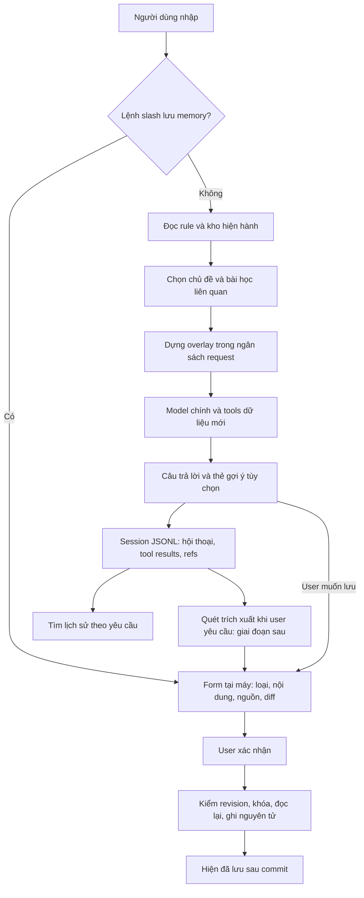

# Memory v5 — Thiết kế hợp nhất sau review v3/v4

> **Trạng thái:** `specified` — đề xuất thiết kế, chưa triển khai. **Ngày đối chiếu:** 27/10/2026.
> Bản v5 cập nhật cho PR #170 sau review v3 và đề xuất v4. Đây là phương án thiết kế mới nhất của PR; giữ nguyên v3 và các tài liệu trước để đối chiếu. Các thay đổi hợp đồng runtime chỉ được thực hiện trong giai đoạn triển khai, chưa có trong PR tài liệu này.

## Mục tiêu chính

Người dùng mở phiên mới vẫn được phục vụ theo lời dặn đã lưu, tiếp tục đúng luận điểm đang nghiên cứu và tìm lại được căn cứ cũ. Hệ thống tự lấy memory liên quan với ít request phụ, hiển thị rõ đã dùng gì và chỉ lưu lâu dài khi người dùng xác nhận.

**Phương án đề nghị:** lấy giao diện và tự truy xuất của v4, giữ nguồn gốc, phiên bản và context chọn lọc của v3. Bản đầu dùng Markdown + JSON có khóa; lịch sử JSONL là nguồn gốc; chưa chạy learner nền. Hiệu quả được đo bằng chất lượng tác vụ trên tổng request/token, không chỉ số dòng code hoặc số lần gọi database.

**Đọc nhanh:** §1–2 xem kết luận review; §3–8 xem hệ hoạt động; §9 xem ví dụ; §10–12 xem kế hoạch và nghiệm thu. Các giới hạn số trong tài liệu là **mặc định pilot đề xuất**, chưa phải kết quả benchmark.

## 1. Căn cứ và kết luận review

| Nguồn | Phiên bản đã đọc | Ý nghĩa |
|---|---|---|
| [V3 trên PR #170][v3] | Commit `d1050e3`, 972 dòng | Thiết kế đầy đủ, chưa triển khai |
| [Đề xuất v4][v4] | Comment `6441474143`, cập nhật 27/10 lúc 19:07 UTC+7 | Nguồn phản biện dùng để xây dựng v5; v4 chưa có file thiết kế riêng |
| [Mã nguồn main][main] | `2501ae4` | Căn cứ cho APIs và lỗi hiện có; checkout local cũ hơn |

| Tiêu chí | V3 | V4 hiện tại | Kết luận |
|---|---|---|---|
| Lưu thuận tiện | Prefix chat dễ nuốt câu hỏi; nhiều cú pháp | Lệnh `/`, form, thẻ gợi ý | Chọn v4 |
| Tự lấy memory | Tự recall thesis; lesson thường cần model tìm/đọc | Tự chọn subject và lesson bằng code | Chọn v4, bổ sung đánh giá độ đúng |
| Qua nhiều lượt | Context tạm nhưng thiếu trạng thái chủ đề rõ ràng | Dùng hai lượt trước/tool args và reminder trong history | Giữ trạng thái chủ đề; dùng context tạm để tránh tích lũy reminder |
| Nguồn và phiên bản | Chi tiết, có khả năng kiểm tra lại | Thesis có bản; provenance bài học còn mỏng | Giữ bộ metadata tối thiểu của v3 |
| Ràng buộc cho agent con | Giao main tự truyền; bảo đảm bằng host đến muộn | Chuyển trực tiếp ngay giai đoạn đầu | Chọn v4 |
| Lưu trữ | SQLite, FTS, job và nhiều quan hệ ngay trong thiết kế đích | JSON có khóa, phù hợp kho nhỏ | JSON trước; chọn SQLite theo số đo/nhu cầu transaction |
| Đổi/xóa/quyền | Projection và nhãn lan truyền mạnh nhưng tốn công | Đơn giản, thừa nhận transcript còn bản sao | Chọn hợp đồng đơn giản; không hứa thu hồi dữ liệu đã gửi |
| Học tự động | Learner opt-in, nguồn/queue/quota đầy đủ | Hoãn; gợi ý ở cuối câu trả lời | Gợi ý trước, trích xuất theo yêu cầu sau, nền cuối cùng |

### Những nhận xét về v3 cần sửa cho công bằng

| Nhận xét | Kết quả đọc lại | Hệ quả cho quyết định |
|---|---|---|
| V3 chạy model phụ sau mọi lượt | V3 §9 ghi `learn=false` mặc định và có giới hạn | Hoãn triển khai learner để giảm độ phức tạp; không coi nó là chi phí bắt buộc mỗi lượt |
| V3 cấm mọi con số | V3 §2, §3 cho phép ngưỡng user và nhật ký có ngày; bộ lọc §5 vẫn quá rộng | Thu gọn bộ lọc, giữ số/đơn vị/phủ định; không bỏ tính năng ghi ngưỡng |
| SQLite làm tăng request LLM | Request tăng do luồng model search → read; SQL tự chạy tại máy | Đổi cách truy xuất độc lập với chọn database |
| Không có Claude Code/Codex là thiếu yêu cầu | Yêu cầu so sánh trước đó nêu OpenCode, DSH, Hermes, Cline | Có thể bổ sung tham khảo; không phải lý do bác bỏ v3 |
| JSON không cần migration | JSON vẫn có schema và dữ liệu cũ | Bắt buộc `schemaVersion`, reader tương thích và đường chuyển đổi |
| Reminder không đổi thì không tốn token nữa | Reminder đã nằm trong history có thể tiếp tục được gửi | Chống chèn trùng không đồng nghĩa hết phí context; cache provider cũng không phải miễn phí mặc định |

### Các vấn đề phải giải quyết

| Ưu tiên | Vấn đề | Quyết định trong kế hoạch |
|---|---|---|
| P0 | Queue ghi session dừng dây chuyền sau một rejection | Sửa và kiểm lỗi ghi từng chặng trước khi dựa vào lịch sử |
| P0 | File hỏng có thể bị hiểu thành kho rỗng nếu dùng generic `readJson` | Strict read; chỉ ENOENT mới là chưa có kho |
| P0 | Quyền đọc quyết định có thể bị vòng qua file/history | Giữ local mặc định; kiểm các đường đọc trước bật chia sẻ |
| P1 | V4 vừa nói không cắt ràng buộc, vừa cắt file sửa tay ở 3.000 ký tự | Không cắt; kiểm lúc ghi và báo lỗi rõ khi sửa tay vượt khả năng request |
| P1 | V3 mất chủ đề, v4 tích lũy reminder | Topic state nhỏ + recall tạm theo từng request |
| P1 | Khóa không phối hợp được editor bên ngoài | CAS cho app writers; kiểm hash/diff với editor; nêu rõ giới hạn cạnh tranh ngoài app |
| P1 | Đoạn đầu 300 ký tự có thể mất ngoại lệ quan trọng | Summary vận dụng do user duyệt; không coi cắt đầu body là bài học đầy đủ |
| P1 | Đề xuất thay/xóa toàn bộ tài liệu cũ | Giữ bản cũ, có một trang chỉ phiên bản đang áp dụng khi triển khai |

## 2. Quyết định thiết kế đích cho bản đầu

| Phần | Chọn gì? | Vì sao / đánh đổi |
|---|---|---|
| Quy tắc | `INVESTOR.md`: tách ràng buộc và sở thích trình bày | Người dùng sửa được; một nơi duy nhất cho lời dặn |
| Sổ nghiên cứu | `notebook.json`, strict schema, revision, ghi có khóa | Tận dụng mẫu watchlist; giới hạn kích thước để đọc/ghi toàn file còn hợp lý |
| Luận điểm | Mỗi phiên bản chứa trọn text, conditions và hạn review | Giữ đúng lịch sử mà không cần bảng `condition_set` riêng |
| Bài học | Nội dung hiện hành, revision, nguồn và summary đã duyệt | Ít cấu trúc hơn v3; chưa có lịch sử sửa mọi lesson |
| Chủ đề | State riêng cho từng session, do host xác định | Theo được “điều kiện thứ hai” mà không phải gửi lại mọi memory cũ |
| Truy xuất | Subject/alias trước; IDF cho lessons; `memory_read` khi cần sâu | Đường phổ biến không có model call chỉ để tìm memory |
| Context | Overlay tạm trên bản sao request; snapshot nguồn vẫn ở kho | Sửa/xóa dừng recall mới; không tích lũy các bản reminder |
| Lịch sử | JSONL gốc, stable turn refs, tìm có giới hạn rồi đọc có phân trang | Có căn cứ; chưa cần chỉ mục ngay |
| Quyền | Model không ghi active; decision không tự recall/search | Dễ giải thích; quyền đọc là cho phép tiết lộ, không phải xóa được dữ liệu đã tiết lộ |
| Tự học | Thẻ gợi ý → user duyệt; `/memory quet` ở bước sau | Không cần daemon/queue/lease trong bản đầu; vẫn còn công xác nhận |

**Chọn JSON có điều kiện:** đây là tối ưu cho kho cá nhân nhỏ, không phải kết luận JSON luôn tốt hơn SQLite. Nếu ngay từ đầu đã có yêu cầu nhiều writer, lịch sử lớn hoặc learner bền, SQLite có thể là lựa chọn đơn giản hơn tổng thể. Đối với phạm vi được chọn ở đây, chưa có số đo chứng minh cần các khả năng đó.

## 3. Luồng tổng thể



| Bước | Xử lý thực tế | Công nghệ | Kết quả |
|---|---|---|---|
| 1 | Nhận input, phân nhánh `/` trước history/log/network | Dispatcher TypeScript trong TUI | Lệnh lưu không bị gửi như câu hỏi |
| 2 | Đọc file rule nhỏ; so nội dung/hash với cache đã parse | `node:fs/promises`, SHA-256 nếu cần cache | Request kế tiếp nhận bản rule hiện hành |
| 3 | Strict read notebook hoặc dùng snapshot RAM sau kiểm file | JSON + schema Zod; hash/revision | File lỗi được báo, không tự reset |
| 4 | Nhận mã/alias và cập nhật topic state | So token, alias khai báo, metadata tool đã biết | Tập subject có lý do chọn |
| 5 | Chấm IDF bài học và loại mục không đủ liên quan | Code tại máy, từ/cặp từ | 0–2 bài học; có thể không chọn mục nào |
| 6 | Render nguyên nhóm cần thiết, kiểm tổng context | Prompt assembler + token estimator/tokenizer khả dụng | Rule đầy đủ, memory có ngày và bản |
| 7 | Gửi request; model đọc sâu hoặc lấy số liệu mới nếu cần | AI SDK và tool registry hiện có | Không có model phụ đứng trước để phân loại query |
| 8 | Hiện câu trả lời; thẻ chỉ xuất hiện khi đề xuất hợp lệ | Streaming renderer + parser giới hạn | Chưa có thao tác ghi nếu user chưa xác nhận |
| 9 | Append session, commit topic/manifest sau ghi thành công | JSONL, stable turn ID, write receipt mới | Phân biệt trả lời xong và lưu thành công |
| 10 | Khi user xác nhận thẻ, chạy cùng writer với lệnh `/` | CAS + file lock + temp/rename | Có memory cho phiên sau; không gọi thêm model để ghi |

Cache host chỉ tiết kiệm parse/render. Rule và memory cần thiết vẫn phải có trong request gửi provider. Thay đổi rule giữa một vòng tool phải được kiểm trước request provider tiếp theo; request đã gửi không tự cập nhật ngược thời gian.

## 4. Dữ liệu và cách ghi

### 4.1. Một nguồn chính cho mỗi loại

| Nơi | Nội dung | Ghi chú |
|---|---|---|
| `INVESTOR.md` | Ràng buộc, khung đầu tư, sở thích | Không sao chép cùng lời dặn thành profile cạnh tranh trong notebook |
| `notebook.json` | Subjects, immutable thesis versions, lessons, decisions | Decisions có trong kho nhưng không thuộc projection trả cho model thông thường |
| Session JSONL | Hội thoại và tool results gốc; turn/topic/memory refs | Không thêm body của auto-recall vào message được lưu |
| RAM | Chỉ mục IDF, file hash, topic state đang dùng, thẻ chưa duyệt | Dựng lại được; không là bằng chứng đã lưu |

**Schema đề xuất, chưa phải API đang có:**

```text
Notebook { schemaVersion, revision, subjects, lessons, decisions }
Subject  { id, aliases, currentVersion, versions[] }
ThesisVersion { version, text, detail, conditions[], reviewBy?, createdAt, source }
Lesson   { id, revision, title, summary, body, appliesWhen?, exceptions?,
           tags[], createdAt, updatedAt, source }
Decision { id, subject, action, reason, thesisVersion?, createdAt, source }
Source   { via: manual | confirmed_card | confirmed_scan,
           operationId, sessionId?, turnId?, messageRef?, sourceHash? }
```

| Bất biến | Cách giữ |
|---|---|
| Điều kiện đúng với luận điểm | Mọi sửa text/condition/reviewBy tạo thesis version mới, form xác nhận toàn bộ |
| Quyết định giữ căn cứ lúc ghi | Writer gắn `thesisVersion` trong cùng lần đọc–sửa–ghi notebook |
| Nguồn không bịa | Manual có operation ID; card có turn/source đã kiểm; nguồn chưa lưu thì ghi rõ không có source bền |
| Không nhầm revision với schema | `schemaVersion` là cấu trúc file; `revision` tăng mỗi commit; version của thesis độc lập |
| Xóa không kéo theo phục hồi body | Decision giữ ref đã xóa + nhãn thiếu nguồn; không chép thesis vào decision để né xóa |

### 4.2. Writer dùng chung

```text
Form/thẻ giữ expectedRevision và target ID
  → user xác nhận đúng bản xem trước
  → vào withFileLock(file)
  → strict read + stripBom + schema validation
  → kiểm expectedRevision, target version, giới hạn
  → tạo next snapshot, tăng revision
  → writeJson(file, next, true)
  → bỏ lock; đổi snapshot RAM; báo đã lưu
```

- Chỉ ENOENT cho phép khởi tạo kho mới. JSON hỏng, permission lỗi, schema tương lai: giữ file nguyên trạng và báo lỗi; không dùng `readJson(file, empty)` cho đường này.
- Đoạn giữ khóa chỉ gồm read/validate/write; không chờ user hoặc network. Mẫu lock hiện có cần kiểm quyền sở hữu khi dọn lock và takeover; chưa phải một lease đủ mạnh cho tác vụ dài.
- `writeJson(..., true)` tạo file riêng tư theo khả năng OS; temp/rename tránh file đích bị ghi nửa chừng nhưng hiện chưa có fsync, nên không quảng bá là bảo đảm qua mọi tình huống mất điện.
- CAS — kiểm “bản user đang sửa còn là bản hiện hành không” — bảo vệ các writer hợp tác. Editor ngoài app không dùng lock; đọc/hash lại phát hiện nhiều xung đột nhưng không tạo được bảo đảm nguyên tử với editor tùy ý. Khi phát hiện đổi: dừng ghi và hiện diff. Luồng được bảo đảm là sửa qua form/editor do app quản lý.
- File dữ liệu không là nơi user bắt buộc sửa JSON bằng tay. `/memory` cung cấp form và export Markdown.

### 4.3. Giới hạn pilot

| Nội dung | Giới hạn đề xuất | Khi vượt |
|---|---|---|
| Ràng buộc | 1.500 ký tự, kiểm thêm tổng request theo model | Reject lần lưu mới, giữ bản trước; không cắt câu |
| Subjects / lessons | 100 / 200 | Hướng dẫn gộp/xóa/xuất; đo trước khi nâng |
| Thesis | Text 350 ký tự; detail 4.000; 8 conditions × 160 | Form báo ngay; body detail không auto-inject |
| Versions / decisions | 20 phiên bản mỗi subject; 2.000 quyết định | Export/dọn theo lựa chọn user; không tự xóa lịch sử |
| Lesson | Title 120; summary 320; body 4.000 ký tự | Summary phải giữ điều kiện và ngoại lệ, hoặc đánh dấu cần đọc đủ |
| Toàn notebook | 8 MiB | Từ chối tăng thêm và báo; schema tương lai có thể nâng sau đo |

Các cap đồng thời có hiệu lực; tổng kích thước file có thể chạm trước cap số mục. Không dùng số lượng vài trăm mục để suy ra file luôn nhỏ.

## 5. Truy xuất và context: phần quyết định hiệu quả

### 5.1. Chọn chủ đề và giữ câu hỏi nối tiếp

| Nguồn tín hiệu | Ưu tiên | Quy tắc |
|---|---:|---|
| Mã user nhắc trực tiếp | 1 | Nguyên từ; mã dễ trùng từ thường cần viết hoa hoặc `@` |
| Alias đã xác nhận | 2 | “Hòa Phát” → HPG; alias trùng nhiều subject phải đánh dấu mơ hồ |
| Chủ đề tập trung của phiên | 3 | Dùng cho câu nối tiếp khi chưa có subject mới rõ ràng |
| Tool args có schema đã biết | Bổ trợ | Chỉ từ tool registry được khai báo; không đọc mọi trường `symbol` của dữ liệu tùy ý |

Topic state tối thiểu: `{ focusSubjects, lastExplicitTurn, evidence, expiresAfterTurn }`. Giữ trong RAM và metadata session; không cần ghi vào notebook mỗi lượt. Mặc định giữ qua hai lượt không có mã mới; không tự gia hạn chỉ vì chính hệ thống lại chèn memory cũ. Khi resume/compact, phục hồi state còn hợp lệ theo turn, rồi đọc phiên bản memory hiện hành.

“Còn FPT?” chuyển focus sang FPT. “So HPG với FPT” giữ hai mã. Một tool sàng lọc trả 100 mã không biến cả 100 thành chủ đề. Nếu “mã đó” có hai ứng viên ngang nhau, model được báo mơ hồ để hỏi rõ, không tự chọn bằng điểm ngẫu nhiên.

### 5.2. Tìm bài học

```text
Câu hỏi + subject rõ ràng
  → fold tiếng Việt để tìm, giữ nguyên bản gốc để hiển thị
  → từ/cặp từ + alias/tag đã khai báo
  → xếp IDF: title/tags ưu tiên, body hỗ trợ
  → ngưỡng được chọn trên tập dev, kiểm trên tập holdout
  → 0–2 kết quả đủ liên quan, kèm ID/revision/nguồn
```

`fold()` đã có. `terms`, `pairs`, `STOP_WORDS` và index trong skill catalog hiện là private; cần trích phần dùng chung hoặc viết scorer riêng có test. Không gọi `matchSoft()` như một API memory, không sao chép ngưỡng 8/1,5 sang corpus lesson. Giữ nguyên behavior routing skill khi refactor.

IDF là tìm từ khóa; FTS5 cũng không tự giải quyết đồng nghĩa. Trước embedding, thử tags/alias và bộ ví dụ “rẻ hay đắt” ↔ “định giá”. Phủ định có thể bị bỏ khi chấm điểm nhưng tuyệt đối không được bỏ khi lưu, render hoặc xác định hai ghi chú tương đương.

### 5.3. Overlay tạm và ngân sách

**Cách chọn:** thêm block vào bản sao của user message mới nhất thuộc lượt đang chạy, chỉ trong request gửi provider; không mutate history gốc. Trong cùng vòng tool, giữ đúng cặp tool-call/result và dựng lại overlay khi revision đổi. Đây là thay đổi phải bổ sung ở request assembly, chưa có API overlay trong runtime hiện tại.

| Thành phần | Ngân sách ban đầu | Xử lý thiếu chỗ |
|---|---|---|
| Ràng buộc | Dành chỗ trước, nguyên văn | Bỏ phần tùy chọn/compact; vẫn không vừa thì hoãn request và cho sửa rule/chọn model |
| Thesis + conditions | Soft cap C 600 / B 900 / A 1.200 token ước lượng | Giữ nguyên nhóm; ưu tiên subject được hỏi trực tiếp |
| Lessons | Nằm trong cùng cap recall, tối đa C 1 / B–A 2 | Bỏ mục điểm thấp trước; không cắt mất ngoại lệ |
| Chi tiết thêm | Tool đọc có giới hạn output và cursor | Trả thiếu phần nào phải nói rõ, không giả đã đọc toàn bộ |

Tổng request phải tính cả system, tool schemas, history, output reserve và safety margin. `estimateTokens()` hiện dùng ký tự/4, chỉ là ước lượng, đặc biệt với tiếng Việt. Khi có tokenizer/usage thực thì đo và hiệu chỉnh; không tuyên bố đạt trần token chính xác từ cap ký tự.

Nếu một nhóm thesis cần thiết vượt soft cap nhưng còn tổng context, cho phép dùng phần trống đã kiểm. Nếu vẫn không vừa, hiện rõ nhóm chưa đọc; câu hỏi đánh giá toàn luận điểm phải đọc bổ sung hoặc chia lượt, không kết luận trên nhóm điều kiện bị thiếu.

**Lựa chọn overflow có chủ đích:** lời dặn hợp lệ không bị cắt theo hạng C. File sửa tay quá lớn có thể làm request bị hoãn cho tới khi người dùng sửa hoặc chọn model đủ context; UI quản lý vẫn hoạt động. Đây là giới hạn hiếm gặp cần giải quyết công khai, không phải lý do cho nhiều lesson chặn chat.

### 5.4. Tool tối thiểu

| Tool đề xuất | Tác dụng | Vì sao |
|---|---|---|
| `memory_read({subject?, id?, query?, history?, cursor?})` | Subject/ID đọc thẳng; query trả top hit và nội dung ngắn đủ vận dụng | Tránh bắt mọi trường hợp đi search rồi mới read |
| `session_search({subject?, query?, from?, to?, cursor?})` | Tìm lượt trong JSONL có giới hạn | History dùng cùng nguồn gốc, không nhân kho |
| `session_get({id, turn?, cursor?})` | Mở đúng lượt, có tool results và phân trang | Bổ sung cho API hiện chỉ trả câu hỏi/kết luận rút gọn |

Schema phải phân biệt các mode truy vấn, không nhận tổ hợp subject/id/query mâu thuẫn. Không có ID kết quả hợp lệ thì trả “chưa tìm được”, không kết luận chưa từng tồn tại. Khi query đã trả đủ lesson, model có thể trả lời sau một vòng tool, không cần thêm `memory_read(id)` bắt buộc.

## 6. Ghi bằng lệnh và thẻ

| Đường ghi | Hành vi được chọn |
|---|---|
| `/nho` | Chọn rõ Ràng buộc hoặc Cách trình bày; không mặc định nâng mọi lời nói thành luật cứng |
| `/luandiem HPG` | Form điền bản hiện hành; lưu cả text/conditions/hạn thành bản mới |
| `/baihoc` | Form summary + điều kiện áp dụng/ngoại lệ + chi tiết |
| `/quyetdinh HPG` | Ghi việc đã quyết và lý do tại máy; không phải lệnh thực hiện giao dịch |
| Chat “nhớ giúp tôi…” | Áp dụng trong hội thoại; có thể có thẻ đề xuất lưu xuyên phiên |
| `/memory` | Xem/sửa/xóa/xuất; hiện revision, nguồn, đã dùng ở đâu |

Lệnh local được xử lý **trước `addHistory`, mở attachment, log classifier và network**; không lưu raw payload của lệnh/form vào prompt-history. Có thể lưu tên lệnh không kèm nội dung để tiện gọi lại. Chat tự nhiên vẫn đi provider như chat thông thường; không được quảng bá nó có độ riêng tư như lệnh local.

Thẻ v4 là tiện ích, không là điều kiện để tính năng cơ bản hoạt động. Chỉ nhận một cấu trúc hợp lệ ở cuối final answer của main; không nhận trong code fence, quote, tool hoặc subagent. Parser phải chịu được tag bị chia qua nhiều stream chunk, tag lỗi và độ dài vượt trần; không che mất phần trả lời hợp lệ sau một tag lỗi. Headless không tự xác nhận.

Thẻ gắn `{turnId, targetId, expectedRevision, contentHash}`; màn hình xác nhận hiện loại, nội dung đầy đủ và nguồn. Enter chỉ lưu khi thẻ đang có focus, không lấy thao tác gửi câu chat mới làm sự đồng ý. Rule card cần cho xem đoạn user gốc; lesson/thesis do model tổng hợp phải ghi rõ là đề xuất của model, chưa phải sự thật đã xác minh.

Chặn mẫu credential có độ chắc chắn cao, không log lại dữ liệu vi phạm. Chuỗi 9 chữ số, email hay số tài chính không tự động chứng minh là bí mật; dùng cảnh báo/chọn lại nội dung theo loại. Không có bộ regex nào chứng minh đã loại hết bí mật hoặc phân biệt hoàn hảo ngưỡng với số liệu hiện hành.

Nếu model nhỏ tạo tag kém: giữ slash/form và thao tác “Lưu đoạn đã chọn”; tắt gợi ý thụ động trên model đó. Chỉ thử tool proposal khi pilot chứng minh chi phí thêm đáng giá, không bắt mọi lượt trả thêm request vì một tính năng tiện ích.

## 7. Quyền, xóa và các giới hạn cần nói đúng

| Việc | Hợp đồng được chọn |
|---|---|
| User lưu rule | Rule user vẫn dưới luật ứng dụng/quyền hệ thống; không mở rộng tool permission |
| Gửi agent con | Host chuyển đầy đủ constraints, không chuyển notebook/decisions; cần tính cả token của child |
| Agent con khác provider | Theo cấu hình và quyền dùng provider hiện hành; UI cho biết constraints sẽ được gửi, không gọi mọi constraints là không nhạy cảm |
| Decision | Không xuất hiện trong index/auto-recall/query thường, kể cả đọc theo ID |
| Chia sẻ decision | Mở rộng sau, duyệt đúng phạm vi trước khi gửi; “một lần” là lần tiết lộ, nội dung có thể còn trong history/provider |
| Xóa/sửa memory | Có hiệu lực với recall mới và tool reads mới; hủy thẻ cũ nhắm vào revision đã đổi |
| Bản sao cũ | Câu trả lời, tool output, export và provider trước có thể còn; không hứa revoke toàn lịch sử |

Giữ nguyên tool outputs trong transcript để resume không phụ thuộc việc tái dựng mọi payload như v3. Session ghi manifest ID/version đã dùng để tra cứu, không có hệ nhãn lan truyền toàn bộ suy luận. Đổi lại, xóa memory không đồng nghĩa xóa những câu đã được trích trong hội thoại. Summary compaction cũng phải được coi là lịch sử cũ, không là bản memory hiện hành.

Vì decisions nằm cùng `notebook.json`, generic file read không được tự gửi cả file chỉ vì lesson được phép dùng. Đánh dấu kho là dữ liệu riêng tư trong các đường file/glob/grep/shell của harness; đường memory trả projection đã lọc. Sau khi user chủ động cho phép đọc cả file thì đó là một quyền tiết lộ rộng hơn, phải hiển thị rõ.

Chỉ thêm `private:` vào permission regex là chưa đủ. Cần kiểm auto-mode, session tools, export và đường file thực. Không tuyên bố đây là sandbox chống chương trình cùng quyền OS; shell tùy ý có thể vượt bộ nhận diện chuỗi đường dẫn. Nếu cần bảo đảm cách ly tuyệt đối, phải có filesystem sandbox tương ứng trước khi quảng bá mức bảo vệ đó.

Notebook lỗi thì chat có thể tiếp tục với thông báo “chưa dùng sổ”; **file ràng buộc đang được dùng mà đọc lỗi** thì hoãn request thay vì giả vờ đã nạp. Chưa từng có file profile là trường hợp khác với file đã có nhưng mất quyền đọc.

## 8. Lịch sử và trích xuất: làm theo nhu cầu

### 8.1. Lịch sử trước, learner sau

Đọc JSONL gốc với stable turn refs; không dùng `loadSession().display` làm raw corpus. Quét theo khoảng tháng và giới hạn byte/lượt/time; trả `partial` + cursor khi chưa quét hết. Phiên cũ dùng số thứ tự turn đã hoàn thành và hash nguồn; file bị đổi phải báo nguồn không còn khớp.

`session_get` phải trả đủ thông tin cần xem lại theo trang: tên tool, arguments, output và câu trả lời có thời gian. Không cắt 1.500/4.000 ký tự rồi coi đó là toàn bộ bằng chứng. Một tool output dài có thể đọc phần tiếp theo mà không nạp lại toàn session.

### 8.2. `/memory quet` — khả năng mở rộng sau khi bản đầu đạt nghiệm thu

```text
User chọn phiên/đoạn đã lưu
  → preview phạm vi nguồn, model và trần chi phí
  → lấy user text có nguồn; bỏ attachment/tool/summary, lọc credential
  → tối đa một request trích xuất, không tự retry
  → schema + source quote/hash validation
  → tối đa ba đề xuất chưa có hiệu lực
  → user xem nguồn, sửa, xác nhận qua writer hiện có
```

Chưa cần worker nền, lease, watermark hay model dự phòng. Source quote đúng chỉ chứng minh trích dẫn tồn tại, không chứng minh diễn giải đúng. Chỉ trích profile/lesson; không tự tạo quyết định. Hết phiên/nguồn thay đổi thì thẻ stale phải được kiểm lại trước lưu.

Không dựa vào giả định mọi provider đều cho đọc “còn 25% quota”. Đặt trần request/input/output nhìn thấy được; dùng usage thực khi provider cung cấp. Chỉ bổ sung learner tự chạy sau khi dữ liệu pilot cho thấy người dùng bỏ sót nhiều memory có ích và đề xuất được chấp nhận đủ thường xuyên.

## 9. Ví dụ thực tế

Các ví dụ minh họa hành vi mong muốn, không phải log chạy hay khuyến nghị đầu tư.

### A. Lưu lời dặn rồi phân công agent con

| Chặng | Hành vi |
|---|---|
| User nhập `/nho Không dùng margin` | Mở thẻ local, chọn Ràng buộc; không cần key model |
| User xác nhận | Kiểm hash/revision, ghi vào `INVESTOR.md`; báo sau commit |
| User hỏi “Sàng lọc cổ phiếu giúp tôi” | Host đưa rule vào main và từng child được gọi |
| Model trả lời | Phải giữ rule; toàn bộ thao tác lưu trước đó dùng 0 request LLM |

### B. Từ “Hòa Phát” sang “điều kiện thứ hai” rồi đổi mã

| Lượt | Câu user | Host lấy gì? | Model cần làm gì? |
|---|---|---|---|
| T1 | “Luận điểm Hòa Phát của tôi còn đúng không?” | Alias → HPG; thesis bản 3 + toàn bộ conditions | Lấy nguồn mới để kiểm, báo rõ thiếu bằng chứng |
| T2 | “Điều kiện thứ hai thì sao?” | Topic state HPG; đọc lại bản hiện hành | Trả lời đúng condition 2, không đoán từ một summary bị cắt |
| Giữa T2/T3 | User sửa thesis qua form | Tạo bản 4; bản 3 vẫn là lịch sử | Chưa cần model call |
| T3 | “Kiểm lại giúp tôi” | Overlay chỉ có bản 4, notice bản đã đổi | Phân biệt bản hiện hành với những gì đã nói về bản 3 |
| T4 | “Còn FPT?” | Focus chuyển FPT; bỏ HPG khỏi auto-recall | Không coi HPG là chủ đề hiện tại chỉ vì còn trong history |

### C. Nhớ bài học mà không bắt model search → read

User hỏi “Tôi định giá ngân hàng thế nào?”. Scorer tìm lesson #7 với summary đã duyệt: “Đọc P/B cùng ROE và chất lượng tài sản; so cùng kỳ; P/B thấp chưa đủ kết luận rẻ.” Host đưa nguyên summary vào request. Model có thể trả lời từ đó; nếu cần nguồn/ngoại lệ dài thì gọi `memory_read({id: "7"})`.

| Đường | Request model tăng riêng do memory |
|---|---:|
| Auto-recall đã đủ | 0 |
| Một vòng đọc sâu | Thường +1 vòng model sau kết quả tool |
| Không khớp lexical, model dùng query | Có thể thêm một vòng; không có bảo đảm tìm đúng mọi cách diễn đạt |

Các số trên không tính tool thị trường, retry và compaction; tổng chi phí phải đo trên tác vụ hoàn chỉnh.

### D. Sửa đồng thời, file hỏng và xóa

| Tình huống | Kết quả |
|---|---|
| Hai cửa sổ cùng mở lesson revision 8; cửa sổ A lưu trước | B lưu với expectedRevision cũ thì nhận conflict và diff; không ghi đè A |
| Notebook JSON hỏng | Giữ file, báo lỗi; không reset thành `subjects: {}` rồi ghi lên |
| User xóa lesson #7 | Index RAM/cache invalidated, recall/read mới không trả #7; thẻ cũ không khôi phục #7 |
| User mở session từng dùng #7 | Vẫn có thể thấy câu trả lời lịch sử đã trích lesson; UI nói rõ giới hạn xóa |
| Ghi transcript thành công nhưng index phiên lỗi | Báo cần sửa index, không append lại nguyên turn tạo bản sao |

## 10. Kế hoạch triển khai theo PR

### Giai đoạn 0 — Chốt hợp đồng và baseline

**Giúp mục tiêu chính:** người triển khai biết chính xác hành vi nào cần đạt và sử dụng API thật, tránh xây nhầm một bản thiết kế khác.

- Đọc nguồn ở §13 trước code; cập nhật inventory nếu main đổi. Chốt ADR về JSON trước, overlay tạm, user-confirmed writes, semantics chia sẻ/xóa. Tạo trang chỉ tài liệu hiện hành, giữ các phiên bản trước làm lịch sử. Design PR giữ `specified`; không sửa prompt runtime chỉ để làm tài liệu trông đồng bộ.
- Xây fixture có nhãn và baseline: không memory; v3 read path; v4 read path; phương án hợp nhất. Hai đường chưa triển khai chỉ là prototype/replay, phải ghi rõ giới hạn so sánh.
- **Mẫu/API:** [MemoryProvider][types], [budget][budget], [session history][history]. `edit/CAS`, overlay, source receipt, topic state đều là phần **mới**.
- **Nghiệm thu:** bảng requirement → test case → phase đầy đủ; baseline không gọi provider tự động. Không dùng score giả hoặc số token ước lượng làm bằng chứng thắng.

### Giai đoạn 1 — Sửa nền lưu phiên và writer

**Giúp mục tiêu chính:** điều đã lưu không mất âm thầm và lần lưu hỏng không làm các lần sau hỏng theo.

- Theo mẫu queue phục hồi trong [watchlist][watchlist], sửa queue session nhưng giữ lỗi của từng thao tác. Thêm turn ID/receipt phân biệt `transcript committed` và `index pending`; chỉ giải phóng charts/harness đã commit. Kiểm first-write failure vì `this.file` hiện được gán trước append; kiểm đuôi JSONL thiếu sau partial write trước nối lượt mới.
- Dùng [strict read watchlist][watchlist], `stripBom`, `writeJson(..., true)` và [file lock][lock] cho repository mới; schema validation/CAS/cap như §4. Kiểm owner khi nhả/takeover lock; không giữ khóa qua network.
- **Nghiệm thu:** lỗi lần đầu/lần giữa rồi ghi tiếp; transcript thành công nhưng index lỗi; partial tail; hai process ghi; conflict; BOM; file hỏng; schema tương lai. Không append lại turn đã commit để “retry cho chắc”.

### Giai đoạn 2 — Rule và lưu chủ động

**Giúp mục tiêu chính:** người dùng có thể lưu ngay lời dặn và agent chính/agent con tuân thủ cùng một bộ quy tắc.

- Theo [profile loader][profile] và dispatcher TUI hiện có, thêm local slash/forms trước mọi đường log/network. Thêm strict profile parser, constraints layer và kiểm overflow; không xóa dòng user chỉ vì chứa “ví dụ”. Markdown heading trong code fence không được nhận nhầm thành section.
- Thêm notebook UI, thesis version với conditions, lessons có nguồn, local decisions và path policy. Truyền constraints bằng host ở nhánh subagent; giữ journal ngoài child.
- **Nghiệm thu:** lưu offline không có provider key; không raw command trong prompt-history; đồng thời edit; ba loại số/ngưỡng/credential; child/desk nhận đúng rule; overflow và lỗi đọc hiển thị đúng. Không bật chia sẻ decision với model ở bước này.

### Giai đoạn 3 — Auto-recall, topic state và thẻ

**Giúp mục tiêu chính:** memory được dùng đúng lúc với ít request phụ, kể cả khi user hỏi tiếp mà không nhắc lại mã.

- Dùng `fold()` và nguyên lý scorer từ [skill catalog][catalog], viết/eval scorer memory riêng; thêm aliases, focus state. Tạo overlay trong [request assembly][agent] trên bản sao messages, không dùng `lastReminder` làm cơ chế giảm token.
- Thêm `memory_read` với mode rõ ràng, context report, parser thẻ và writer có CAS dùng lại. Không chuyển toàn body dài thành policy; không tạo assistant/tool role giả để né protocol.
- **Nghiệm thu:** fixture alias/đại từ/chuyển chủ đề; no-hit; phủ định; sửa/xóa giữa tool loop; compact/resume; snapshot request không còn raw recall cũ; raw session không bị overlay mutate. Mock stream kiểm parser; online pilot chỉ chạy có ngân sách được chọn.
- **Mốc phát hành bản đầu:** sau bước này và cổng kiểm chứng §11, có đủ rule, thesis, lessons, local decisions, auto-recall và quản lý sổ.

### Giai đoạn 4 — Lịch sử có nguồn và chia sẻ quyết định

**Giúp mục tiêu chính:** người dùng tìm được lý do cũ và chủ động chọn dữ liệu riêng tư nào được đưa cho model.

- Mở rộng [sessionHistoryTools][history] từ raw JSONL, stable refs/cursor/partial; không dùng các đoạn display 400 ký tự như bằng chứng đầy đủ. Giới hạn quét để không treo TUI.
- Thêm private scope/user-only theo [permission gate][gate], đồng thời kiểm file/shell/history/export. Câu duyệt ghi rõ nội dung có thể ở lại transcript. Không tái tạo hệ revoke toàn bộ suy luận của v3 trong bước này.
- **Nghiệm thu:** source missing/hash mismatch; raw sau compact; nhiều trang; query quyết định theo ID/subject không vòng quyền; auto classifier không tự duyệt; path aliases/symlink; không đưa decision vào search thường. Không mở chia sẻ trước khi đạt các ca này.

### Giai đoạn 5 — Trích xuất theo yêu cầu

**Giúp mục tiêu chính:** giảm công chép lại những lời dặn/bài học đã nói mà người dùng vẫn kiểm soát điều được nhớ.

- Làm `/memory quet` theo §8.2, đọc nguồn thành công trước khi gọi model. Dùng schema Zod đã có và adapter AI SDK đang được repo sử dụng; xác minh khả năng structured output của model trước khi chọn API cụ thể.
- Dùng writer/thẻ có sẵn; kiểm source/target lại lúc commit. Không thêm queue nền chỉ để phục vụ một lệnh user chạy đồng bộ; không tự fallback sang provider khác.
- **Nghiệm thu:** 0 request khi không có nguồn hợp lệ; tối đa một request cho một lần chạy theo cấu hình; quote sai bị loại; nguồn sửa/xóa làm stale; proposal không active trước xác nhận. Đây là nâng cấp sau bản đầu, không phải điều kiện chặn release giai đoạn 3.

### Giai đoạn 6 — Kiểm chứng, rollout và quyết định nâng cấp

**Giúp mục tiêu chính:** chứng minh người dùng hoàn thành tác vụ tốt hơn mà chi phí vẫn trong giới hạn, rồi mới mở rộng hệ thống.

- Chạy các cổng §11 sau mỗi mốc phát hành, không đợi learner mới kiểm. Cùng model, tools, fixture, context limit; tách tokens main/child/summary/extraction và cache hit/miss. Dùng test home tạm.
- Kiểm API/anti-pattern theo §13; chạy `bun test` cho nhóm thay đổi và `bun run typecheck`, sau đó bộ regression liên quan. Script `memory-eval` là phần cần viết, không phải lệnh đã có trong repo.
- Giữ provider cũ cho người đang dùng cho tới khi user chọn chuyển; migration có preview/idempotency, không xóa file cũ. Với user mới có thể bật notebook rỗng sau pilot; learner và chia sẻ quyết định vẫn tắt mặc định.
- **Nghiệm thu:** có báo cáo số đo, trường hợp thất bại, giới hạn đã công bố và rollback cấu hình. Chỉ cập nhật `implemented` khi behavior tương ứng đã qua kiểm chứng.

## 11. Bộ đo và cổng chất lượng

Đề xuất 100 ca offline: 20 rule/local write, 25 subject/alias/nối tiếp, 20 lesson/no-hit, 15 version/delete/concurrency, 10 session recovery, 10 privacy/history. Tách 70 dev/30 holdout; không sửa ngưỡng theo holdout. Các stress/property tests bổ sung cho lỗi hiếm, không gộp vào phần trăm thành công của 100 ca.

| Thước đo | Cổng pilot đề xuất | Vì sao |
|---|---|---|
| Đường local | 0 model request; 0 raw payload trong các log đã cấm | Lưu được khi offline và giảm bản sao |
| Ràng buộc trong payload | 100% ca main/child đúng và không bị cắt | Có rule trong prompt là điều kiện cần; hành vi model kiểm riêng |
| Recall subject | ≥95% ca có nhãn; không lỗi ở ca alias/mã mơ hồ bắt buộc | Giữ chủ đề đúng |
| Lesson precision@k / recall@k | ≥90% / ≥85% trên holdout liên quan; báo cả mẫu số | Tránh đạt recall bằng cách nhét toàn kho |
| False injection | ≤5% trên nhóm không có memory phù hợp | Giảm nhiễu/context |
| Version/private | 0 lần tự inject bản đã xóa hoặc decision chưa duyệt trong bộ test | Lỗi chặn release, không bù bằng điểm trung bình |
| Độ trễ local | p95 <100 ms trên kho 200 lessons/100 subjects, máy ghi rõ cấu hình | Mục tiêu kỹ thuật, chưa phải số đã đo |
| History search | p95 ≤1 giây trên 1.000 sessions có ghi tổng bytes/turns; kết quả partial phải rõ | Số session đơn lẻ chưa mô tả đủ workload |
| Request/token | Đếm tổng theo tác vụ thành công, so cùng baseline | Không chỉ đếm request của riêng memory |

Online smoke: khoảng 12 kịch bản × 2 nhóm model (nhỏ và mạnh hơn), có trần request/token; một kịch bản có thể nhiều request. Đo tuân thủ rule, đủ ba trạng thái condition, nguồn/kỳ, thẻ hợp lệ và thẻ thừa. Không coi mẫu nhỏ này là chứng minh thống kê; kết quả quyết định pilot rộng hơn hoặc tắt tiện ích thẻ trên model yếu.

Không hy sinh chất lượng để đạt “0 request phụ”. Nếu auto-recall thiếu nội dung mà đọc thêm giúp trả lời đúng, đó là chi phí hợp lý. Ngược lại, 0 request vẫn không hiệu quả nếu gửi nhiều memory sai trong mọi lượt.

## 12. Khi nào mới nâng cấp?

| Nâng cấp | Tín hiệu cần có | Bước tiếp theo |
|---|---|---|
| SQLite cho notebook | Chạm cap thường xuyên; p95 đọc/ghi thất bại mục tiêu; nhiều writer/CAS conflict; cần queue/transaction phức tạp | ADR + migration một chiều có backup do user quản lý; giữ repository contract |
| FTS5 lịch sử | Scan đã giới hạn vẫn >1 giây ở workload thực | Index dẫn xuất từ JSONL, rebuild được, có offset/hash và kiểm đuôi chưa index |
| Embedding | Recall kém tập paraphrase sau khi đã thử alias/tag/lexical tuning | Pilot cùng corpus; đo lợi ích so CPU/storage/quyền gửi dữ liệu |
| Learner nền | User thường bỏ sót memory hữu ích; manual scan được dùng và đề xuất có ích | Opt-in có quota, source suppression, durable jobs; lúc này đánh giá lại SQLite |
| Workspace memory | Có nhu cầu thật về profile/danh mục tách biệt | Host-owned namespace, migration rõ; không coi subject là ACL |
| Revoke lịch sử mạnh | User cần ngừng gửi lại mọi bản dẫn xuất sau khi tắt chia sẻ | Dự án riêng về provenance/projection; không hứa đạt chỉ bằng nút toggle |

**Phạm vi chốt cho bản đầu:** rule + forms + notebook có nguồn/phiên bản + auto-recall + topic state + memory_read + local decisions. History sâu, chia sẻ decision và manual scan đi sau; background learner giữ trong roadmap theo nhu cầu đo được.

## 13. APIs đã có và mẫu triển khai được phép dùng

Tất cả source dưới ghim main `2501ae4`. Những tên trong §4–5 không xuất hiện ở đây là đề xuất cần triển khai, không được giả định đã tồn tại.

| API / nguồn | Có thật | Mẫu dùng và giới hạn |
|---|---|---|
| [profile.ts][profile] | `loadProfile()`, `profileFile()`, `ensureProfile()` | Đã đọc profile; hiện catch lỗi nên cần phân biệt ENOENT/read failure |
| [store.ts][store] | `stripBom(text)`, `writeJson(file, value, secret=false)` | Atomic rename và private mode; `readJson` catch-all không phù hợp notebook |
| [file-lock.ts][lock] | `withFileLock(file, run, {timeoutMs?, staleMs?})` | Mẫu khóa hợp tác; cần audit ownership/stale trước tái sử dụng |
| [watchlist/local.ts][watchlist] | `readWatchlists`, queue update có `.catch(() => {})` trước thao tác sau | Copy strict-read/queue pattern, không copy blanket default permissions |
| [memory/types.ts][types] | `MemoryProvider`: index/recall/tools/register/list/approve/reject/remove | Chưa có CAS/edit/source receipts/async close |
| [agent.ts][agent] | `withContext`, `userMessage`, `lastReminder`, `assembleFor`, `requestFor` | withContext ở đầu user đầu tiên; overlay mới phải đặt đúng lượt và không mutate history |
| [skills/catalog.ts][catalog] | `fold`, `matchSoft` | Helpers IDF private; body từng làm skill eval kém, cần eval lesson riêng |
| [session/store.ts][session] | `appendTurn`, `appendCompact`, `flush`, `loadSession` | Queue poison/partial state phải sửa; flush không chứng minh từng append thành công |
| [tools/session/history.ts][history] | `sessionHistoryTools()` → session_list/session_get | Hiện get chỉ 12 lượt cuối và answer rút gọn; chưa có raw turn pagination |
| [permission/index.ts][gate] | `PermissionGate.check`, userOnly/sessionOk nội bộ | Scope private mới cần cập nhật cả path-safety và consumers |
| [prompt/budget.ts][budget] | `tierOf`, `estimateTokens`, `fit` | `fit` cắt chuỗi không dùng cho nhóm constraints/conditions nguyên tử |

## 14. Phạm vi xác minh của bản kế hoạch

Đã đọc v3, comment v4 mới nhất và các nguồn ghim commit; kiểm được lỗi queue và các giới hạn API nêu trên. Đã kiểm cấu trúc Markdown của tài liệu này. Chưa triển khai runtime, chưa chạy memory-eval hoặc đo model thật; mọi mục tiêu p95/precision/token ở đây là tiêu chí nghiệm thu đề xuất. Không có cơ sở khẳng định phương án đã thắng v3/v4 về chất lượng trước khi thử cùng workload.

[v3]: https://github.com/FinDaHuman/OpenTrading/blob/d1050e3f8243af269ed30fc88152f936bd405a14/docs/memory/design-v3.md
[v4]: https://github.com/FinDaHuman/OpenTrading/pull/170#issuecomment-6441474143
[main]: https://github.com/FinDaHuman/OpenTrading/tree/2501ae486d5659aea33c2e6194c1e1b3018809a4
[profile]: https://github.com/FinDaHuman/OpenTrading/blob/2501ae486d5659aea33c2e6194c1e1b3018809a4/src/core/profile.ts#L12
[store]: https://github.com/FinDaHuman/OpenTrading/blob/2501ae486d5659aea33c2e6194c1e1b3018809a4/src/core/store.ts#L7
[lock]: https://github.com/FinDaHuman/OpenTrading/blob/2501ae486d5659aea33c2e6194c1e1b3018809a4/src/core/file-lock.ts#L41
[watchlist]: https://github.com/FinDaHuman/OpenTrading/blob/2501ae486d5659aea33c2e6194c1e1b3018809a4/src/core/tools/watchlist/local.ts#L60
[types]: https://github.com/FinDaHuman/OpenTrading/blob/2501ae486d5659aea33c2e6194c1e1b3018809a4/src/core/memory/types.ts#L28
[agent]: https://github.com/FinDaHuman/OpenTrading/blob/2501ae486d5659aea33c2e6194c1e1b3018809a4/src/core/agent.ts#L662
[catalog]: https://github.com/FinDaHuman/OpenTrading/blob/2501ae486d5659aea33c2e6194c1e1b3018809a4/src/core/skills/catalog.ts#L45
[session]: https://github.com/FinDaHuman/OpenTrading/blob/2501ae486d5659aea33c2e6194c1e1b3018809a4/src/core/session/store.ts#L153
[history]: https://github.com/FinDaHuman/OpenTrading/blob/2501ae486d5659aea33c2e6194c1e1b3018809a4/src/core/tools/session/history.ts#L39
[gate]: https://github.com/FinDaHuman/OpenTrading/blob/2501ae486d5659aea33c2e6194c1e1b3018809a4/src/core/permission/index.ts#L124
[budget]: https://github.com/FinDaHuman/OpenTrading/blob/2501ae486d5659aea33c2e6194c1e1b3018809a4/src/core/prompt/budget.ts#L1
