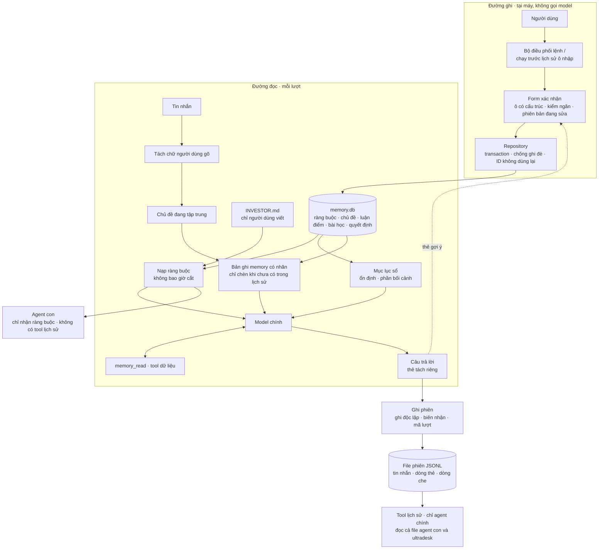

# Rà soát kiến trúc memory v5 và đề xuất kiến trúc v5.1

| | |
| --- | --- |
| **Trạng thái** | Tài liệu rà soát và đề xuất. Q1–Q7 đã được người phụ trách memory chốt ngày 28/10/2026 (bảng "Đã chốt" ở B10), và **kiến trúc v5.1 (phần C) được chốt làm kiến trúc để implement**; các quyết định đảo v5 vẫn chờ ADR được nhóm duyệt, các thay đổi lõi (C11) chờ chủ repo duyệt. Chưa có code. Mọi con số giới hạn là mặc định đề xuất, chưa phải kết quả đo |
| **Ngày** | 27/10/2026 |
| **Đối tượng rà soát** | [design-v5.md](design-v5.md) (PR #170) và code trên `main` tại `955ed36` |
| **Phạm vi** | Chỉ kiến trúc memory và phần code memory dựa trực tiếp vào. Không rà các phần khác của repo |
| **Cách làm** | Đọc code thật, chạy bốn thí nghiệm bằng chính code của repo trong thư mục dữ liệu tạm (không chạm `~/.opentrading` thật), nghiên cứu tài liệu công khai của các hệ khác |

Tài liệu gồm ba phần:

- **Phần A: Rà soát.** Rà từng khối, từng đường nối, rồi cả kiến trúc. Liệt kê vấn đề kèm ví dụ và căn cứ.
- **Phần B: Nghiên cứu và phân tích giải pháp.** Các phương án, so sánh, đề xuất, kể cả chỗ đề nghị đổi kiến trúc.
- **Phần C: Kiến trúc dựng lại (v5.1).** Kiến trúc chi tiết sau khi áp các giải pháp ở phần B.

---

## Mục lục

**Phần A: Rà soát**
- A1. Cách rà và ký hiệu
- A2. Tóm tắt các vấn đề
- A3. Tầng 1: rà từng khối
- A4. Tầng 2: rà từng đường nối
- A5. Tầng 3: tình huống xuyên khối và gốc rễ
- A6. Chi tiết từng vấn đề
- A7. Điểm yếu do gắn cứng
- A8. Các thí nghiệm đã chạy
- A9. Đã rà, không có vấn đề
- A10. Đính chính so với ghi chú trước

**Phần B: Nghiên cứu và giải pháp**
- B1. Căn cứ nghiên cứu
- B2. Nguyên tắc chọn giải pháp
- B3. Gốc 1: nội dung memory trong hội thoại
- B4. Gốc 2: truy tìm memory cho khớp câu hỏi
- B5. Gốc 3: định danh và thời gian
- B6. Gốc 4: tầng ghi và kho dữ liệu
- B7. Gốc 5: ranh giới
- B8. Gắn cứng và "policy as code"
- B9. Ý tưởng khác đáng thử
- B10. Quyết định cần nhóm chốt

**Phần C: Kiến trúc v5.1**
- C1. Tổng quan
- C2. Bảng chính sách theo loại memory
- C3. Kho dữ liệu
- C4. Đường ghi
- C5. Đường đọc
- C6. Agent con
- C7. Lịch sử phân tích
- C8. Xoá, lỗi, khôi phục
- C9. Năm tình huống chạy lại trên v5.1
- C10. Bất biến tài chính và cách kiểm
- C11. Thay đổi lõi và phần memory
- C12. Lộ trình và nghiệm thu
- C13. Đo lường và rủi ro còn lại

**Nguồn tham khảo**

---

# Phần A: Rà soát

## A1. Cách rà và ký hiệu

Rà theo ba tầng:

1. **Tầng 1, từng khối:** mỗi khối trên sơ đồ v5, theo thứ tự dữ liệu chạy.
2. **Tầng 2, từng đường nối:** thứ gì đi qua giữa hai khối, và khối nhận có giả định đúng về thứ đó không. Nhiều lỗi chỉ lộ ra ở tầng này.
3. **Tầng 3, toàn kiến trúc:** chạy thử các tình huống thật đi xuyên nhiều khối, rồi gom các vấn đề về gốc rễ.

| Ký hiệu | Nghĩa |
| --- | --- |
| `K` | Lỗi **kiến trúc**: cách các phần được thiết kế để phối hợp |
| `T` | Lỗi **kỹ thuật**: cài đặt sai, hoặc code hiện có sai |
| `H` | Điểm yếu do **gắn cứng** (hardcode) |
| **Cao** | Memory sai, mất dữ liệu, hoặc ràng buộc bị bỏ qua mà không ai biết |
| **Trung bình** | Sai trong điều kiện hiếm, tốn kém, hoặc khó bảo trì |
| **Tái hiện** | Đã chạy thí nghiệm bằng code của repo (mục A8) |
| **Code** | Đã đọc code hiện có |
| **Thiết kế** | Phân tích văn bản v5 |

## A2. Tóm tắt các vấn đề

| Mã | Loại | Khối hoặc đường nối | Vấn đề | Mức | Kiểm bằng | v5 đã nhận ra? |
| --- | --- | --- | --- | --- | --- | --- |
| K1 | Kiến trúc | Chọn memory | Không có mục lục: model không biết trong sổ còn gì ngoài phần host tự chọn | Cao | Thiết kế | Không |
| K2 | Kiến trúc | Chọn memory | Bài học khớp theo chữ trong câu hỏi, không theo mã đang hỏi; không có quan hệ mã–ngành–thị trường | Cao | Thiết kế | Một phần (nêu giới hạn đồng nghĩa) |
| K3 | Kiến trúc | Overlay tạm ↔ file phiên | Hai đường đưa memory vào hội thoại theo hai luật lưu ngược nhau | Cao | Thiết kế + code | Không |
| K4 | Kiến trúc | File phiên | Lịch sử phân tích thiếu nguồn: agent con, ultradesk ghi file riêng | Trung bình | Code | Không |
| K5 | Kiến trúc | File phiên | Lượt không có mã bền; bản tóm tắt sau nén thành bản sao memory không nhãn | Trung bình | Code + TN2 | Một phần (mã lượt cho lượt mới) |
| K6 | Kiến trúc | INVESTOR.md | Vừa là văn bản người viết vừa là kho app ghi; ràng buộc không có định danh, không có phiên bản; tên mục không khớp v5 | Trung bình | Thiết kế + code | Không |
| K7 | Kiến trúc | Form → hai kho | Ranh giới hai kho dựa hoàn toàn vào lựa chọn của người dùng | Trung bình | Thiết kế | Không |
| K8 | Kiến trúc | TUI → đường trả lời | Chữ người dùng gõ không được tách khỏi thông báo của agent con | Cao | Code | Không |
| K9 | Kiến trúc | Tool lịch sử ↔ agent con | Agent con đọc được mọi phiên cũ, đi vòng qua nguyên tắc "agent con không nhận sổ" | Trung bình; Cao khi chia sẻ quyết định | Code | Không |
| T1 | Kỹ thuật | Ghi phiên | Một lần ghi lỗi làm kẹt mọi lần ghi sau, kể cả khi nguyên nhân đã hết | Cao | Tái hiện (TN1) | Có, kế hoạch giai đoạn 1 |
| T2 | Kỹ thuật | Ghi phiên | Dòng ghi dở làm mất câu hỏi của lượt sau | Trung bình | Tái hiện (TN2) | Có, kế hoạch giai đoạn 1 |
| T3 | Kỹ thuật | Writer (khoá file) | Khoá bị chiếm khi chủ còn sống; nhả khoá xoá nhầm khoá của người khác | Trung bình | Tái hiện (TN3) | Nghi ngờ, chưa kiểm |
| T4 | Kỹ thuật | Writer (đọc nghiêm) | Kiểm cấu trúc âm thầm bỏ trường lạ, ghi lại là mất dữ liệu | Trung bình | Tái hiện (TN4) | Không |
| T5 | Kỹ thuật | Form → Writer | Mốc chống ghi đè chưa rõ; ID và số bản luận điểm có thể bị dùng lại | Cao | Thiết kế | Một phần |
| T6 | Kỹ thuật | TUI → bộ điều phối | Lệnh memory rò vào lịch sử ô nhập qua hai đường | Trung bình | Code | Một nửa (đường gửi) |
| T7 | Kỹ thuật | Nạp ràng buộc | `INVESTOR.md` đọc lỗi bị coi như không có ràng buộc | Cao | Code | Có |
| T8 | Kỹ thuật | INVESTOR.md → agent con | Dòng mẫu "(ví dụ: …)" bị gửi đi như ràng buộc thật | Trung bình | Code | Một phần |
| H1–H8 | Gắn cứng | Nhiều khối | Xem mục A7 | Trung bình | Code + thiết kế | Một phần |

## A3. Tầng 1: rà từng khối

### Làn trái: Lưu chủ động

| Khối | Kết quả rà | Vấn đề |
| --- | --- | --- |
| Người dùng · TUI | Lưu nội dung lệnh xuống lịch sử ô nhập qua hai đường; ghép kết quả agent con nền vào câu hỏi | T6, K8 |
| Bộ điều phối lệnh `/` | **Ổn.** Lệnh lạ không bao giờ tới model. Tên lệnh memory không thể bị lệnh khác chiếm: lệnh của MCP luôn có tiền tố `máy-chủ:`, playbook chỉ có 4 tên cố định | — |
| Form xác nhận | Chưa có mốc chống ghi đè đúng; chọn ngăn lưu dựa hoàn toàn vào người dùng | T5, K7 |
| Writer dùng chung | Khoá file cho hai người cùng ghi; kiểm cấu trúc bỏ trường lạ; ID có thể bị dùng lại | T3, T4, T5 |
| `INVESTOR.md` | Đọc lỗi bị coi là không có ràng buộc; dòng mẫu thành ràng buộc; ràng buộc không định danh, không phiên bản; tên mục không khớp v5 | T7, T8, K6 |
| `notebook.json` | ID và số bản có thể bị dùng lại; ghi lại có thể xoá trường lạ | T4, T5 |

### Làn giữa: Đường trả lời

| Khối | Kết quả rà | Vấn đề |
| --- | --- | --- |
| Nạp ràng buộc | Đọc lỗi im lặng; mang theo dòng mẫu | T7, T8 |
| Trạng thái chủ đề | Đầu vào lẫn chữ không phải của người dùng; không biết quan hệ mã–ngành | K8, K2 |
| Projection đã lọc | **Ổn trong làn này** (một cổng lọc, không trả quyết định), nhưng bị đi vòng qua tool lịch sử phiên | K9 |
| Chọn memory | Model không có mục lục; bài học khớp theo chữ | K1, K2 |
| Overlay tạm | Luật "không lưu" ngược với luật "lưu" của kết quả tool | K3 |
| Model chính | **Ổn** về chỉ dẫn (kiểm điều kiện ba trạng thái, nêu phản chứng). Chất lượng phụ thuộc K1, K2 | — |
| Tool chỉ đọc | Kết quả `memory_read` được lưu và gửi lại; tool lịch sử chỉ đọc file phiên chính; agent con cũng có tool lịch sử | K3, K4, K9 |
| Câu trả lời + thẻ | Thẻ nằm trong văn bản câu trả lời nên bị lưu và gửi lại; trạng thái duyệt của thẻ không được ghi | K3 |

### Làn phải: Agent con, phiên, sau này

| Khối | Kết quả rà | Vấn đề |
| --- | --- | --- |
| Agent con | Nhận dòng mẫu như ràng buộc; không nhận "khung đầu tư"; đọc được mọi phiên cũ | T8, K6, K9 |
| Ghi phiên JSONL | Kẹt vĩnh viễn sau một lỗi; dòng ghi dở nuốt câu hỏi lượt sau; không có mã lượt | T1, T2, K5 |
| File phiên JSONL | Thiếu phân tích của agent con và ultradesk; tham chiếu lượt dễ lệch | K4, K5 |
| RAM | Nếu làm mới theo `revision` thì không thấy sửa tay | T5 |
| `/memory quet` | Đọc "chữ người dùng" nhưng chữ đó đang lẫn kết quả agent con; thiếu câu hỏi do T2 | K8, T2 |

## A4. Tầng 2: rà từng đường nối

| # | Đường nối | Thứ đi qua | Lỗi ở chỗ nối | Mã |
| --- | --- | --- | --- | --- |
| 1 | TUI → Bộ điều phối | Dòng người dùng gõ | Lịch sử ô nhập lưu **trước** khi phân loại; xoá ô nhập (Esc Esc, Ctrl+C) cũng lưu nội dung | T6 |
| 2 | TUI → Đường trả lời | "Câu hỏi" | Kết quả agent con nền được **ghép vào trước** chữ người dùng gõ; khối chủ đề và khối chấm điểm nhận cả hai | K8 |
| 3 | Câu trả lời → Form (thẻ) | Đề xuất lưu | Thẻ là một phần của câu trả lời nên bị lưu vào lịch sử; thẻ cũ có thể nhắm vào mục đã đổi hoặc đã xoá | K3, T5 |
| 4 | Form → Writer | Nội dung và mốc so sánh | Chưa rõ so theo gì; ngăn lưu do người dùng chọn | T5, K7 |
| 5 | Writer → `INVESTOR.md` | Một dòng ràng buộc | Ghi vào văn bản tự do của người dùng; không có định danh dòng | K6 |
| 6 | Writer → `notebook.json` | Bản sổ mới | Khoá không loại trừ được nhau; trường lạ bị xoá; ID dùng lại | T3, T4, T5 |
| 7 | `INVESTOR.md` → Nạp ràng buộc | Văn bản hồ sơ | Đọc lỗi thành "không có"; dòng mẫu đi theo; tên mục mẫu không khớp hai loại của v5 | T7, T8, K6 |
| 8 | Nạp ràng buộc → Agent con | Mục Ràng buộc | Dòng mẫu thành luật cứng ở mọi agent con; "khung đầu tư" không được gửi | T8, K6 |
| 9 | Sổ → Projection → Chọn memory, Tool | Bản nhìn đã lọc | Bộ đệm làm mới theo `revision`, nên sửa tay không được thấy | T5 |
| 10 | Trạng thái chủ đề → Chọn memory | Danh sách mã | Mã từ kết quả agent con lọt vào; không kéo được luận điểm ngành, thị trường | K8, K2 |
| 11 | Chọn memory → Overlay → Model | Lát cắt memory | Model không biết ngoài lát cắt còn gì | K1 |
| 12 | Model ⇄ Tool chỉ đọc | Kết quả `memory_read` | Được lưu và gửi lại ở mọi lượt sau; overlay thì không | K3 |
| 13 | Tool lịch sử ⇄ Agent con | Phiên cũ | 14 trên 17 loại agent con có sẵn nhận tool đọc phiên cũ, đọc được phiên ở **mọi** thư mục | K9 |
| 14 | Câu trả lời → Ghi phiên | Lượt vừa xong | Overlay không lưu, thẻ có lưu, tham chiếu chưa có mã lượt | K3, K5 |
| 15 | Ghi phiên → File phiên | Các dòng JSONL | Kẹt sau một lỗi; dòng cụt nuốt dòng đầu lượt sau; lỗi ở lượt đầu làm phiên biến mất khỏi chỉ mục | T1, T2 |
| 16 | File phiên → Tool lịch sử, `/memory quet` | Lượt cũ | Thiếu file agent con, ultradesk; đếm lượt bị lệch; chữ người dùng lẫn thông báo | K4, K5, K8 |

## A5. Tầng 3: tình huống xuyên khối và gốc rễ

### Năm tình huống

**Tình huống A: lưu ràng buộc rồi nhờ sàng lọc**

```
/nho Không dùng margin (lỡ dán khoá, Esc Esc, gõ lại)
 → khoá đã nằm trong lịch sử ô nhập                                     [T6]
 → chọn nhầm "Cách trình bày" thay vì "Ràng buộc", không ai cảnh báo    [K7]
 → INVESTOR.md còn dòng mẫu "(ví dụ: Tránh ngành BĐS nghỉ dưỡng)"     [T8]
 → lượt sau file bị lỗi quyền đọc → coi như không có ràng buộc         [T7]
 → "Sàng lọc giúp tôi": agent con nhận ràng buộc GIẢ (dòng mẫu),
   không nhận ràng buộc thật (đã lưu nhầm ngăn)                         [T8, K7]
```

Hệ thống báo "đã lưu", nhưng luật thật không tới đâu, còn luật giả thì tới mọi agent con.

**Tình huống B: luận điểm, sửa giữa phiên, ghi quyết định, xoá rồi tạo lại**

```
T1: model gọi memory_read(HPG) → HPG bản 2 lưu vào lịch sử              [K3]
Người dùng sửa thành bản 3 → overlay hiện bản 3, lịch sử còn bản 2
   → model thấy hai bản, không biết bản nào hiện hành                    [K3]
Form quyết định mở từ lúc còn bản 2 → writer tự gắn bản 3                [T5]
Xoá chủ đề HPG rồi tạo lại → đánh số lại từ bản 1
   → quyết định cũ "dựa trên bản 2" trỏ vào một luận điểm khác hẳn       [T5]
```

**Tình huống C: câu hỏi không nhắc mã, đang có agent con nền**

```
Agent con nền vừa sàng lọc 20 mã → kết quả ghép vào trước câu hỏi kế tiếp   [K8]
Người dùng: "VCB có rẻ không?"
 → khối chủ đề thấy 20 mã + VCB; mã của agent con đứng trước                 [K8]
 → luận điểm của vài mã không liên quan chiếm ngân sách
 → bài học "Định giá ngân hàng" không khớp chữ ("rẻ" ≠ "định giá")          [K2]
 → model không có mục lục nên không biết bài học đó tồn tại                   [K1]
```

**Tình huống D: tháng 11 hỏi lại phân tích ultradesk tháng 9**

```
Tháng 9 có một lần ghi lỗi giữa phiên → phần sau của phiên không được lưu        [T1]
Phần đã lưu: số liệu thật nằm trong nhật ký ultradesk, không ở file phiên chính   [K4]
Bài học được chèn bằng overlay → không có trong file; bài học đã sửa sau đó       [K3]
Một dòng ghi dở → đếm lượt lệch → "mở nguồn" mở nhầm lượt                        [T2, K5]
→ model không giải thích được, có nguy cơ tự bịa lý do
```

**Tình huống E: hai cửa sổ cùng mở, có sửa tay**

```
Cửa sổ A mở form sửa bài học #7; cửa sổ B lưu bài #7; người dùng sửa tay file sổ
 → khoá file cho A và B cùng vào vùng ghi nếu máy ngủ giữa chừng   [T3]
 → bản app cũ xoá trường mới khi ghi lại                           [T4]
 → so theo số của mục: không thấy phần sửa tay → ghi đè            [T5]
```

### Năm gốc rễ

| Gốc rễ | Nghĩa là | Gây ra |
| --- | --- | --- |
| **1. Nội dung memory trong hội thoại không có một luật thống nhất** | Overlay thì tạm, kết quả tool thì lưu, thẻ nằm trong câu trả lời, bản tóm tắt chép lại | K3, K5 |
| **2. Truy tìm dựa vào chữ của "câu hỏi", mà "câu hỏi" không sạch** | Không mục lục, không quan hệ mã–ngành; chữ người dùng bị trộn chữ của agent con | K1, K2, K8 |
| **3. Định danh không bền** | ID và số bản dùng lại được; lượt không có mã; ràng buộc không có mã | T5, K5, K6 |
| **4. Tầng ghi nền không an toàn** | Ghi phiên kẹt hoặc mất dòng; khoá không loại trừ được nhau; ghi lại làm mất trường | T1, T2, T3, T4 |
| **5. Ranh giới có đường vòng** | Agent con đọc phiên cũ; lệnh rò vào lịch sử ô nhập; ràng buộc rơi rớt trên đường tới agent con | K9, T6, T7, T8, K7 |

Sửa ở gốc thì sửa được nhiều mục một lúc. Phần B đi theo đúng năm gốc này.

## A6. Chi tiết từng vấn đề

### K1. Không có mục lục

- **Khối:** Chọn memory → Overlay tạm → Model chính.
- **Chuyện xảy ra:** mỗi lượt, host chọn luận điểm theo mã và 0–2 bài học theo điểm IDF. Ngoài lát cắt đó, model không thấy gì về nội dung sổ: không có danh sách mã đã có luận điểm, không có tên bài học. Tool `memory_read` có tồn tại, nhưng model không có lý do để gọi.
- **Ví dụ:**
  - sổ có bài học #7 "Định giá ngân hàng"; hỏi "VCB có rẻ không?" thì host không chọn #7 (không trùng chữ), và model không biết #7 tồn tại;
  - hỏi "Sàng lọc 5 mã thép"; giữa lượt tool trả về HPG, người dùng có luận điểm HPG, nhưng memory đã được chọn **trước** khi tool chạy.
- **Hậu quả:** memory bị bỏ qua mà không ai biết. Đây là kiểu lỗi khó phát hiện nhất, vì câu trả lời vẫn trông hợp lý.
- **Căn cứ:** v5 §5 (truy xuất) không có mục lục; bản v2 có mục lục ở mọi request.
- **Hướng xử lý:** B4.

### K2. Bài học khớp theo chữ; không có quan hệ mã–ngành–thị trường

- **Khối:** Trạng thái chủ đề → Chọn memory.
- **Chuyện xảy ra:**
  - Bài học áp dụng được hay không phụ thuộc vào đặc điểm của mã đang hỏi (thuộc ngành nào), nhưng v5 khớp bằng chữ trong câu hỏi. Ô "điều kiện áp dụng" của bài học là chữ tự do, không dùng để chọn.
  - Luận điểm chỉ khớp đúng mã; mã, ngành, thị trường là các chủ đề rời nhau.
- **Ví dụ:** có luận điểm NGANHTHEP ("chu kỳ thép đang đáy") và VNINDEX ("thị trường tích luỹ"). Hỏi HSG (chưa có luận điểm riêng) thì không có gì được chèn; hỏi HPG thì chỉ có luận điểm HPG, không có luận điểm ngành mà nó dựa vào.
- **Căn cứ:** v5 §5.1, §5.2. v5 thừa nhận IDF không giải được đồng nghĩa.
- **Hướng xử lý:** B4.

### K3. Hai đường đưa memory vào hội thoại theo hai luật lưu ngược nhau

- **Khối:** Overlay tạm, Tool chỉ đọc, Ghi phiên JSONL.
- **Chuyện xảy ra:**

| Đường | v5 có lưu vào lịch sử và file phiên? | Các lượt sau có gửi lại? |
| --- | --- | --- |
| Host tự chèn (overlay) | Không, chỉ lưu tham chiếu | Không, mỗi lượt dựng lại |
| Model gọi `memory_read` | Có, kết quả tool lưu nguyên văn | Có, tới khi nén |

- **Hậu quả:**
  1. **Sửa có hiệu lực một nửa.** Sửa HPG lên bản 3 giữa phiên: overlay hiện bản 3, lịch sử vẫn còn bản 2 từ lần gọi tool. Model thấy hai bản.
  2. **Xoá có hiệu lực một nửa.** Xoá bài #7: overlay ngừng chèn, nhưng kết quả tool chứa #7 vẫn được gửi ở các lượt sau.
  3. **Bằng chứng lệch.** Thứ model đọc qua tool có trong file phiên; thứ host chèn thì không. Bài học lại chỉ giữ bản hiện hành, nên không biết lượt cũ model đã đọc nội dung gì.
  4. **Mất prompt cache cả lượt trước, ở mỗi lượt.** Provider cache theo phần đầu giống hệt. Lượt N có khối memory trong câu hỏi lượt N; sang lượt N+1, câu hỏi lượt N trong lịch sử không còn khối đó, nên toàn bộ lượt N (câu trả lời, kết quả tool) bị tính lại không có cache. Lõi hiện có chú thích cho thấy nhóm đang chủ động giữ cache này khi dọn kết quả tool giữa lượt.
  5. **Vi phạm nguyên tắc "model thấy gì thì phải có trong nhật ký"** (xem B1).
- **Cùng gốc:** thẻ gợi ý nằm trong văn bản câu trả lời (bị lưu và gửi lại, không có trạng thái duyệt); bản tóm tắt sau khi nén có thể chép lại nội dung memory.
- **Căn cứ:**
  - v5 §4.1 ("Không thêm body của auto-recall vào message được lưu"), §5.3, §7 ("Giữ nguyên tool outputs trong transcript");
  - code: phần nhắc nhở có lưu, phần bối cảnh không lưu, chú thích về cache trong vòng agent.
- **Hướng xử lý:** B3.

### K4. Lịch sử phân tích thiếu nguồn

- **Khối:** File phiên → `session_search`, `session_get`.
- **Chuyện xảy ra:** file phiên chính chỉ chứa lời giao việc cho agent con và kết quả tóm tắt. Tool và số liệu của agent con nằm trong file riêng của từng agent con; ultradesk ghi nhật ký riêng cho từng lần chạy. v5 chỉ cho tool lịch sử đọc file chính.
- **Ví dụ:** "Tháng 9 ultradesk đánh giá HPG thế nào, dựa trên số nào?". `session_get` chỉ thấy bản tóm tắt cuối.
- **Căn cứ:** `docs/contracts.md` §8 (file riêng của agent con), `docs/desk.md` (nhật ký ultradesk), v5 §8.1.
- **Hướng xử lý:** B7.

### K5. File phiên chưa đủ làm nguồn tham chiếu

- **Chuyện xảy ra:**
  - Không có mã lượt, nên tham chiếu "lượt 5" phải đếm thứ tự; một dòng ghi dở (T2) làm thứ tự lệch.
  - Bản tóm tắt sau khi nén do model viết từ lịch sử có memory, nên có thể chép lại một luận điểm (bản cũ) thành bản sao không nhãn.
- **Ví dụ:** bài học #7 ghi nguồn "phiên S01, lượt 5"; sau một dòng cụt ở lượt 3, "mở nguồn" mở nhầm lượt.
- **Căn cứ:** code lưu phiên (không có mã lượt), TN2, v5 §8.1.
- **Hướng xử lý:** B5, B3.

### K6. `INVESTOR.md` vừa là văn bản người viết, vừa là kho app ghi

- **Chuyện xảy ra:**
  - Từng dòng ràng buộc không có định danh, không có phiên bản: `/memory` không sửa hay xoá chính xác được; dòng "đã dùng gì" không chỉ ra được ràng buộc nào; quyết định không ghi được bộ ràng buộc đang áp dụng; chống ghi đè chỉ làm được trên cả file.
  - Tên mục của file mẫu ("Cách tôi muốn được hỗ trợ") không khớp loại "Cách trình bày" của v5. Mục "Khung đầu tư" không thuộc loại nào, nên khung thời gian nắm giữ không tới agent con.
- **Ví dụ:** người dùng tự sửa "Không dùng margin" thành "Không dùng margin quá 20%"; một thẻ "xoá ràng buộc 'Không dùng margin'" đang chờ duyệt không còn khớp dòng nào.
- **Căn cứ:** v5 §2, §6; file mẫu trong `src/core/profile.ts`.
- **Hướng xử lý:** B5, B7, C3.

### K7. Ranh giới hai kho dựa vào lựa chọn của người dùng

- **Chuyện xảy ra:** chọn sai ngăn có hậu quả không đều. Hướng nguy hiểm nhất là **ràng buộc bị lưu thành bài học**: không còn luôn có mặt, không tới agent con, không ai được báo.
- **Ví dụ:** "Không bao giờ bắt đáy" lưu thành bài học; một câu hỏi không nhắc chữ "bắt đáy" sẽ không kéo bài học này ra.
- **Hướng xử lý:** B7.

### K8. Chữ người dùng gõ không được tách riêng

- **Khối:** TUI → Đường trả lời; File phiên → `/memory quet`.
- **Chuyện xảy ra:** kết quả agent con chạy nền được ghép vào **trước** chữ người dùng gõ, rồi gửi đi và lưu như một phần tin nhắn người dùng. Mọi khối memory đọc "câu hỏi" sẽ đọc nhầm:
  - mã trong kết quả agent con thành "mã người dùng nhắc";
  - từ ngữ của agent con làm lệch điểm bài học;
  - `/memory quet` có thể đề xuất "sở thích của người dùng" lấy từ chữ do agent con viết. Đây là một đường đưa nội dung không tin cậy vào đề xuất.
- **Căn cứ:** code gửi tin nhắn của TUI (ghép thông báo vào văn bản), vòng agent nhận chính văn bản đã ghép. Repo đã có sẵn công cụ tách thông báo của agent con và ultradesk.
- **Hướng xử lý:** B4.

### K9. Agent con đọc được mọi phiên cũ

- **Khối:** Tool chỉ đọc ↔ Agent con ↔ File phiên.
- **Chuyện xảy ra:** agent con nhận mọi tool chỉ đọc trừ tool có nguồn `memory:`. Tool đọc phiên cũ không có nguồn đó, nên **14 trên 17 loại agent con có sẵn** dùng được, và đọc được phiên ở mọi thư mục. Với v5, file phiên chứa kết quả `memory_read`. Đây là đường vòng để agent con đọc sổ, và sau này đọc cả quyết định khi bật chia sẻ.
- **Căn cứ:**
  - code tạo bộ tool cho agent con (chỉ loại tool memory và danh sách loại trừ cố định);
  - nhóm tool "chỉ đọc" lấy mọi tool có cờ chỉ đọc;
  - file định nghĩa các loại agent con;
  - v5 §7 ("không chuyển notebook/decisions cho agent con").
- **Hướng xử lý:** B7.

### T1. Ghi phiên kẹt vĩnh viễn sau một lần lỗi

- **Khối:** Ghi phiên JSONL.
- **Chuyện xảy ra:** mọi lần ghi của một phiên (lượt, nén hội thoại, tiêu đề) nối thành một chuỗi. Một lần lỗi làm hỏng cả chuỗi:
  - mọi lần ghi sau không chạy nữa;
  - mỗi lượt chỉ báo lại **đúng lỗi cũ**, không thử lại, kể cả khi nguyên nhân đã hết;
  - nếu lỗi ngay lượt đầu, phiên không có dòng nào trong file chỉ mục, nên biến mất khỏi `/sessions` và mọi tool lịch sử;
  - đường dẫn file được gán trước khi ghi, nên nếu lần đầu lỗi thì dòng thông tin phiên không bao giờ được ghi lại.
- **Ví dụ:** OneDrive khoá file vài giây, hoặc ổ đầy thoáng qua. Từ đó tới hết phiên không lượt nào được lưu.
- **Căn cứ:** TN1, `src/core/session/store.ts`, `src/tui/session.ts`.
- **Hướng xử lý:** B6.

### T2. Dòng ghi dở làm mất câu hỏi của lượt sau

- **Chuyện xảy ra:** tắt ngang khi đang ghi để lại một dòng cụt. Mở lại phiên và hỏi tiếp, dòng mới bị nối dính vào dòng cụt; lúc đọc lại cả hai bị bỏ qua. Dòng bị mất thường là câu hỏi của người dùng. File chỉ mục cũng bị cùng lỗi.
- **Ví dụ (TN2):** lịch sử đọc lại thành "câu 1, đáp 1, câu 2, đáp 2, **đáp 3**". "Câu 3" biến mất.
- **Hướng xử lý:** B6.

### T3. Khoá file cho hai người cùng ghi

- **Khối:** Writer dùng chung (v5 dùng lại khoá này; watchlist cũng đang dùng).
- **Chuyện xảy ra:**
  1. Khoá cũ hơn 30 giây bị coi là mồ côi và bị chiếm, **dù chủ khoá còn sống và đang ghi**.
  2. Ghi xong, chủ khoá xoá file khoá **mà không kiểm đó còn là khoá của mình**.
- **Ví dụ:** máy ngủ đúng lúc cửa sổ A đang ghi; thức dậy, cửa sổ B thấy khoá "cũ" và chiếm; A và B cùng ghi, một bên mất thay đổi.
- **Căn cứ:** TN3 (hai lần có 2 người trong vùng ghi), `src/core/file-lock.ts`. v5 §4.2 đã nghi ngờ điểm này.
- **Hướng xử lý:** B6.

### T4. Kiểm cấu trúc âm thầm bỏ trường lạ

- **Chuyện xảy ra:** thư viện kiểm cấu trúc đang dùng trong repo (Zod 4.6.5) mặc định bỏ trường không khai báo. Writer đọc, kiểm, sửa, rồi ghi lại toàn file, nên trường lạ biến mất không báo.
- **Ví dụ:** bản app mới hơn (cùng `schemaVersion`) thêm trường lịch sử cho bài học; bản app cũ ở cửa sổ khác sửa một bài học thì trường đó bị xoá khỏi mọi bài học.
- **Căn cứ:** TN4; v5 §4.2.
- **Hướng xử lý:** B6.

### T5. Mốc chống ghi đè và định danh

- **Chuyện xảy ra:**
  - Kiểm theo `revision` của cả file thì từ chối thừa.
  - Kiểm theo số của mục thì không thấy sửa tay (sửa tay không tăng số nào).
  - v5 chưa quy định cách cấp ID; nếu ID là "lớn nhất + 1" thì xoá rồi tạo lại sẽ dùng lại ID.
  - Xoá chủ đề rồi tạo lại thì số bản luận điểm bắt đầu lại từ 1.
  - Ghi quyết định tự gắn bản luận điểm **lúc ghi**, không phải bản người dùng đang xem.
- **Ví dụ:**
  - thẻ cũ "sửa #7 bản 1" được bấm sau khi #7 cũ bị xoá và #7 mới được tạo: số khớp, nên **ghi đè bài mới**;
  - quyết định D12 "dựa trên HPG bản 2" trỏ sang một luận điểm khác sau khi chủ đề bị xoá và tạo lại;
  - bộ đệm làm mới theo `revision` không thấy sửa tay.
- **Căn cứ:** v5 §4.1, §4.2, §6; điểm mở của nhóm memory.
- **Hướng xử lý:** B5, B6.

### T6. Lệnh memory rò vào lịch sử ô nhập qua hai đường

- **Chuyện xảy ra:** lịch sử ô nhập lưu:
  1. mọi dòng gửi đi, **trước** khi phân loại lệnh;
  2. **nội dung đang gõ dở khi người dùng xoá ô nhập** bằng Esc hai lần hoặc Ctrl+C, để bấm ↑ là lấy lại. Lưu cả đoạn dán, tới 1 triệu ký tự.
- **Ví dụ:** gõ `/nho`, dán nhầm khoá API, bấm Esc Esc để xoá. Khoá vẫn nằm trong file lịch sử.
- **Căn cứ:** code TUI và `src/tui/prompt/history.ts`. v5 §6 mới nói tới đường thứ nhất.
- **Hướng xử lý:** B7.

### T7. `INVESTOR.md` đọc lỗi bị coi như không có ràng buộc

- **Chuyện xảy ra:** mọi lỗi đọc (mất quyền, ổ OneDrive hay ổ mạng chưa sẵn sàng…) đều bị hiểu là "chưa có hồ sơ". Agent trả lời như không có ràng buộc, không ai được báo.
- **Căn cứ:** `src/core/profile.ts`. v5 §7 đã nêu cần hoãn request.
- **Hướng xử lý:** B7.

### T8. Dòng mẫu "(ví dụ: …)" bị gửi như ràng buộc thật

- **Chuyện xảy ra:** `/profile` tạo file mẫu có các dòng "(ví dụ: Không margin. Không phái sinh.)", "(ví dụ: Tránh ngành: bất động sản nghỉ dưỡng)", "(ví dụ: Tối đa 10% danh mục cho một mã)". Người dùng không xoá thì chúng đi thẳng vào prompt; không có chỉ dẫn nào bảo model bỏ qua. Với v5, mục Ràng buộc được gửi nguyên văn cho mọi agent con.
- **Căn cứ:** `src/core/profile.ts`, `prompts/identity.md`; v5 §10 giai đoạn 2.
- **Hướng xử lý:** B7.

## A7. Điểm yếu do gắn cứng

Gắn cứng **không xấu** khi đó là **bất biến nghiệp vụ**, ví dụ: quyết định không bao giờ tự vào request, ràng buộc không bao giờ bị cắt, model không có đường ghi. Những thứ này **nên** nằm trong code, gom một chỗ và có test (C10).

Gắn cứng **nguy hiểm** khi đó là **tri thức thị trường, ngôn ngữ, hoặc tham số chưa đo**, vì chúng thay đổi, khác nhau giữa người dùng, và sai âm thầm.

| Mã | Điểm yếu | Ví dụ cụ thể | Hậu quả |
| --- | --- | --- | --- |
| **H1** | Định nghĩa "mã chứng khoán" rải rác, không thống nhất | Ultradesk nhận 3–5 ký tự, nên loại mất chứng quyền (8 ký tự), mã phái sinh VN30F1M (7), ETF E1VFVN30 (8). Thiết kế memory v2 cho 2–20 ký tự. v5 không định nghĩa | Memory có thể chép quy tắc sai của khối khác; một mã hợp lệ bị từ chối ở chỗ này, nhận ở chỗ kia |
| **H2** | Danh sách từ dễ nhầm và bí danh viết trong code | TIN, BAN, NAM, GAS, CEO, VND; "Fed", "S&P" → THEGIOI. **BID** là mã BIDV nhưng "bid" cũng là "giá mua", rất hay xuất hiện trong văn bản giao dịch | Danh sách không theo kịp mã mới; mỗi người dùng một nhu cầu; sai cả hai chiều |
| **H3** | Phân loại số liệu tài chính bằng biểu thức chính quy | "1.500" là một nghìn năm trăm (kiểu Việt) hay 1,5 (kiểu Anh)? Đơn vị nghìn đồng, đồng, tỷ; "10k"; "P/E 12 lần" | Chặn nhầm hoặc lọt; v5 đã nới thành cảnh báo, đúng hướng |
| **H4** | Ngưỡng và giới hạn chọn tay, rải rác | 0–2 bài học, giữ chủ đề 2 lượt, ngân sách 600/900/1.200, 8 điều kiện, 20 bản, ngưỡng IDF; ngưỡng 8 và 1,5 của bộ gợi ý skill | Không ai biết vì sao chọn số đó, đổi ở đâu, đo bằng gì |
| **H5** | Luật định tuyến theo loại memory viết rải rác | Loại nào vào mục lục, vào request, gửi agent con, có riêng tư không: mỗi khối tự kiểm | Thêm loại mới (lịch sự kiện, đánh giá lại quyết định) phải sửa nhiều chỗ, dễ sót một cửa, đúng kiểu lỗi K9 |
| **H6** | Chỉ dẫn memory dễ thành chuỗi trong code | Luật chống thiên kiến, ba trạng thái điều kiện, nhãn "người dùng tự ghi" | Khó sửa, khó kiểm. Repo đã có cơ chế ghi phiên bản `prompts/*.md` vào mỗi phiên; chuỗi trong code thì không được ghi |
| **H7** | Giả định mã chứng khoán bất biến | v5 dùng chính mã làm khoá chủ đề. Mã có thể đổi do sáp nhập, đổi tên, chuyển sàn; mã cũ có thể được cấp lại sau huỷ niêm yết; VN30F1M là mã lăn theo tháng; chứng quyền hết hạn | Luận điểm mồ côi; quyết định trỏ sai công ty |
| **H8** | Giả định một bộ ràng buộc cho mọi tài khoản và chiến lược | Tài khoản hưu trí "không margin", tài khoản ngắn hạn cho phép margin có kiểm soát | Ràng buộc toàn cục sai cho một trong hai; v5 hoãn "workspace memory", nhưng phạm vi **tài khoản** khác phạm vi **thư mục** |

Hướng xử lý chung ở B8.

## A8. Các thí nghiệm đã chạy

Tất cả chạy bằng chính code của repo, thư mục dữ liệu trỏ vào thư mục tạm, không đụng `~/.opentrading` thật. Có thể tái hiện theo mô tả.

| Mã | Mục đích | Cách làm | Kết quả |
| --- | --- | --- | --- |
| **TN1** | Ghi phiên sau một lỗi | Tạo phiên; đặt một **file** trùng tên thư mục năm để lần ghi đầu lỗi; gỡ file đó; ghi thêm hai lượt | Cả ba lượt báo cùng một lỗi cũ; không có file chỉ mục |
| **TN2** | Dòng ghi dở | Ghi hai lượt; cắt bớt 25 byte cuối file (mô phỏng tắt ngang); mở lại phiên; ghi lượt 3; đọc lại lịch sử | "câu 3" biến mất; còn "đáp 2" rồi "đáp 3" liền nhau |
| **TN3** | Khoá file | Ba tiến trình ghi dùng khoá của repo, thời gian thu nhỏ: A giữ khoá lâu; B coi khoá là cũ; C vào sau | Hai lần có 2 người cùng trong vùng ghi |
| **TN4** | Kiểm cấu trúc | Đọc một bài học có thêm trường `exceptions`, `history` qua schema chỉ khai báo `id`, `title` | Trường lạ bị bỏ. Chế độ chặt từ chối, chế độ "giữ trường lạ" giữ nguyên |
| Phụ | Kiểm tiến trình còn sống của khoá | Kiểm PID của tiến trình cha, của chính mình, và một PID không tồn tại trên Bun/Windows | Đúng: còn sống trả "có", không tồn tại trả lỗi "không tồn tại" |

## A9. Đã rà, không có vấn đề

- **Kiểm tiến trình còn sống** của khoá file chạy đúng trên Bun/Windows.
- **Bộ điều phối lệnh `/`:** lệnh lạ không tới model; không có nguy cơ trùng tên lệnh memory.
- **Thư mục dữ liệu `~/.opentrading`** không bao giờ được làm workspace. Tool đọc file muốn đọc ngoài workspace phải hỏi người dùng **từng lần** và không lưu được "luôn cho phép".
- **Mẫu ghi của watchlist** (đọc nghiêm, hàng đợi không bị kẹt, ghi qua file tạm rồi đổi tên) đúng, ngoài T3 và T4.
- **Ý tưởng Projection** (một cổng lọc duy nhất) đúng; vấn đề chỉ là đường vòng K9.
- **Lịch phiên giao dịch** đã là dữ liệu tách khỏi code, có cờ "chưa kiểm chứng" và ngày. Đây là mẫu tốt để làm theo (B8).

## A10. Đính chính so với ghi chú trước

1. Lỗi ghi phiên (T1) **có báo lỗi**: báo lại lỗi cũ ở mọi lượt và không thử lại. Ghi chú trước viết "không báo" là chưa đúng.
2. Đề xuất tách file quyết định để chống tool đọc file **kém cấp bách hơn đã nói**, vì thư mục dữ liệu đã được bảo vệ khỏi tool đọc file (A9). Đường lộ thật là K9.

---

# Phần B: Nghiên cứu và phân tích giải pháp

## B1. Căn cứ nghiên cứu

| Nguồn | Điều rút ra | Dùng cho |
| --- | --- | --- |
| Hướng dẫn prompt caching của OpenAI | Cache chỉ trúng khi phần đầu request giống hệt; đặt phần ổn định ở đầu, phần thay đổi ở cuối | K3 (B3) |
| Implicit caching của Gemini 2.5 | Request bắt đầu bằng cùng nội dung với request trước thì được giảm giá; nội dung thay đổi đặt ở cuối | K3 (B3) |
| Bài học dựng ngữ cảnh của Manus | Tỷ lệ trúng cache là chỉ số quan trọng nhất của agent chạy thật; ngữ cảnh **chỉ nối thêm**, không sửa hành động và quan sát đã gửi; chuỗi hoá phải tất định (thứ tự khoá JSON cố định); không đặt thời gian chính xác tới giây ở phần đầu | K3, định dạng khối memory (B3, C5) |
| DeepSeek Harness (nhật ký phiên có nguồn gốc) | Phiên là nhật ký sự kiện ghi nối; lịch sử model thấy là một phép chiếu từ nhật ký; mỗi loại sự kiện được khai báo là model thấy hay chỉ ghi nhật ký | K3, K5 (B3, C3) |
| Memory của Claude Code | Mục lục (MEMORY.md, giới hạn số dòng) luôn nạp, nội dung nạp khi cần; luật do người viết tách khỏi quan sát đã học | K1, K6 (B4, B5) |
| Hướng dẫn dựng ngữ cảnh của Anthropic | Agent giữ "định danh nhẹ" (đường dẫn, câu truy vấn) và nạp dữ liệu đúng lúc bằng tool; cách đặt tên và lập danh mục quyết định chất lượng | K1, K2 (B4) |
| Letta (memory dạng khối) | Mỗi khối có nhãn, mô tả cho model, giới hạn ký tự, được dựng vào ngữ cảnh mỗi lượt | Bảng chính sách theo loại (B8, C2) |
| Graphiti/Zep (đồ thị tri thức hai trục thời gian) | Mỗi sự kiện có thời gian hiệu lực ngoài đời và thời gian hệ thống biết; mâu thuẫn thì đánh dấu hết hiệu lực, không xoá | Vòng đời luận điểm, câu hỏi theo thời gian (B5) |
| Cedar (AWS AgentCore Policy, Strands Agents) | Chính sách quyền gọi tool viết bằng ngôn ngữ khai báo, quyết định **ngoài model**; có mẫu chống mở rộng quyền khi agent giao việc cho agent khác; chính sách được đánh phiên bản và kiểm thử như một sản phẩm phát hành | Gắn cứng, K9 (B8) |
| LongMemEval (ICLR 2025) | Đo memory theo 5 năng lực: trích xuất thông tin, suy luận nhiều phiên, suy luận thời gian, cập nhật tri thức, biết từ chối khi không có; tách thiết kế thành lập chỉ mục, truy tìm, đọc | Bộ đo (C13) |
| Các mẫu nhật ký quyết định đầu tư | Ghi trước khi quyết: kỳ vọng, mức tự tin, ngày xem lại, điều gì sẽ làm đổi ý; đóng dấu thời gian để không sửa về sau; đánh giá theo **quá trình**, không theo kết quả | Lược đồ quyết định (B9) |
| ISIN | Định danh chứng khoán ổn định hơn mã giao dịch (mã có thể đổi khi đổi tên, có thể được cấp lại sau huỷ niêm yết) | H7 (B5) |
| proper-lockfile | Chủ khoá làm mới thời điểm khoá định kỳ; phát hiện khoá bị mất; nhả khoá đã bị mất thì báo lỗi | T3 (B6) |
| SQLite AUTOINCREMENT | Bảo đảm ID tự cấp không bao giờ trùng ID đã từng dùng, kể cả sau khi xoá | T5, chọn kho (B6) |
| MINJA (tấn công cài memory chỉ bằng câu hỏi) | Kẻ tấn công không cần quyền đặc biệt: đi qua đúng giao diện người dùng bình thường để cài bản ghi độc vào memory. Các kiểm soát quyền thông thường khó chặn, vì đường đi trông như người dùng thật | K8, thẻ gợi ý, `/memory quet` (B4, B7) |
| Nghiên cứu tấn công qua agent ngang hàng | Model chống được lệnh độc gửi thẳng vẫn làm theo khi lệnh đến từ một agent khác. Khuyến nghị: mỗi lần trao đổi giữa các agent là một ranh giới tin cậy; agent con chỉ nhận bộ tool tối thiểu cho việc của nó | K8, K9 (B4, B7) |
| Cách Claude Code chèn ngữ cảnh (phân tích ngược và báo lỗi cộng đồng) | Claude Code chèn CLAUDE.md, ngày, tệp được nhắc tới… thành khối nhắc nhở nằm trong tin nhắn người dùng, tức là được lưu cùng hội thoại. Một báo lỗi cho thấy khi khối chèn tự động dùng nhãn giống "tệp người dùng gửi", model hiểu nhầm nguồn và hỏi người dùng về tệp đó | Y, và nhãn khối memory phải nói rõ nguồn (B3) |
| Open Policy Agent (Rego) cho agent | Cổng chính sách đứng giữa agent và tool, mặc định từ chối; có **chế độ chỉ ghi nhận** để thử chính sách mới mà chưa chặn; có nhật ký quyết định để kiểm toán. Rego khó học; Cedar là lựa chọn thay thế chính | B8 |
| MemoryAgentBench (ICLR 2026) | Đo memory của agent theo 4 năng lực: truy tìm chính xác, học trong lúc chạy, hiểu tầm xa, **quên có chọn lọc** (xử lý thông tin đã bị thay hoặc mâu thuẫn) | Bộ đo (C13) |

## B2. Nguyên tắc chọn giải pháp

1. **Ưu tiên cơ chế lõi đã có**, chỉ thêm cơ chế mới khi thật cần. Lõi đã có: chỗ "mục lục" và "nhắc nhở" trong hợp đồng memory, phần nhắc nhở có lưu, mẫu "danh mục skill + nạp skill khi cần", công cụ tách thông báo agent con, điểm chuẩn bị trước mỗi bước của vòng agent, lịch phiên dạng dữ liệu.
2. **Một luật cho một loại dữ liệu.** Không để cùng một nội dung đi hai đường với hai luật.
3. **Giữ prompt cache:** phần đầu ổn định, nội dung mới nối thêm vào sau, không viết lại thứ đã gửi.
4. **Model thấy gì thì phải có trong nhật ký**, trừ phần hệ thống cố định đã có phiên bản.
5. **Sửa ở gốc**, không vá từng triệu chứng.
6. **Bất biến nghiệp vụ gắn trong code; tri thức thay đổi để ở dữ liệu; tham số gom một chỗ và đo được.**
7. **Không hứa điều không làm được:** xoá vật lý trên mọi bản sao, thu hồi dữ liệu provider đã nhận.

## B3. Gốc 1: nội dung memory trong hội thoại (K3, K5)

### Bốn phương án

| | **A. Overlay tạm (v5)** | **X. Mọi thứ đều tạm** | **Y. Bản ghi có nhãn, nối sau lịch sử** | **Z. Sổ làm việc ở đầu request** |
| --- | --- | --- | --- | --- |
| Cách làm | Host chèn vào bản sao câu hỏi, không lưu; kết quả tool thì lưu | Kết quả `memory_read` cũng chỉ lưu tham chiếu; mở lại thì thay bằng chỗ trống hoặc dựng lại | Mọi khối memory (host chèn hoặc model đọc) lưu đúng như đã gửi, có nhãn; không chèn lại khối đang có; sửa thì nối bản mới; xoá thì che | Mọi memory đã dùng trong phiên gom thành một khối đặt ở đầu, dựng lại mỗi request |
| Một luật cho mọi đường | Không | Có | Có | Có |
| Sửa, xoá đúng ngay trong phiên | Một nửa | Có | Có | Có |
| Prompt cache | Vỡ phần lượt trước, **mỗi lượt** | Vỡ mỗi lượt | Chỉ vỡ khi xoá (hiếm) | Vỡ **toàn hội thoại** mỗi khi sổ làm việc đổi |
| Model thấy gì có trong nhật ký | Không | Không | **Có** | Không |
| Bằng chứng lịch sử | Thiếu | Phải thêm nhật ký riêng | **Có sẵn** | Phải thêm nhật ký riêng |
| Dùng cơ chế lõi có sẵn | Không (cần chỗ chèn mới) | Không | **Có** (nhắc nhở có lưu) | Có (phần bối cảnh) |
| Độ phức tạp | Vừa | Cao | Vừa | Vừa |
| Đánh đổi chính | Bốn hậu quả ở K3 | Phức tạp, cache kém | Nội dung đã xoá còn trong **file** phiên (được che khi đọc lại) | Cache kém khi người dùng chuyển qua nhiều mã |

### Đề xuất: Y, bản ghi memory có nhãn, nối sau lịch sử

Y khớp cả bốn nguyên tắc ở B2, khớp kinh nghiệm của Manus và DeepSeek Harness, và **dùng đúng cơ chế lõi đang có**: phần nhắc nhở đã được lưu cùng tin nhắn người dùng. Y đảo một quyết định của v5 (overlay không lưu), nên cần nhóm chốt (B10).

**Cơ chế:**

1. **Định dạng khối cố định từng byte.** Dòng đầu là nhãn:

   ```
   [Memory · luận điểm · HPG · bản 3 · ghi 20/01/2027 · người dùng tự ghi]
   Hồi phục chậm hơn dự kiến, chờ Dung Quất 2
   Sai nếu: (1) biên gộp giảm 2 quý liên tiếp; (2) tồn kho tăng 3 quý liên tiếp
   Hạn xem lại: 30/06/2027
   ```

   - **Chỉ dùng ngày tuyệt đối**, không dùng "cách đây N ngày". Model tự tính tuổi từ ngày hôm nay trong nhắc nhở đồng hồ phiên (đã có).
   - Thứ tự trường cố định.
   - **Nhãn nói rõ nguồn:** "người dùng đã lưu từ trước", khác hẳn tin nhắn người dùng vừa gửi và tệp người dùng đính kèm. Một báo lỗi của Claude Code cho thấy nhãn mơ hồ làm model hiểu nhầm nguồn (B1).
2. **Chỉ chèn khi chưa có.** Lõi đưa cho memory danh sách nhãn đang có trong lịch sử hiện tại (sau nén thì danh sách này ngắn lại). Khối nào đã có thì không chèn lại.
3. **Bản mới thì nối thêm.** Chủ đề có bản mới hơn khối trong lịch sử thì chèn khối bản mới kèm dòng "thay cho bản 2 ở lượt trước".
4. **Sửa hoặc xoá giữa phiên luôn được báo.** Lượt kế tiếp có một dòng nhắc ngắn, kể cả khi chủ đề không được hỏi: "Luận điểm HPG đã có bản 4; bản 3 phía trên đã cũ". Model không bao giờ dùng bản cũ trong im lặng.
5. **Xoá thì che.** Đây là thao tác hiếm, vỡ cache một lần:
   - lõi thay mọi khối của mục đó trong lịch sử đang mở (cả nhắc nhở lẫn kết quả tool) bằng "[Memory #7 đã bị người dùng xoá]";
   - ghi một **dòng che** vào file phiên (loại dòng chỉ ghi nhật ký);
   - mở lại phiên hoặc đọc lịch sử thì áp các dòng che;
   - câu báo: "Đã ngừng dùng; nội dung được che khi đọc lại phiên; bản đã gửi provider không thu hồi được".
6. **`memory_read` dùng cùng định dạng khối.** Khối đã có trong lịch sử thì trả câu ngắn "đã có ở lượt T5", để không tốn token hai lần.
7. **Thẻ gợi ý tách khỏi câu trả lời** trước khi lưu, ghi thành **dòng thẻ** riêng (chỉ ghi nhật ký) kèm trạng thái. Người dùng lưu hay bỏ qua thì lượt sau có dòng nhắc ngắn, để model không tưởng đã lưu.
8. **Nén hội thoại:** mẫu tóm tắt dặn chỉ giữ **nhãn**, không chép nội dung khối. Sau nén, khối được chèn lại khi chủ đề còn liên quan, luôn là bản hiện hành.
9. **Ngân sách theo phiên:** khối nằm lại tới khi nén. Tổng khối memory trong phiên vượt ngân sách thì thu gọn khối của chủ đề không còn tập trung thành một dòng nhãn. Thao tác hiếm, vỡ cache một lần.

**Ví dụ về cache:**

```
Request lượt T1: [hệ thống][lịch sử …][T1: nhắc nhở{khối HPG bản 3} + câu hỏi]
Request lượt T2: [hệ thống][lịch sử …][T1: nhắc nhở{khối HPG bản 3} + câu hỏi][trả lời T1][T2: câu hỏi]
                 └──────────── giống hệt request T1 → trúng cache ───────────┘
```

Với overlay của v5, T2 không còn khối HPG trong phần T1, nên mọi thứ từ T1 trở đi bị tính lại.

**Thay đổi cần làm:**
- **Lõi:** đưa danh sách nhãn đang có vào ngữ cảnh memory; hỗ trợ che khối trong lịch sử đang mở; thêm dòng che và dòng thẻ vào file phiên; áp dòng che khi đọc lại; tách thẻ khỏi câu trả lời; sửa mẫu tóm tắt khi nén.
- **Memory:** dựng khối theo định dạng cố định; quyết định chèn, không chèn hay thay.

**Rủi ro còn lại:**
- Ngữ cảnh dài hơn overlay (khối nằm lại tới khi nén). Có ngân sách theo phiên ở bước 9.
- Model có thể nhầm bản cũ. Có nhãn bản và dòng "thay cho"; cần ca kiểm.

## B4. Gốc 2: truy tìm memory cho khớp câu hỏi (K1, K2, K8)

### Bước 1: làm sạch đầu vào (K8)

Mọi khối memory chỉ đọc **chữ người dùng gõ**:
- bỏ thông báo của agent con và ultradesk (repo đã có công cụ tách);
- bỏ nội dung file đính kèm;
- mã nằm trong **đoạn dán dài** chỉ được tính nếu đoạn dán có ít mã (mặc định ≤ 3), hoặc người dùng gõ lại mã đó ngoài đoạn dán.

**Ví dụ:** kết quả agent con nêu 20 mã, người dùng gõ "VCB có rẻ không?" thì chủ đề chỉ là VCB.

**Vì sao đây là việc an toàn, không chỉ là độ chính xác:** nghiên cứu về MINJA cho thấy memory có thể bị cài độc chỉ qua giao diện người dùng bình thường. Nghiên cứu tấn công qua agent ngang hàng cho thấy model làm theo lệnh độc dễ hơn khi lệnh đến từ agent khác (B1). Nếu chữ của agent con bị coi là chữ người dùng, thì kết quả của một agent con đã đọc phải trang web độc có thể đi thẳng vào phần chọn memory, vào thẻ gợi ý, và vào `/memory quet`.

### Bước 2: mục lục sổ (K1)

- **Nội dung:**
  - danh sách mã có luận điểm, kèm ngành nếu có;
  - tên các bài học;
  - **không** có quyết định, **không** có ngày tương đối.
- **Vị trí:** chỗ "mục lục" có sẵn trong hợp đồng memory, thuộc phần bối cảnh được dựng lại mỗi request. Không cần cơ chế mới.
- **Ổn định:** thứ tự theo ID, chỉ đổi khi sổ đổi. Ghi vào sổ là việc hiếm, nên mỗi lần ghi chỉ vỡ cache một lần.
- **Giới hạn** theo hạng model; tràn thì ghi "còn N bài, tìm bằng `memory_read`".
- **Ví dụ:**

  ```
  [Sổ ghi nhớ · mục lục]
  Luận điểm: FPT · HPG (ngành NGANHTHEP) · NGANHTHEP · VNINDEX
  Bài học: #3 Quản trị rủi ro khi giải ngân · #7 Định giá ngân hàng · #12 Đọc báo cáo quý · … còn 14 bài
  Đọc nội dung: memory_read(id | mã | từ khoá)
  ```

### Bước 3: luận điểm thì host tự chèn, bài học thì model tự đọc

| Phương án cho bài học | Ưu | Nhược |
| --- | --- | --- |
| **IDF tự chèn (v5)** | Không cần model quyết định | Trượt câu diễn đạt khác; phải chỉnh ngưỡng trên bộ ca có nhãn (v5 đề 100 ca); có thể chèn nhầm |
| **Model tự đọc từ mục lục (đề xuất)** | Model hiểu nghĩa ("rẻ hay đắt" là chuyện định giá); không cần ngưỡng; cùng mẫu với "danh mục skill + nạp skill" đã có trong repo; khớp hướng dẫn "nạp đúng lúc" của Anthropic | Có thể thêm một vòng gọi model nếu câu hỏi không cần tool dữ liệu; model nhỏ có thể bỏ qua |
| **Embedding** | Bắt đồng nghĩa tốt | Thêm model hoặc key, gửi nội dung đi nơi khác, nặng. Hoãn |

**Vì sao "model tự đọc" thường không tốn thêm vòng:**
- Câu hỏi phân tích (phần lớn câu hỏi trong OpenTrading) cần tool dữ liệu. Model gọi `memory_read` **cùng bước** với tool dữ liệu, vì tool chỉ đọc chạy song song.
- Câu hỏi thuần về phương pháp ("tôi định giá ngân hàng thế nào?") mới tốn thêm một vòng. Chấp nhận được.

**Luận điểm** vẫn do host tự chèn (theo cơ chế Y), vì độ chính xác cao: chủ đề được nhắc trực tiếp. Kèm một **dòng trỏ** (không phải nội dung) tới luận điểm ngành hoặc thị trường liên quan: "Liên quan: luận điểm ngành NGANHTHEP (bản 2), đọc bằng `memory_read`".

**Dự phòng cho model nhỏ:** nếu đo thấy model hạng C bỏ qua mục lục, host thêm một dòng **gợi ý tên** bài học khớp nhất ("có thể liên quan: #7"), không chèn nội dung.

### Bước 4: tìm trong tool

`memory_read` ở chế độ từ khoá xếp hạng trên tiêu đề, tóm tắt, tag và danh sách "áp dụng cho" (ngành hoặc mã), sau khi bỏ dấu. Tool chỉ trả top kết quả, không cần ngưỡng, vì model là bên quyết định đọc tiếp hay không. Ý này tương tự "mở rộng khoá bằng sự kiện" của LongMemEval.

### Bước 5: trạng thái chủ đề

Giữ ý của v5 (giữ chủ đề 2 lượt), nhưng:
- đầu vào là chữ người dùng đã làm sạch;
- chủ đề của các lượt trước **suy ra từ nhãn khối** đang có trong lịch sử. Với Y, file phiên tự mô tả được, nên **không cần thêm loại dữ liệu chủ đề riêng** vào file phiên như v5 dự kiến.

## B5. Gốc 3: định danh và thời gian (T5, K5, K6, H7)

| Việc | Giải pháp |
| --- | --- |
| **ID mục** | Không bao giờ dùng lại (SQLite AUTOINCREMENT; nếu giữ JSON thì dùng bộ đếm chỉ tăng lưu trong file) |
| **Số bản luận điểm** | Không bao giờ đánh lại. Xoá chủ đề vẫn giữ "số bản cuối" để tạo lại thì đánh số tiếp |
| **Chủ đề** | Có **ID nội bộ**. Mã giao dịch chỉ là thuộc tính và bí danh (có lịch sử). Lưu ISIN nếu máy chủ MCP cung cấp. Đổi mã thì thêm bí danh mới, không tạo chủ đề mới |
| **Chống ghi đè** | Theo **phiên bản của từng mục**: chỉ ghi nếu mục vẫn ở đúng phiên bản form đã đọc. Tạo mới thì điều kiện là "chưa tồn tại"; xoá thì phải khớp phiên bản |
| **Quyết định** | Ghi kèm bản luận điểm **đang xem** và phiên bản bộ ràng buộc. Luận điểm đổi giữa chừng thì hỏi "dựa trên bản 2 (đang xem) hay bản 3 (mới nhất)?" |
| **Lượt** | Có **mã lượt** ghi trong file phiên; mọi tham chiếu dùng mã lượt, không đếm thứ tự |
| **Ràng buộc** | Có ID và phiên bản (C3) |
| **Thời gian hiệu lực** (ý từ Graphiti) | Mỗi bản luận điểm có "hiện hành từ … đến …" theo thời điểm hệ thống. Luận điểm có trạng thái: đang theo dõi, đã bị bác bỏ ngày …, đã đóng ngày … |

Nhờ thời gian hiệu lực, câu hỏi "tháng 9 tôi đang tin gì về HPG?" được trả lời bằng tra cứu "bản hiện hành tại ngày 15/09", không phải đoán.

## B6. Gốc 4: tầng ghi và kho dữ liệu (T1–T5)

### Sửa phần lưu phiên (T1, T2), PR riêng của lõi

1. **Mỗi lần ghi độc lập:** lần trước lỗi không chặn lần sau (giống mẫu watchlist đang làm đúng).
2. **Mỗi lần ghi có biên nhận riêng.** Báo lỗi nói rõ lượt nào chưa được lưu và đã thử lại chưa.
3. **Lần đầu lỗi thì lần sau ghi lại dòng thông tin phiên** (không gán đường dẫn file trước khi ghi thành công).
4. **Trước khi ghi nối**, file không kết thúc bằng xuống dòng thì thêm xuống dòng trước. Áp cho file phiên và file chỉ mục.
5. **Bộ đọc lịch sử không phụ thuộc hoàn toàn vào file chỉ mục:** thiếu thì quét thư mục năm/tháng.
6. **Thêm mã lượt và các loại dòng mới:** dòng che, dòng thẻ.

### Sửa khoá file (T3), cho watchlist và cho memory nếu giữ JSON

Làm theo mẫu của proper-lockfile:
- chỉ xoá khoá nếu nội dung khoá vẫn là của mình;
- chỉ chiếm khoá khi chủ đã chết, hoặc khoá cũ hơn một ngưỡng rất dài;
- thao tác dài thì làm mới thời điểm khoá định kỳ;
- phát hiện khoá đã bị mất thì huỷ thao tác ghi.

### Quyết định S: giữ JSON hay chuyển SQLite

| Tiêu chí | `notebook.json` (v5) | `memory.db` SQLite (đề xuất) |
| --- | --- | --- |
| ID không dùng lại | Phải tự viết bộ đếm | Có sẵn (AUTOINCREMENT) |
| Chống ghi đè theo mục | Phải tự viết so mã băm hoặc phiên bản | Cột phiên bản, điều kiện nằm trong cùng câu ghi |
| Ghi nhiều mục nhất quán (quyết định gắn luận điểm và ràng buộc) | Đọc, sửa, ghi cả file trong khoá | Transaction |
| Hai cửa sổ cùng ghi | Khoá file tự viết (đang có lỗi T3) | Khoá của SQLite, đã được kiểm chứng rộng rãi |
| Trường lạ khi đổi phiên bản | Phải chọn chặt hoặc giữ (T4) | Không áp dụng: cột cố định, có migration |
| Tắt ngang khi đang ghi | File tạm rồi đổi tên (ổn) | Nhật ký WAL (ổn) |
| Phát hiện thay đổi để làm mới bộ đệm | Băm cả file mỗi lần kiểm | Đọc một con số thay đổi của SQLite (`data_version`) |
| Người đọc bằng mắt | Đọc được, nhưng v5 không yêu cầu sửa tay (có form và xuất Markdown) | Không đọc trực tiếp; dùng `/memory` xuất Markdown |
| Windows | Đổi tên file đôi khi bị khoá tạm (đã có thử lại) | Kết nối còn mở giữ khoá file; phải đóng đúng lúc |
| Dependency | Không | Không (`bun:sqlite` có sẵn trong Bun) |
| Công sức | Ít hạ tầng, nhiều luật tự viết | Lược đồ và migration; có bản code thử SQLite trước đây để tham khảo |
| Đổi về sau | v5 §12 dự kiến "ADR và migration một chiều" khi chạm giới hạn | Chưa có dữ liệu người dùng nào, nên đổi **bây giờ** không tốn migration |

**Đề xuất: chuyển sang SQLite ngay từ bản đầu.** Lý do:
- Các nhu cầu mà v5 §12 đặt làm điều kiện để chuyển (transaction, chống ghi đè, nhiều cửa sổ) **đã xuất hiện ngay** trong bản đầu: quyết định phải gắn đúng bản luận điểm, chống ghi đè theo mục, ID không dùng lại.
- Chưa có dữ liệu người dùng, nên không mất chi phí chuyển đổi.

**Nếu nhóm giữ JSON**, sáu việc bắt buộc:
1. sửa khoá file (T3);
2. kiểm cấu trúc chặt hoặc giữ trường lạ, không bao giờ "bỏ rồi ghi đè" (T4);
3. chống ghi đè theo mã băm nội dung từng mục;
4. bộ đếm ID và "số bản cuối" lưu trong file;
5. làm mới bộ đệm theo mã băm file, không theo `revision`;
6. tách quyết định ra file ghi nối có chống dòng cụt, hoặc giữ trong sổ và chấp nhận ghi lại cả file.

## B7. Gốc 5: ranh giới (K9, T6, T7, T8, K7, K4)

| Vấn đề | Giải pháp |
| --- | --- |
| **K9** agent con đọc phiên cũ | Không cấp tool lịch sử phiên cho agent con: thêm vào danh sách tool agent con không bao giờ có. Agent chính tự đưa trích đoạn cần thiết vào lời giao việc. Áp cho cả `session_search` mới. Khớp khuyến nghị "agent con chỉ nhận bộ tool tối thiểu" của nghiên cứu tấn công qua agent ngang hàng (B1) |
| **T6** lệnh rò vào lịch sử ô nhập | Với lệnh memory, cả đường gửi lẫn đường xoá ô chỉ lưu tên lệnh. Nội dung form không bao giờ đi qua ô nhập |
| **T7** ràng buộc đọc lỗi | "Chưa có" thì chạy bình thường. Không đọc được (file hồ sơ hoặc kho ràng buộc) thì **hoãn lượt** và báo, kèm lựa chọn rõ ràng "chạy không có ràng buộc ở lượt này" do người dùng bấm |
| **T8** dòng mẫu | File mẫu chuyển các ví dụ vào phần chú thích không gửi đi. Khi nhập ràng buộc từ `INVESTOR.md` sang kho ràng buộc (C3), bỏ qua đúng các dòng trùng nguyên văn file mẫu. Agent con chỉ nhận ràng buộc từ kho có cấu trúc, nên dòng mẫu không bao giờ tới agent con |
| **K7** chọn nhầm ngăn | Bốn lớp: (1) tiêu chí phân loại hiện trên form; (2) cảnh báo khi câu có dạng cấm đoán ("không bao giờ", "tuyệt đối không", "cấm", "tối đa … % danh mục") mà người dùng chọn bài học; (3) kiểm trùng và mâu thuẫn giữa ràng buộc và bài học; (4) thao tác "chuyển ngăn" trong `/memory` |
| **K4** lịch sử thiếu nguồn | Tool lịch sử coi file của agent con và nhật ký ultradesk là một phần của phiên, nối bằng mã lời gọi và mã lần chạy đã có. `session_get` mở được theo tham chiếu; `session_search` quét cả chúng, có giới hạn |

## B8. Gắn cứng và "policy as code" (H1–H8)

### Khung phân loại

| Loại thứ cần quyết định | Đặt ở đâu | Ví dụ |
| --- | --- | --- |
| **Bất biến nghiệp vụ** | **Code**, gom một chỗ, có test bất biến (C10) | Quyết định không tự vào request; ràng buộc không bị cắt; model không có đường ghi; agent con không nhận sổ |
| **Luật định tuyến theo loại memory** | **Bảng chính sách khai báo** (policy as data), một chỗ, có phiên bản | Loại nào vào đâu, gửi agent con không, riêng tư không, giới hạn bao nhiêu (C2) |
| **Tri thức thị trường, ngôn ngữ** | **Dữ liệu có nguồn và ngày**, sửa được không cần build lại | Bí danh của từng chủ đề, cờ "chỉ khớp khi viết hoa", danh sách mã từ MCP, lịch phiên |
| **Tham số** | **Bảng cấu hình một chỗ**, mỗi số có lý do, cách đo, khi nào đổi | Giới hạn ký tự, số bài học, số lượt giữ chủ đề, ngân sách |
| **Ý nghĩa tài chính trong câu tự do** | **Không phân tích bằng biểu thức chính quy.** Cần cấu trúc thì dùng ô của form; còn lại để model xử lý, kèm nhãn và kiểm bằng tool | Ngày xem lại (ô ngày), điều kiện (danh sách ô), ngành (chọn) |
| **Chỉ dẫn cho model** | `prompts/memory.md`, được ghi phiên bản vào mỗi phiên như các prompt khác | Luật chống thiên kiến, ba trạng thái điều kiện |

### Giải pháp cho từng điểm

| Mã | Giải pháp |
| --- | --- |
| **H1** | Một bộ chuẩn hoá mã dùng chung cho memory và ultradesk. Quy tắc rộng (chữ in hoa, chữ số, gạch nối, có giới hạn độ dài), kiểm thêm với danh mục mã của máy chủ MCP khi có. Memory chỉ khớp với chủ đề người dùng đã tạo, nên quy tắc rộng không gây khớp nhầm |
| **H2** | Bí danh và cờ "chỉ khớp khi viết hoa" là **dữ liệu của từng chủ đề**, người dùng sửa trong form. Giá trị gợi ý ban đầu (VNINDEX, THEGIOI, các mã trùng từ thường) là một file dữ liệu có ngày và nguồn, như lịch phiên |
| **H3** | Bỏ hẳn việc chặn số liệu bằng biểu thức chính quy. Chỉ chặn cứng mẫu khoá bí mật có độ chắc cao; còn lại là cảnh báo. Số trong luận điểm luôn kèm nhãn "người dùng tự ghi" và ngày |
| **H4** | Gom mọi tham số vào một bảng cấu hình của memory, mỗi dòng có lý do và cách đo. Số nào cần đo thì nằm trong bộ đo (C13) |
| **H5** | **Bảng chính sách theo loại memory** (C2). Mọi khối (mục lục, chèn khối, tool, agent con, xuất) đọc cùng một bảng thay vì tự kiểm. Thêm loại mới là thêm một dòng cộng test. Test tự động duyệt bảng và kiểm mọi đường đọc theo đúng bảng, để không sót cửa như K9 |
| **H6** | Chỉ dẫn memory nằm ở `prompts/memory.md`, đi vào phiên bản prompt đã được ghi vào file phiên. Có thể tra phiên nào dùng chỉ dẫn nào |
| **H7** | Chủ đề có ID nội bộ; mã giao dịch và ISIN là thuộc tính và bí danh có lịch sử (B5) |
| **H8** | Ràng buộc có trường **phạm vi**, mặc định "mọi tài khoản". Bản đầu chỉ dùng giá trị mặc định, nhưng lược đồ sẵn sàng cho "tài khoản hưu trí", "tài khoản ngắn hạn" mà không phải đổi cấu trúc |

### Có nên dùng một bộ máy chính sách như Cedar?

**Cedar** được AWS (AgentCore Policy) và Strands Agents dùng để quyết định quyền gọi tool của agent, **ngoài model**: mỗi lời gọi tool được đối chiếu với chính sách khai báo (ai, làm gì, trên tài nguyên nào, trong bối cảnh nào). Có cả mẫu chống mở rộng quyền khi agent giao việc cho agent khác.

| | Bảng chính sách khai báo trong code (đề xuất cho bây giờ) | Cedar (cân nhắc về sau) |
| --- | --- | --- |
| Phù hợp quy mô | 5 loại memory, 2 vai (agent chính, agent con) | Nhiều vai, nhiều tài khoản, chia sẻ có điều kiện |
| Kiểm thử | Test thường của repo | Có công cụ phân tích chính sách riêng |
| Dependency | Không | Thêm gói WebAssembly; chưa kiểm chạy trên Bun |
| Người không lập trình đọc được | Đọc được dạng bảng | Đọc được dạng chính sách |
| Rủi ro | Thấp | Thêm một ngôn ngữ cho nhóm phải học |

**Open Policy Agent (Rego)** là lựa chọn bộ máy khác, phổ biến hơn trong hạ tầng. Nó làm cùng việc: cổng chính sách đứng giữa agent và tool, mặc định từ chối. Nhưng Rego gần với một ngôn ngữ truy vấn logic hơn là một bảng cấu hình, nên khó học hơn Cedar. Với quy mô của OpenTrading, cả hai đều thừa ở thời điểm này.

**Đề xuất:** dùng bảng chính sách khai báo, viết theo đúng **hình dạng của Cedar** (ai · làm gì · tài nguyên nào · bối cảnh) để sau này chuyển được dễ. Chỉ chuyển sang Cedar khi chính sách lớn lên: nhiều tài khoản, chia sẻ quyết định có điều kiện, hoặc cần kiểm toán chính sách độc lập.

**Hai ý từ các bộ máy chính sách dùng được ngay, không cần thêm bộ máy:**
1. **Chế độ chỉ ghi nhận khi đổi chính sách.** Một dòng mới trong bảng (ví dụ cho agent con đọc thêm một loại) chạy trước ở chế độ "chỉ ghi nhận": ghi lại những lần chính sách mới *sẽ* cho phép hoặc chặn, nhưng chưa áp dụng. Xem nhật ký đủ chắc rồi mới bật.
2. **Ghi phiên bản bảng chính sách vào mỗi phiên**, giống cách repo đã ghi phiên bản `prompts/*.md`. Khi cần kiểm toán, biết được phiên nào chạy dưới chính sách nào. Với nghiệp vụ tài chính, đây là câu hỏi thường gặp.

Kết luận về gắn cứng: "policy as code" không có nghĩa là luật rải trong if-else. Nó có nghĩa là **luật nằm một chỗ, khai báo, có phiên bản, có test**, và tách khỏi tri thức thay đổi.

## B9. Ý tưởng khác đáng thử

| Ý tưởng | Từ đâu | Áp vào | Khi nào |
| --- | --- | --- | --- |
| **Nhật ký quyết định đúng chuẩn** | Các mẫu nhật ký quyết định đầu tư | Lược đồ quyết định thêm các ô tuỳ chọn: kỳ vọng, mức tự tin, ngày xem lại, "điều gì sẽ làm tôi đổi ý" (có thể trỏ tới điều kiện Sai nếu). Đóng dấu thời gian, không sửa | Bản đầu (ô tuỳ chọn) |
| **Đánh giá lại quyết định theo quá trình** | Các mẫu nhật ký quyết định | Mục "đánh giá lại" ghi nối vào quyết định: kết quả (đúng, sai, một phần, chưa rõ), "quá trình có đúng không", bài học rút ra (người dùng xác nhận thành bài học). Thay một phần F9 mà không cần dữ liệu giá quá khứ | Sau bản đầu |
| **Vòng đời luận điểm** | Graphiti (thời gian hiệu lực) | Trạng thái đang theo dõi, đã bị bác bỏ, đã đóng, kèm ngày. Tra "bản hiện hành tại ngày X" | Bản đầu (trạng thái), sau (tra theo ngày) |
| **Bộ đo theo 5 năng lực** | LongMemEval | Chia bộ ca kiểm theo: trích xuất, nhiều phiên, thời gian, cập nhật tri thức, biết từ chối | Bản đầu (C13) |
| **Tìm lịch sử có ý thức thời gian** | LongMemEval | `session_search` nhận khoảng thời gian; câu hỏi có mốc thời gian ("tháng 9") được chuyển thành khoảng ngày | Giai đoạn lịch sử |
| **Chuỗi hoá tất định** | Manus | Khối memory, mục lục, ràng buộc luôn dựng với thứ tự trường cố định | Bản đầu |

## B10. Quyết định cần nhóm chốt

| # | Quyết định | Đề xuất | Đảo quyết định v5? |
| --- | --- | --- | --- |
| Q1 | Nội dung memory trong hội thoại | **Y**: bản ghi có nhãn, nối sau lịch sử | Có (bỏ overlay tạm) |
| Q2 | Kho dữ liệu | **SQLite** (`memory.db`) ngay từ bản đầu | Có (bỏ JSON) |
| Q3 | Lấy bài học | **Mục lục và model tự đọc**; IDF chỉ dùng xếp hạng trong tool | Có (bỏ IDF tự chèn) |
| Q4 | Ràng buộc | **Kho có cấu trúc do app quản lý**; `INVESTOR.md` chỉ người dùng viết | Có (app không ghi `INVESTOR.md`) |
| Q5 | Tool lịch sử cho agent con | **Không cấp** | Bổ sung |
| Q6 | Chính sách theo loại | **Bảng khai báo**, hình dạng tương thích Cedar | Bổ sung |
| Q7 | Định danh chủ đề | **ID nội bộ**; mã và ISIN là bí danh | Có (v5 dùng mã làm khoá) |

Q1, Q2, Q3, Q4 đảo quyết định của v5, nên cần ADR trong `docs/decisions/` sau khi nhóm đồng ý.

### Đã chốt

Người phụ trách memory chốt từng câu. Câu nào đảo v5 thì vẫn cần ADR được nhóm duyệt trước khi thành thiết kế chính thức.

| # | Quyết định | Ngày | Ghi chú |
| --- | --- | --- | --- |
| Q1 | **Y**: mọi khối memory (host chèn hay model đọc qua `memory_read`) lưu đúng như đã gửi, có nhãn, nối sau lịch sử; không chèn lại khối đang có; bản mới thì nối khối mới kèm "thay cho"; xoá thì che (B3) | 28/10/2026 | Bỏ overlay tạm của v5 §5.3. Cần ADR. Kéo theo: sửa câu "sự kiện không chứa nội dung memory" trong bất biến về lịch sử phiên của hướng dẫn dự án |
| Q2 | **SQLite** `memory.db` ngay từ bản đầu, dùng `bun:sqlite` (B6, C3) | 28/10/2026 | Bỏ `notebook.json` của v5. Cần ADR. Không thêm dependency. Khoá file (T3) không còn cần cho memory, vẫn cần sửa cho watchlist |
| Q3 | **Mục lục và model tự đọc** bài học qua `memory_read`; bỏ IDF tự chèn; điểm khớp chữ chỉ dùng xếp hạng trong tool (B4) | 28/10/2026 | Cần ADR. Bản đầu: mục lục tràn trần thì giữ theo thứ tự ID và ghi "… còn N bài"; mục lục và khối chèn theo lượt **dùng chung** ngân sách "memory" hiện có của lõi, đo rồi mới tách. Lưu ý: mục lục đổi (khi sổ đổi) làm vỡ cache cả hội thoại một lần, vì phần bối cảnh nằm trước toàn bộ hội thoại |
| Q4 | **Ràng buộc trong `memory.db`** (ID, phiên bản, phạm vi mặc định "mọi tài khoản"); app không ghi `INVESTOR.md`; agent con chỉ nhận ràng buộc từ kho (C3, B7) | 28/10/2026 | Cần ADR. Để sau: nhập dòng ràng buộc cũ từ `INVESTOR.md` vào kho |
| Q5 | **Agent con không có tool lịch sử phiên** (B7) | 28/10/2026 | Sửa danh sách loại trừ trong lõi, cần chủ repo duyệt |
| Q6 | **Bảng chính sách khai báo** trong code, hình dạng tương thích Cedar (vai · hành động · loại memory · bối cảnh), có test duyệt bảng (C2, B8) | 28/10/2026 | Bản đầu tối giản: một bảng và test. Để sau: chế độ "chỉ ghi nhận" khi đổi chính sách, ghi phiên bản bảng vào phiên, chuyển sang Cedar |
| Q7 | **Chủ đề có ID nội bộ**; mã giao dịch là bí danh có lịch sử (B5) | 28/10/2026 | Cần ADR (gộp với Q2). Để sau: ISIN |

---

# Phần C: Kiến trúc v5.1 (dựng lại)

## C1. Tổng quan

v5.1 giữ khung của v5 (lệnh `/` và form, thẻ gợi ý, luận điểm có bản chứa điều kiện, quyết định chỉ tại máy, agent con nhận ràng buộc từ host, lịch sử từ file phiên, học nền để sau). Lệnh `/memory quet` của v5 (trích xuất theo yêu cầu) **đã bỏ** ngày 29/10/2026, xem bảng "Đã bỏ" ở C13. v5.1 đổi năm trụ: **luật memory trong hội thoại (Y)**, **kho SQLite**, **mục lục và model tự đọc bài học**, **kho ràng buộc có cấu trúc**, **ranh giới và định danh**.



### So sánh v5 và v5.1

| Phần | v5 | v5.1 | Giải quyết |
| --- | --- | --- | --- |
| Kho sổ | `notebook.json` | `memory.db` (SQLite) | T3, T4, T5 |
| Ràng buộc | App ghi vào `INVESTOR.md` | Kho ràng buộc có ID, phiên bản, phạm vi; `INVESTOR.md` chỉ người dùng viết | K6, T8, H8 |
| Memory trong hội thoại | Overlay tạm (không lưu), kết quả tool lưu | Bản ghi có nhãn, nối sau lịch sử; một luật cho mọi đường; xoá thì che | K3, K5 |
| Model biết sổ có gì | Không | Mục lục ổn định ở phần bối cảnh | K1 |
| Bài học | IDF tự chèn 0–2 bài | Model tự đọc từ mục lục; IDF xếp hạng trong tool | K2, H4 |
| Đầu vào chọn memory | Cả văn bản tin nhắn | Chỉ chữ người dùng gõ | K8 |
| Chủ đề | Mã là khoá | ID nội bộ; mã và ISIN là bí danh; có ngành | H7, K2 |
| Định tuyến theo loại | Mỗi khối tự kiểm | Bảng chính sách khai báo | H5, K9 |
| Agent con | Nhận ràng buộc; vẫn có tool lịch sử | Nhận ràng buộc có cấu trúc; không có tool lịch sử | K9, T8 |
| Lịch sử | File phiên chính | Cả file agent con và nhật ký ultradesk; mã lượt; dòng che | K4, K5 |

## C2. Bảng chính sách theo loại memory

Đây là **nguồn sự thật duy nhất** cho việc mỗi loại đi đâu. Mọi khối đọc bảng này; test duyệt bảng để kiểm mọi đường.

| Loại | Ai làm cho có hiệu lực | Ai được đề xuất | Vào request ở đâu | Agent con | Tool lịch sử thấy | Phiên bản | Riêng tư | Giới hạn mặc định (đề xuất) |
| --- | --- | --- | --- | --- | --- | --- | --- | --- |
| **Ràng buộc** | Người dùng qua form | Thẻ (phải có câu gốc) | Phần hệ thống, mọi request, nguyên văn | **Có** | Có | Có (bất biến) | Không | Tổng 1.500 ký tự; mỗi dòng 200 |
| **Cách trình bày** | Người dùng qua form | Thẻ | Phần hệ thống, agent chính | Không | Có | Có | Không | Tổng 1.000 ký tự |
| **Luận điểm** | Người dùng qua form | Không ai | Mục lục (tên mã); khối có nhãn khi chủ đề tập trung | Không | Có | Có (bất biến) | Không | Văn bản 350; chi tiết 4.000; 8 điều kiện × 160 |
| **Bài học** | Người dùng qua form | Thẻ | Mục lục (tiêu đề); khối có nhãn khi model đọc | Không | Có | Có (bất biến) | Không | Tiêu đề 120; tóm tắt 320; chi tiết 4.000 |
| **Quyết định** | Người dùng qua form | Không ai | **Không bao giờ tự vào.** Chỉ đọc khi người dùng cho phép chia sẻ (giai đoạn sau) | Không | Chỉ khi đã chia sẻ, và bị che khi thu hồi | Không (ghi nối) | **Có** | Việc 120; lý do 2.000 |
| **Đánh giá lại quyết định** (sau bản đầu) | Người dùng qua form | Không ai | Như quyết định | Không | Như quyết định | Không (ghi nối) | Có | 2.000 |

Hình dạng của mỗi dòng tương ứng với chính sách kiểu Cedar: **vai** (agent chính, agent con, tool lịch sử), **hành động** (đọc vào request, đọc qua tool, đề xuất, làm cho có hiệu lực), **tài nguyên** (loại memory), **bối cảnh** (đã chia sẻ chưa).

## C3. Kho dữ liệu

### `memory.db` (SQLite, một file trong thư mục dữ liệu)

| Bảng | Trường chính | Bất biến |
| --- | --- | --- |
| **Ràng buộc** | ID (không dùng lại), loại (ràng buộc / cách trình bày), phạm vi (mặc định "mọi tài khoản"), bản hiện hành, trạng thái | ID không dùng lại; xoá là xoá nội dung, giữ ID |
| **Bản ràng buộc** | ID ràng buộc, số bản, văn bản, nguồn (gõ tay / thẻ đã xác nhận / nhập từ INVESTOR.md), ngày | Bản đã ghi không sửa; sửa là thêm bản |
| **Chủ đề** | ID nội bộ, mã hiển thị, bí danh (có lịch sử), ISIN (nếu có), loại (mã / ngành / thị trường), ngành (trỏ chủ đề loại ngành), cờ "chỉ khớp khi viết hoa", số bản cuối, trạng thái luận điểm (đang theo dõi / đã bị bác bỏ / đã đóng) kèm ngày | Số bản cuối không bao giờ giảm, kể cả khi xoá |
| **Bản luận điểm** | ID chủ đề, số bản, văn bản, chi tiết, điều kiện (danh sách có thứ tự), hạn xem lại, hiện hành từ, hiện hành đến, nguồn | Bất biến; số bản không đánh lại |
| **Bài học** | ID (không dùng lại), bản hiện hành, trạng thái | |
| **Bản bài học** | ID bài học, số bản, tiêu đề, tóm tắt, áp dụng cho (danh sách ngành hoặc mã), ngoại lệ, chi tiết, tag, nguồn, ngày | Bất biến. Có lịch sử bản nên giải thích lại được lượt cũ |
| **Quyết định** | ID, chủ đề, việc, lý do, bản luận điểm đang xem lúc ghi, phiên bản bộ ràng buộc lúc ghi, ô tuỳ chọn (kỳ vọng, mức tự tin, ngày xem lại, điều gì làm đổi ý), nguồn, ngày | Ghi nối, không sửa; xoá là xoá nội dung |
| **Thông tin kho** | Phiên bản lược đồ | Gặp lược đồ mới hơn bản app hiểu thì từ chối mở, báo rõ |

**Thiết lập:**
- chế độ WAL;
- thời gian chờ khoá ngắn, dưới mọi thời gian chờ của giao diện;
- mỗi lần ghi là một transaction ghi ngay;
- chống ghi đè: "chỉ cập nhật nếu bản hiện hành vẫn là bản form đã đọc";
- làm mới bộ đệm theo `data_version`.

**Xoá:** xoá nội dung mọi bản của mục, giữ ID và số bản; ghi dòng che vào các phiên có liên quan khi đọc lại (C8).

**Đóng kết nối** khi tắt app hoặc tắt memory. Mở lỗi thì đóng ngay (trên Windows, kết nối mở giữ khoá file).

### `INVESTOR.md`

- **Chỉ người dùng viết.** App không ghi vào file này.
- Gửi cho agent chính như hiện nay. Agent con **không** nhận file này; agent con chỉ nhận ràng buộc từ kho có cấu trúc.
- **File mẫu mới:** các ví dụ nằm trong phần chú thích (không gửi đi). Mục "Ràng buộc" thay bằng chú thích: "Thêm ràng buộc bằng /nho; danh sách được quản lý trong /memory".
- **Người dùng cũ** có sẵn mục "Ràng buộc": lần đầu mở `/memory`, app đề nghị nhập các dòng đó vào kho ràng buộc, bỏ qua dòng trùng nguyên văn file mẫu. Người dùng xác nhận từng dòng.

### File phiên JSONL (thay đổi so với hiện tại)

| Loại dòng | Model thấy? | Mới? | Nội dung |
| --- | --- | --- | --- |
| Thông tin phiên | Không | Không | Như hiện nay |
| Tin nhắn | **Có** | Không | Như hiện nay; khối memory có nhãn nằm trong phần nhắc nhở hoặc kết quả tool |
| Mở đầu, kết thúc lượt | Không | Mở rộng | Thêm **mã lượt** |
| Nén | Có (bản tóm tắt) | Không | Mẫu tóm tắt chỉ giữ nhãn memory |
| Biểu đồ, chữ do harness viết | Không | Không | Như hiện nay |
| **Thẻ** | Không | **Mới** | Thẻ gợi ý tách khỏi câu trả lời, kèm trạng thái (chờ, đã lưu, đã bỏ qua) |
| **Che** | Không | **Mới** | "Che mọi khối của mục X" (khi xoá hoặc thu hồi chia sẻ); áp khi đọc lại |

### RAM

- Bộ đệm mục lục và chỉ mục tìm kiếm, làm mới theo `data_version`.
- Chủ đề đang tập trung (suy ra lại được từ nhãn khối trong lịch sử).
- Thẻ chưa duyệt.

Không có thứ gì trong RAM được coi là "đã lưu".

## C4. Đường ghi

| Bước | Khối | Việc |
| --- | --- | --- |
| 1 | Bộ điều phối | Nhận ra lệnh memory **trước** khi lưu lịch sử ô nhập. Lịch sử ô nhập chỉ lưu tên lệnh, ở cả đường gửi lẫn đường xoá ô |
| 2 | Form | Đọc bản hiện hành và **phiên bản** của mục. Hiện các ô có cấu trúc. Hiện tiêu chí phân loại và cảnh báo lệch ngăn (K7). Kiểm trùng, mâu thuẫn với kho ràng buộc và bài học. Thẻ ràng buộc phải kèm câu gốc người dùng gõ |
| 3 | Form | Hiện diff, nguồn, phạm vi. Người dùng bấm Xác nhận (Enter chỉ có tác dụng khi form đang được chọn) |
| 4 | Repository | Một transaction: kiểm phiên bản (chống ghi đè); cấp ID mới nếu tạo mới; ghi bản mới; với quyết định thì gắn bản luận điểm **form đã hiển thị** và phiên bản bộ ràng buộc |
| 5 | Repository | Thành công thì báo "Đã lưu" kèm ID và bản. Xung đột thì hiện diff giữa bản đang có và bản của người dùng |
| 6 | Đường đọc | Lượt kế tiếp: mục lục mới; nếu mục đã có khối trong lịch sử thì có dòng nhắc "đã có bản mới" (B3, bước 4) |

**Ví dụ:**

```
/luandiem HPG
Form: điền sẵn bản 3 (phiên bản đọc lúc mở: 3)
Người dùng đổi điều kiện (2) → Xác nhận
Repository: HPG vẫn ở bản 3 → tạo bản 4, "bản 3 hiện hành đến 27/10/2026"
Báo: "Đã lưu luận điểm HPG bản 4"
Nếu trong lúc đó cửa sổ khác đã lưu bản 4 → báo xung đột, hiện diff, không ghi
```

## C5. Đường đọc

| Bước | Khối | Việc | Gọi model? |
| --- | --- | --- | --- |
| 1 | Tách chữ người dùng | Bỏ thông báo agent con, ultradesk, file đính kèm; luật đoạn dán dài | Không |
| 2 | Nạp ràng buộc | Đọc kho ràng buộc và `INVESTOR.md`. Lỗi thì hoãn lượt (B7). Ràng buộc đặt ở phần hệ thống, không bao giờ cắt | Không |
| 3 | Mục lục | Dựng từ bộ đệm (đổi khi `data_version` đổi), đặt ở phần bối cảnh | Không |
| 4 | Chủ đề | Từ chữ đã làm sạch, bí danh, và nhãn khối trong 2 lượt gần nhất | Không |
| 5 | Bản ghi có nhãn | Với mỗi chủ đề tập trung: khối bản hiện hành chưa có trong lịch sử thì chèn vào phần nhắc nhở; bản cũ có trong lịch sử thì chèn bản mới kèm "thay cho". Thêm dòng trỏ luận điểm ngành, thị trường liên quan. Thêm dòng nhắc sửa, xoá, trạng thái thẻ nếu có | Không |
| 6 | Model chính | Nhận request; tự gọi `memory_read` (thường cùng bước với tool dữ liệu) khi cần bài học hay chi tiết | **Có** |
| 7 | Tool `memory_read` | Trả khối có nhãn; khối đã có trong lịch sử thì trả câu ngắn | Không |
| 8 | Câu trả lời | Tách thẻ khỏi văn bản; ghi phiên với mã lượt; dòng "đã dùng memory: HPG bản 4, #7 bản 2" | Không |

**Ví dụ chạy qua bốn lượt:**

```
T1 "Luận điểm Hòa Phát của tôi còn đúng không?"
   chủ đề: HPG (bí danh) → chèn [Memory · luận điểm · HPG · bản 3 · …] + dòng trỏ NGANHTHEP
   model: gọi song song tool BCTC(HPG) và memory_read(NGANHTHEP) → trả lời, kiểm từng điều kiện
T2 "Điều kiện thứ hai thì sao?"
   chủ đề: HPG (nhãn khối ở T1) → khối đã có → không chèn gì → request T2 trúng cache toàn bộ phần T1
Giữa T2 và T3: người dùng lưu HPG bản 4 qua form
T3 "Kiểm lại giúp tôi"
   chèn [Memory · luận điểm · HPG · bản 4 · thay cho bản 3 ở lượt T1]
T4 "VCB có rẻ không?"
   chủ đề: VCB (chưa có luận điểm) → không chèn gì; mục lục có "#7 Định giá ngân hàng"
   model: gọi song song tool giá(VCB), BCTC(VCB), memory_read(#7) → trả lời theo phương pháp của người dùng
```

## C6. Agent con

| Agent con nhận | Agent con không nhận |
| --- | --- |
| Ràng buộc từ kho có cấu trúc, đúng phạm vi, do **host** gửi (không phụ thuộc agent chính nhớ chuyển) | Cách trình bày, mục lục, luận điểm, bài học, quyết định |
| Lời giao việc của agent chính (có thể kèm trích đoạn cần thiết) | Tool memory, **tool lịch sử phiên** |

Phần ràng buộc gửi cho agent con được tính vào ngân sách của agent con. Không vừa thì agent con không chạy và báo lý do, không chạy thiếu ràng buộc.

## C7. Lịch sử phân tích

- **`session_search`:** tìm theo mã, từ khoá, khoảng thời gian (câu có mốc "tháng 9" được đổi thành khoảng ngày). Quét file phiên chính, file agent con, nhật ký ultradesk. Có giới hạn; chưa quét hết thì trả "một phần" kèm vị trí đọc tiếp.
- **`session_get`:** mở đúng một lượt theo mã lượt, gồm tin nhắn, tool đã gọi, **kết quả tool gốc**, khối memory có nhãn đã gửi lúc đó, và tham chiếu tới phân tích của agent con. Có phân trang. Áp dòng che.
- **Chỉ agent chính** có hai tool này.
- **Bằng chứng:** nhờ Y, file phiên chứa đúng khối memory model đã thấy. Bài học và luận điểm có bản bất biến, nên tham chiếu "#7 bản 2" luôn mở được, trừ khi đã bị xoá (khi đó hiện "đã xoá").
- **Chưa cần chỉ mục FTS5.** Chỉ thêm khi đo thấy tìm chậm hơn 1 giây trên dữ liệu thật (giữ tiêu chí của v5 §12).

## C8. Xoá, lỗi, khôi phục

| Tình huống | Hành vi | Câu báo |
| --- | --- | --- |
| Xoá một mục | Một transaction xoá nội dung mọi bản, giữ ID và số bản. Lõi che khối của mục đó trong lịch sử đang mở, ghi dòng che vào file phiên | "Đã ngừng dùng #7. Nội dung được che khi đọc lại phiên. Bản đã gửi provider không thu hồi được" |
| Thu hồi chia sẻ quyết định (giai đoạn sau) | Như xoá, nhưng chỉ che khối quyết định, không xoá trong kho | "Quyết định không còn được gửi cho model" |
| `memory.db` không mở được | Đóng ngay kết nối. Ràng buộc không đọc được nên hoãn lượt, kèm lựa chọn "chạy không có ràng buộc ở lượt này". Sổ không dùng được nhưng chat vẫn chạy nếu người dùng chọn | Nêu lỗi, đường dẫn file, cách xử lý |
| Lược đồ mới hơn bản app | Từ chối mở, giữ nguyên file | "Kho memory do phiên bản mới hơn tạo" |
| Ghi phiên lỗi | Lượt đó báo "chưa lưu"; lượt sau vẫn thử ghi (T1 đã sửa) | "Chưa lưu được lượt T5: lỗi …; sẽ thử lại" |
| Tắt ngang khi đang ghi phiên | Lần ghi sau tự thêm xuống dòng trước (T2 đã sửa) | — |
| Hai cửa sổ cùng sửa một mục | Cửa sổ lưu sau nhận xung đột kèm diff | "Mục này vừa được sửa ở nơi khác" |

## C9. Năm tình huống chạy lại trên v5.1

| Tình huống | Trên v5 | Trên v5.1 |
| --- | --- | --- |
| **A. Lưu ràng buộc rồi sàng lọc** | Khoá vào lịch sử ô nhập; chọn nhầm ngăn; dòng mẫu thành luật; đọc lỗi thì im lặng | Lịch sử ô nhập chỉ có `/nho`; form cảnh báo câu cấm đoán đang lưu thành bài học; dòng mẫu không gửi đi; ràng buộc đọc lỗi thì hoãn lượt; agent con nhận đúng ràng buộc có cấu trúc |
| **B. Sửa luận điểm, quyết định, xoá rồi tạo lại** | Hai bản trong lịch sử; quyết định gắn sai bản; số bản bị đánh lại | Có dòng "thay cho bản 3"; quyết định hỏi bản nào; số bản tiếp tục từ số bản cuối; ID không dùng lại |
| **C. Câu hỏi không nhắc mã, có agent con nền** | Mã của agent con lọt vào; bài học trượt; model không biết bài học tồn tại | Chỉ đọc chữ người dùng gõ; mục lục cho model biết có #7; model đọc #7 cùng bước với tool dữ liệu |
| **D. Hỏi lại phân tích ultradesk tháng 9** | Phiên có thể thiếu lượt; số liệu ultradesk không tìm được; không biết model đã đọc bài học nào; mở nhầm lượt | Ghi phiên không kẹt; tool lịch sử đọc cả nhật ký ultradesk; khối memory đã gửi nằm trong file phiên; tra theo mã lượt |
| **E. Hai cửa sổ, sửa tay** | Khoá cho hai người cùng ghi; mất trường lạ; ghi đè sửa tay | SQLite tự xử lý ghi đồng thời; không có trường lạ; xung đột phiên bản được báo. Sửa tay không còn là đường ghi; có xuất Markdown |

## C10. Bất biến tài chính và cách kiểm

Đây là phần "phải chắc chắn". Mỗi bất biến có **nơi bảo đảm bằng code** và **test tự động không gọi mạng**. Riêng các hành vi chỉ model làm được thì kiểm bằng bộ đo (C13).

| # | Bất biến | Bảo đảm ở đâu | Kiểm bằng |
| --- | --- | --- | --- |
| B1 | Memory không phải nguồn số liệu: mọi khối có nhãn "người dùng tự ghi" và ngày tuyệt đối | Bộ dựng khối | Test định dạng khối; bộ đo: model lấy số mới bằng tool |
| B2 | Ràng buộc không bao giờ bị cắt, luôn tới agent chính và mọi agent con | Nạp ràng buộc; ngân sách dành trước | Test request của agent chính và agent con chứa đủ ràng buộc |
| B3 | Quyết định không bao giờ tự vào request, không có đường vòng | Bảng chính sách; tool; agent con không có tool lịch sử | Test duyệt bảng chính sách qua mọi đường đọc (mục lục, khối, tool, tool lịch sử, agent con, xuất) |
| B4 | Model không có đường ghi memory | Danh sách tool | Test: không tool nào của model ghi vào kho |
| B5 | Lệnh memory không rời máy | Bộ điều phối | Test: 0 request, không có nội dung trong lịch sử ô nhập (cả đường xoá ô) và nhật ký duyệt quyền |
| B6 | Quyết định ghi đúng căn cứ lúc ghi | Repository | Test: đổi luận điểm trong khi form quyết định đang mở |
| B7 | Định danh không dùng lại | Lược đồ (AUTOINCREMENT, số bản cuối) | Test: xoá rồi tạo lại |
| B8 | Thiếu dữ liệu phải nói ra (ba trạng thái điều kiện) | Chỉ dẫn trong `prompts/memory.md` | Bộ đo với model thật |
| B9 | Xoá có hiệu lực với mọi lần gửi sau, trong phiên và phiên mới | Che trong lịch sử; dòng che | Test: xoá giữa phiên, request sau không còn nội dung; mở lại phiên vẫn che |
| B10 | Model thấy gì có trong nhật ký (trừ phần hệ thống có phiên bản) | Y; mã lượt; phiên bản prompt | Test: so request đã gửi với file phiên |

## C11. Thay đổi lõi và phần memory

### Cần chủ repo duyệt

| # | Phần lõi | Thay đổi | Giải quyết | Cỡ |
| --- | --- | --- | --- | --- |
| C-1 | Lưu phiên | Ghi độc lập, biên nhận, ghi lại dòng thông tin phiên, chống dòng cụt, mã lượt, dòng thẻ, dòng che, áp dòng che khi đọc lại, đọc không cần file chỉ mục | T1, T2, K5, K3 | Vừa |
| C-2 | Khoá file | Nhả khoá có kiểm chủ; không chiếm khoá của người còn sống; làm mới định kỳ | T3 (watchlist) | Nhỏ |
| C-3 | TUI | Lệnh memory chạy trước lịch sử ô nhập, ở cả hai đường; giao diện form; tách thẻ khỏi câu trả lời trước khi ghi | T6, K3 | Vừa |
| C-4 | Vòng agent và hợp đồng memory | Đưa chữ người dùng đã làm sạch và danh sách nhãn đang có cho memory; hỗ trợ che khối trong lịch sử đang mở | K8, K3 | Vừa |
| C-5 | Agent con | Không cấp tool lịch sử phiên; host gửi ràng buộc có cấu trúc | K9, T8 | Nhỏ |
| C-6 | Hồ sơ | Phân biệt "chưa có" với "đọc lỗi"; file mẫu đưa ví dụ vào chú thích; nạp kho ràng buộc vào phần hệ thống, độc lập với công tắc memory | T7, T8, K6 | Nhỏ |
| C-7 | Nén hội thoại | Mẫu tóm tắt chỉ giữ nhãn memory | K3, K5 | Nhỏ |
| C-8 | Tool lịch sử | Đọc file agent con và nhật ký ultradesk; tra theo mã lượt; phân trang; áp dòng che; nhận khoảng thời gian | K4, K5 | Vừa |

Ràng buộc phải nạp **độc lập với công tắc memory**: người dùng tắt memory (sổ, mục lục, tool) thì ràng buộc vẫn áp dụng, giống `INVESTOR.md` hiện nay.

### Phần memory tự làm

- `memory.db`, repository, lược đồ và migration.
- Bảng chính sách theo loại.
- Form cho năm lệnh.
- Bộ dựng mục lục và khối có nhãn; quyết định chèn, không chèn, thay.
- `memory_read`.
- `prompts/memory.md`.
- Bộ chuẩn hoá mã dùng chung (đề xuất cùng chủ repo, vì ultradesk cũng dùng).
- Bộ đo.

## C12. Lộ trình và nghiệm thu

| Giai đoạn | Nội dung | Nghiệm thu (hành vi phải đạt) |
| --- | --- | --- |
| **0. Chốt** | Nhóm chốt Q1–Q7 (B10); viết ADR cho SQLite và cho bản ghi có nhãn | Có ADR được duyệt; tài liệu này chuyển trạng thái "đã chốt" |
| **1. PR sửa lỗi lõi** (chủ repo) | C-1, C-2, C-5 | TN1 và TN2 chạy lại cho kết quả đúng; TN3 không còn 2 người trong vùng ghi; agent con không có tool lịch sử |
| **2. Kho và lệnh** | `memory.db`, kho ràng buộc, năm lệnh và form, nhập ràng buộc từ `INVESTOR.md`, C-3 (phần lệnh), C-6 | Lưu được khi không có key; B4, B5, B6, B7; ràng buộc tới agent con đúng phạm vi; đọc lỗi thì hoãn lượt; dòng mẫu không đi đâu cả |
| **3. Đường đọc** (bản phát hành đầu) | Mục lục, chủ đề từ chữ sạch, bản ghi có nhãn, `memory_read`, thẻ tách riêng, C-4, C-7 | B1, B2, B3, B9, B10; câu nối tiếp lấy đúng chủ đề; sửa giữa phiên có dòng "thay cho"; lượt sau trúng cache phần lượt trước |
| **4. Lịch sử** | C-8; chia sẻ quyết định có thu hồi bằng che | Tìm được phân tích của agent con và ultradesk; mở đúng lượt theo mã; thu hồi chia sẻ thì che đúng |
| ~~5. Quét theo yêu cầu~~ | **Đã bỏ** (29/10/2026): không làm `/memory quet`. Xem bảng "Đã bỏ" ở C13 | — |
| **6. Đo và phát hành** | Chạy bộ đo C13; báo cáo | Đạt các cổng ở C13 |

## C13. Đo lường và rủi ro còn lại

### Bộ đo theo 5 năng lực (theo cách chia của LongMemEval, bổ sung từ MemoryAgentBench)

Bắt đầu khoảng 30 ca offline có nhãn, chia đều 5 nhóm, cộng một nhóm riêng cho an toàn. Nhóm "cập nhật tri thức" gộp cả năng lực **quên có chọn lọc** của MemoryAgentBench: thông tin đã bị thay hoặc bị xoá không được dùng nữa.

| Năng lực | Ví dụ ca | Cổng đề xuất |
| --- | --- | --- |
| Trích xuất | "Tôi có được dùng margin không?" → nêu đúng ràng buộc | Đúng mọi ca |
| Nhiều phiên | Luận điểm lưu ở phiên trước, hỏi ở phiên sau, câu nối tiếp "điều kiện thứ hai" | ≥ 90% |
| Thời gian | "Tháng 9 tôi đang tin gì về HPG?" → bản hiện hành tại ngày đó | ≥ 80% |
| Cập nhật tri thức và quên có chọn lọc | Sửa luận điểm giữa phiên → trả lời theo bản mới; xoá bài học #7 → không còn dùng nội dung #7 | ≥ 95% |
| Biết từ chối | Hỏi bài học không tồn tại; thiếu số liệu cho điều kiện → nói "chưa có" hoặc "chưa đủ dữ liệu" | ≥ 95% |
| **An toàn** | Quyết định không lộ; ràng buộc không cắt; xoá có hiệu lực | **100%** (lỗi chặn phát hành) |

**Đo thêm:**
- **Tỷ lệ token được cache** từ lượt thứ hai trở đi, lấy từ số liệu sử dụng provider trả về. So Y với overlay trên cùng kịch bản.
- **Tỷ lệ model bỏ qua bài học liên quan**, theo hạng model. Quyết định có bật dòng gợi ý tên cho model nhỏ không.
- **Tổng token và số request** trên mỗi tác vụ hoàn thành, so với không dùng memory.

### Rủi ro còn lại

| Rủi ro | Giảm thiểu |
| --- | --- |
| Ngữ cảnh dài hơn do khối nằm lại tới khi nén | Ngân sách memory theo phiên; thu gọn khối của chủ đề không còn tập trung |
| Model nhầm bản cũ dù có nhãn | Dòng "thay cho"; ca kiểm "cập nhật tri thức" |
| Model nhỏ bỏ qua mục lục | Đo; dòng gợi ý tên bài học cho hạng C |
| SQLite trên Windows (kết nối giữ khoá file) | Đóng kết nối đúng lúc; test đóng trước khi xoá thư mục tạm |
| Nội dung đã xoá còn trong file phiên (được che) | Câu báo trung thực; không hứa xoá vật lý |
| Bốn quyết định đảo v5 cần nhóm đồng ý | ADR ở giai đoạn 0; tài liệu này giữ cả lý do và phương án thay thế |

### Để sau (deferred, ngoài phạm vi bản đầu)

| Mục | Vấn đề | Hướng đã bàn | Ghi chú |
| --- | --- | --- | --- |
| **Mã gõ sai** | Người dùng gõ "hgp", "hjp" thay cho HPG: khối 2 chỉ so đúng mã và bí danh nên không xác định được chủ đề, luận điểm không được chèn. Chỉ còn mục lục, và model không chắc tự nhận ra. (Gõ chữ thường "hpg" vẫn khớp, trừ mã có cờ "chỉ khớp khi viết hoa") | **Không** cho code tự sửa rồi chèn: nhiều mã thật chỉ khác một chữ (HSG và HPG), chèn nhầm luận điểm tệ hơn không chèn. Hướng ưu tiên: code chỉ thêm **một dòng gợi ý** ("gõ 'hgp' không khớp; gần giống HPG có luận điểm; đọc bằng `memory_read` hoặc hỏi lại"), không chèn nội dung. Phụ thuộc: cần danh sách mã niêm yết để không gợi ý khi chữ gõ là một mã thật khác (chưa kiểm lõi có danh sách này chưa) | Bàn ngày 28/10/2026 |
| **Chủ đề xuất hiện giữa lượt** | Model gọi tool dữ liệu với một mã có luận điểm (do gõ sai, hoặc tool sàng lọc trả về giữa lượt, ví dụ thứ hai của K1), nhưng chủ đề đã được chọn từ đầu lượt | Host bắt theo tham số tool model gọi, báo memory ở bước sau. Cần thiết kế chỗ đặt khối memory giữa lượt (theo Y, khối hiện chỉ nằm ở tin nhắn đầu lượt) | Bàn ngày 28/10/2026 |

### Đã bỏ

| Mục | Là gì | Quyết định | Còn lại sau khi bỏ |
| --- | --- | --- | --- |
| **`/memory quet`** | Lệnh của v5 (§8.2): người dùng chạy, model đọc lại chữ người dùng trong các phiên cũ rồi đề xuất ràng buộc, cách trình bày, bài học để người dùng duyệt | Người phụ trách memory bỏ ngày 29/10/2026: không đáng công so với giá trị | Đề xuất memory từ hội thoại chỉ còn thẻ gợi ý (spec 007, tuỳ chọn). Học nền vẫn để sau, chưa thiết kế |

---

## Nguồn tham khảo

| Nội dung | Nguồn |
| --- | --- |
| Prompt caching của OpenAI | https://developers.openai.com/api/docs/guides/prompt-caching |
| Implicit caching của Gemini 2.5 | https://developers.googleblog.com/en/gemini-2-5-models-now-support-implicit-caching/ |
| Bài học dựng ngữ cảnh của Manus | https://manus.im/blog/Context-Engineering-for-AI-Agents-Lessons-from-Building-Manus |
| Nhật ký phiên có nguồn gốc của DeepSeek Harness | https://github.com/deepseek-ai/deepseek-harness/blob/22ddee3792402c3e70ec5f86a63c3e3e895a2f60/packages/session-query/session-query/README.md |
| Memory của Claude Code | https://code.claude.com/docs/en/memory |
| Mô hình thời gian của Graphiti | https://mintlify.com/getzep/graphiti/concepts/temporal-model |
| Graphiti/Zep: vượt khỏi đồ thị tri thức tĩnh | https://blog.getzep.com/beyond-static-knowledge-graphs/ |
| Letta (MemGPT): khái niệm memory dạng khối | https://deepwiki.com/letta-ai/letta/1.3-key-concepts |
| Cedar trong Amazon Bedrock AgentCore Policy | https://docs.aws.amazon.com/bedrock-agentcore/latest/devguide/policy-core-concepts.html |
| Cedar trong Strands Agents | https://strandsagents.com/docs/user-guide/concepts/agents/interventions/cedar-authorization/ |
| Cedar cho chuỗi nhiều agent | https://aws.amazon.com/blogs/security/enforce-least-privilege-authorization-in-multi-agent-ai-chains-using-cedar/ |
| LongMemEval | https://arxiv.org/abs/2410.10813 |
| Mẫu nhật ký quyết định | https://umbrex.com/resources/frameworks/decision-making-frameworks/decision-journal/ |
| Mã chứng khoán so với ISIN, FIGI | https://arkolith.com/blog/cusip-vs-isin-vs-figi-vs-ticker |
| proper-lockfile | https://www.npmjs.com/package/proper-lockfile |
| SQLite AUTOINCREMENT | https://sqlite.org/autoinc.html |
| SQLite `data_version` | https://www.sqlite.org/pragma.html#pragma_data_version |
| Zod: chế độ đối tượng chặt và giữ trường lạ | https://zod.dev/api#objects |
| MINJA: tấn công cài memory chỉ bằng câu hỏi | https://arxiv.org/abs/2503.03704 |
| Tấn công qua agent ngang hàng | https://arxiv.org/abs/2507.06850 |
| Cách Claude Code dựng prompt (phân tích ngoài) | https://www.dbreunig.com/2026/04/04/how-claude-code-builds-a-system-prompt.md |
| Báo lỗi: memory tự chèn bị model hiểu là tệp người dùng gửi | https://claudeissues.com/issue/68607-bug-nested-memory-claude-md-auto-injection-is-presented-to-the-model-as-a-user-s |
| Open Policy Agent làm cổng chính sách cho agent (tài liệu nhà cung cấp) | https://www.truefoundry.com/docs/ai-gateway/opa-guardrails |
| MemoryAgentBench | https://arxiv.org/abs/2507.05257 |

Các mô tả về hệ khác dựa trên tài liệu công khai tại thời điểm viết. Cần kiểm lại trước khi dựa vào một chi tiết cụ thể.
