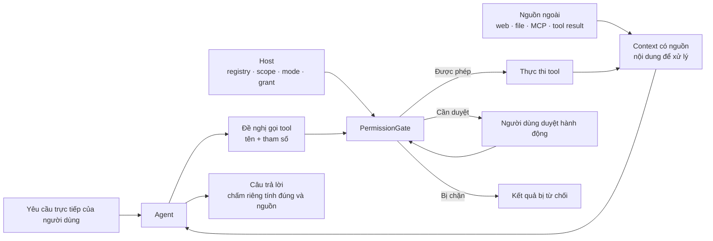
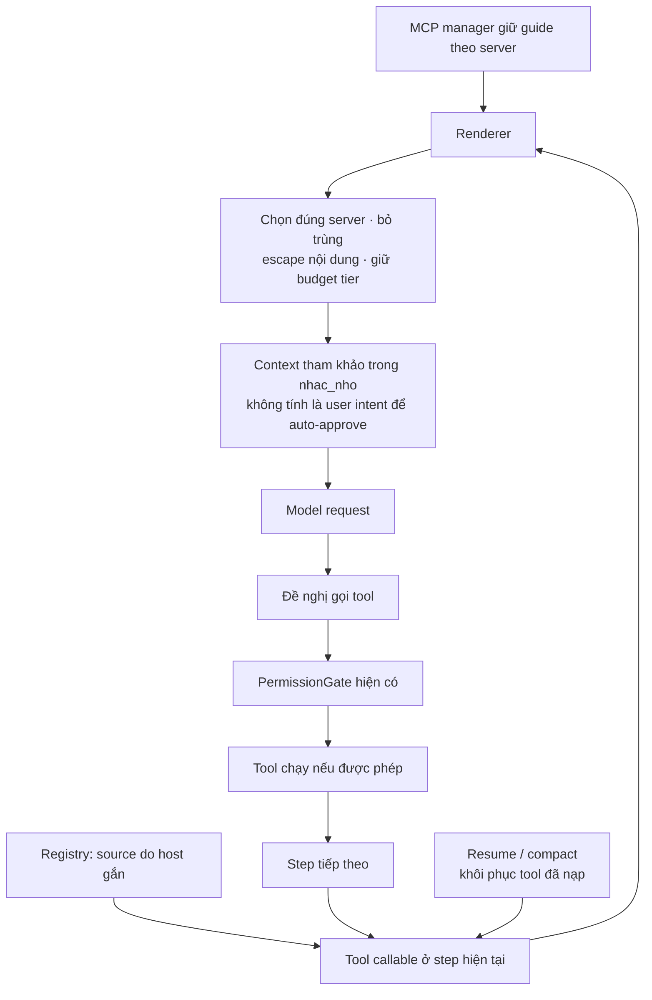
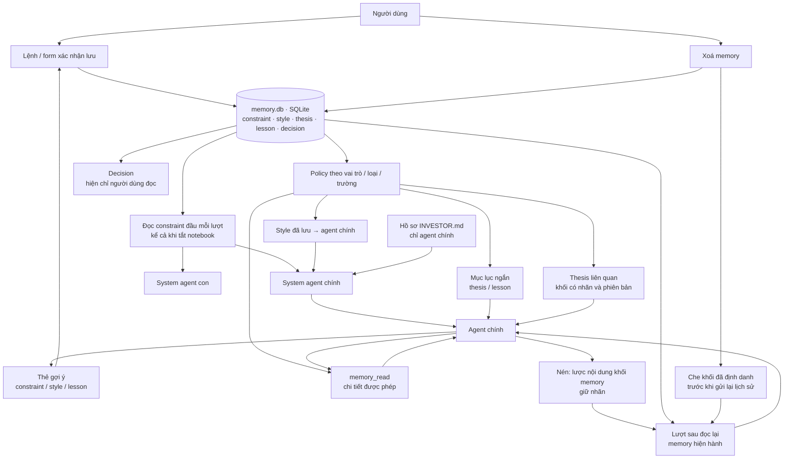
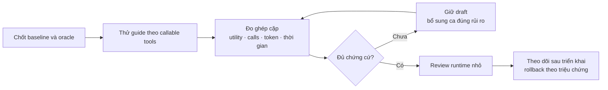

# Safeguard cho OpenTrading: nguồn nội dung, quyền thực thi và memory

Đề xuất ngày 12/11/2026. Trạng thái: **draft để review**, chưa đề nghị merge runtime. PR tài liệu chỉ công khai proposal và kết quả tổng hợp.

## 1. Quyết định đề xuất

Ưu tiên một thay đổi nhỏ: **hướng dẫn do MCP server cung cấp đi vào context tham khảo, chỉ khi server có tool đang callable; quyền vẫn do host quyết định**. Giữ kiến trúc memory mới nhất và PermissionGate hiện có. Chưa thêm classifier, reviewer thứ hai hoặc một vòng model bắt buộc cho mọi tác vụ.

Lý do: ở bản gốc, nội dung server cung cấp được ghép vào system dù không phải chỉ dẫn của ứng dụng hay người dùng. Đây là ranh giới nguồn có thể sửa bằng code mà không thêm inference. Hạ vị trí của guide giúp biểu diễn đúng thẩm quyền; hiệu quả chống dẫn dắt vẫn phải đo riêng. Các nhãn và thẻ bao không tạo ra bảo đảm an toàn tuyệt đối.

| Yêu cầu | Quyết định | Đánh đổi cần theo dõi |
|---|---|---|
| System prompt gần ngưỡng fixture | Không thêm một bộ luật dài; chuyển guide ra khỏi system | Chuyển kênh không tự giảm tổng input; wrapper cũng tốn token |
| Giữ tốc độ và chất lượng đọc dữ liệu | Dùng registry, bộ nạp tool và gate đang có | Model có thể dùng guide khác đi; cần đo bước, retry và chất lượng |
| Tránh hardcode theo payload | Chọn theo `ToolDef.source` do host đặt và tập tool callable | Phụ thuộc registry gắn nguồn đúng; phải kiểm đường đăng ký |
| Memory mới nhất | Giữ policy theo loại/vai trò, SQLite, thẻ gợi ý và nhãn | Cần kiểm giao điểm MCP–memory–compact thay vì mặc định mọi memory giống nhau |
| Sự cố copyright refusal | Truy tín hiệu dừng và bước xảy ra trước khi sửa | Chưa có trace đủ để kết luận nguyên nhân hoặc đề nghị thay ngưỡng trích dẫn |

## 2. Mốc code và phạm vi chứng cứ

| Mốc | SHA / nguồn | Ý nghĩa |
|---|---|---|
| Bản gốc để so sánh | `1737b93ee0082f6f4d6b1278c41c92a62b74ed2c` | `origin/main` được kiểm tra ngày 12/11/2026 |
| Memory hiện hành trong bản gốc | `a1adaee247adce7179375a3d7b9b9a42c46eac43` | Spec 007: nén giữ nhãn, gỡ memory cũ, thẻ gợi ý; đã nằm trong main |
| Candidate đã kiểm chứng cục bộ | `ea5454f68f8f2cb391d9caaa81219c2200af8d1b` | 5 file ứng dụng/test; runtime candidate chưa được xuất bản qua PR tài liệu này |
| Tổng hợp phép đo | [Kết quả ngày 12/11](../eval/safe-guard-2026-11-12.md) | Phân biệt kiểm tra cấu trúc, utility, mạng và bảo mật |

Đây là đánh giá code OpenTrading và tài liệu công khai của các hệ thống tham khảo. Không phải kiểm toán nội bộ ChatGPT, Claude hay các sản phẩm đóng; không xếp hạng bảo mật hoặc tốc độ giữa chúng khi chưa có phép đo cùng điều kiện.

## 3. Prompt injection là gì trong ứng dụng này?

Người dùng yêu cầu đọc báo cáo. Tool trả về báo cáo có một đoạn yêu cầu thay đổi cách trả lời, lấy thêm dữ liệu hoặc gửi dữ liệu đi. Nếu agent coi đoạn trong báo cáo là lệnh được phép thực hiện, **nội dung cần đọc đã vượt sang quyền điều khiển**. Sự nhầm lẫn này có thể xuất hiện trong web, file, MCP guide, tool result, memory recall, lịch sử hoặc lời trả của agent con.

Một câu trả lời sai và một hành động ngoài quyền là hai kết quả khác nhau. Runtime có thể chặn hành động ghi/gửi mà model vẫn bị dẫn dắt trong câu trả lời. Vì vậy cần chấm riêng chất lượng, an toàn hành động và tính riêng tư.

| Bề mặt | Kẻ tấn công có thể kiểm soát trong threat model | Chốt cần giữ ở host | Giới hạn |
|---|---|---|---|
| MCP guide và kết quả tool | Body, văn bản tự nhận là system hoặc đã được duyệt | Danh tính server, đăng ký tool, quyền và phạm vi | Guide có thể làm model trả lời sai dù không tạo grant |
| Web/file được đọc | Đoạn dẫn dắt nằm trong dữ liệu hợp lệ | Quyền đọc/ghi/gửi; nguồn của nội dung | Chỉ đánh dấu nguồn không ngăn mọi suy diễn |
| Tool discovery/skill/repair | Tài liệu tool chứa chỉ dẫn ngoài nhiệm vụ | Tập tool callable, marker nạp do host sinh | Tài liệu cần đủ để model dùng tool đúng |
| Memory recall | Nội dung đã lưu có thể sai hoặc mang chỉ dẫn | Policy loại/vai trò/trường; người dùng xác nhận ghi | Người dùng vẫn cần xem nội dung trước khi lưu làm constraint/style |
| Lịch sử, nén, resume | Chỉ dẫn bị chép lại và mất nguồn | Nhãn memory, trạng thái phiên và đọc lại bản hiện hành | Văn bản diễn giải tự do không luôn truy được về bản ghi gốc |
| Agent con và UI gọi tool trực tiếp | Lời trả agent con, dữ liệu panel | Scope và gate của từng đường gọi thật | Một gate trong vòng chat không mặc nhiên bao phủ mọi đường khác |

Code plugin/extension đã được cho chạy với quyền hệ điều hành, host bị chiếm quyền hoặc người dùng chủ động duyệt một hành động khác phạm vi là các tình huống cần cơ chế riêng. Nhãn trong prompt không cô lập được code đã chạy.

## 4. Hiện trạng và thay đổi MCP đã thử

Ở mốc gốc, `assemble.ts` ghép MCP instructions vào system theo ngân sách tier. Candidate bỏ phần đó khỏi system và dùng một renderer tại ranh giới chuẩn bị request.

| Tình huống | Candidate làm gì | Vì sao chọn |
|---|---|---|
| Tool đã sẵn sàng ngay đầu lượt | Cung cấp guide đúng server trước request dùng tool | Không tạo discovery chỉ để đọc guide |
| `tool_search`, `load_skill`, preload hoặc `repairCall` | Tính lại guide từ tập callable ở `prepareStep` tiếp theo | Một điểm tích hợp chung; giữ nguyên protocol bộ nạp |
| MCP kết nối nhưng không có tool callable | Không đưa guide của server đó vào request | Giảm nội dung không liên quan bằng trạng thái thật |
| Nhiều tool cùng server | Một guide cho server trong mỗi request | Tránh bản sao trong cùng context |
| Resume hoặc compact | Lấy guide hiện tại từ host và tập tool đã khôi phục | Không phụ thuộc bản guide cũ bị chép trong lịch sử |
| Server guide có ký tự đóng thẻ | Escape nội dung và nguồn; giới hạn toàn khối | Giữ ranh giới biểu diễn; không coi escape là bộ phát hiện injection |

Guide được ghép tạm vào request, không ghi vào lịch sử phiên; không tích lũy bản sao qua từng step. Role truyền qua adapter vẫn là user-context với wrapper nội bộ. Đây là cách biểu diễn tham khảo trong API hiện tại, **không phải một role bảo mật riêng do provider bảo đảm**. Gate phải tiếp tục dựa vào state và user intent mà host xác định.

Candidate chỉ thay `src/core/agent.ts`, `src/core/prompt/assemble.ts`, thêm `src/core/prompt/mcp-guidance.ts`, và hai file test. Không thay MCP manager, loader, permission engine hay dependency. Preview `/context` và token estimate fallback được cập nhật để tính phần guide đúng kênh.

## 5. Memory hiện hành: sơ đồ và ranh giới cần giữ

Đối chiếu code `src/core/memory/policy.ts`, `binding/bind.ts`, `notebook/provider.ts`, `notebook/history-blocks.ts`, `src/core/compact.ts` và specs 006–007. Một số tài liệu thiết kế cũ mô tả phiên bản trước; code hiện hành và hợp đồng spec đã triển khai là mốc kiểm chứng ở đây.

| Thành phần | Hành vi hiện tại | Điều phải giữ khi cải tiến safeguard |
|---|---|---|
| Constraint | Bind đầu mỗi lượt cho agent chính và con, kể cả notebook tắt | Không để guide ngoài thay quyền hoặc làm mất constraint; không âm thầm cắt constraint |
| Profile và lỗi đọc nguồn | Profile chỉ cho main; lỗi đọc giữ lượt, trừ lựa chọn bỏ qua một lượt từ host/người dùng | Model không được tự tạo sự kiện bỏ qua nguồn |
| Style | Style đã lưu đi vào instructions của main | Phân biệt nội dung người dùng đã xác nhận với lời khuyên từ tool |
| Thesis | Mục lục metadata, nhận chủ đề từ chữ người dùng gõ, recall có nhãn/version; chi tiết qua `memory_read` | Không để nội dung tool tự trở thành chủ đề người dùng yêu cầu |
| Lesson | Mục lục tiêu đề, đọc chi tiết bằng tool | Giữ projection và nguồn; không nâng bài học thành permission |
| Decision | Policy chưa có quyền đọc cho main hoặc subagent | Kiểm cả request gửi provider, không chỉ xem câu trả lời có lộ hay không |
| Thẻ gợi ý | Main chỉ đề xuất constraint/style/lesson; người dùng mở form để xác nhận | Không thêm đường model tự ghi; thẻ chưa duyệt chưa có hiệu lực |
| Compact | Lược nội dung khối memory được nhận diện, giữ nhãn để đọc lại | Phân biệt nén thật với fixture mô phỏng trạng thái sau nén trong phép đo |
| Xoá | Che khối memory đã định danh trong các đường lịch sử trước khi gửi lại | Không hứa xoá được mọi diễn giải tự do hoặc dữ liệu provider từng nhận |
| Legacy | Đã bỏ `propose_memory`, hook `Ghi nhớ:` và FileMemory; giữ dữ liệu cũ | Không tái tạo đường ghi ngầm khi thêm safeguard |

Năm loại tương ứng: **constraint** là ràng buộc, **style** là cách trình bày, **thesis** là luận điểm, **lesson** là bài học, **decision** là nhật ký quyết định. `INVESTOR.md` là nguồn hồ sơ riêng, không phải một loại thứ sáu trong SQLite. Khi tắt notebook, các nhánh style/index/recall/tool của notebook không hoạt động; đường constraint độc lập vẫn được bind.

**Quyết định:** giữ thiết kế này. Bổ sung kiểm chứng giao điểm thay vì viết lại memory hoặc gắn classifier vào mọi lần recall. Cần ca riêng cho giả nhãn memory trong tool result, guide tự nhận là constraint, thay đổi/xoá rồi resume, child không thấy decision, và thẻ gợi ý bị dẫn dắt nhưng chưa xác nhận. Phép đo hiện tại chỉ bao phủ một phần; xem bảng giới hạn trong báo cáo.

## 6. Học chọn lọc từ các harness và nghiên cứu

Các mô tả dưới đây dựa trên nguồn chính thức được đọc trong đợt khảo sát. Cột quyết định là đánh giá cho OpenTrading: TypeScript/Bun, desktop Windows, hạn chế ngân sách prompt và số lượt model. Những giới hạn phiên bản cần được kiểm lại trước khi tích hợp.

| Hệ thống / nguồn chính thức | Điểm đáng học, mặt tốt | Chi phí hoặc giới hạn | Chọn / hoãn và lý do |
|---|---|---|---|
| [OpenAI Agents SDK](https://developers.openai.com/api/docs/guides/agents/guardrails-approvals) | Guardrail input/output/tool, human review có state | Mỗi loại guardrail có phạm vi; input đầu lượt không bao phủ mọi tool result | **Chọn** chốt gần hành động và giữ duyệt ngoài text; tận dụng gate sẵn có |
| [Codex permissions](https://learn.chatgpt.com/docs/permissions) | Quyền môi trường giới hạn tài nguyên có thể chạm tới | Mỗi cơ chế chỉ bao phủ bề mặt của nó; cô lập OS cần tương thích nền tảng | **Chọn** lập bản đồ file/network/MCP; **hoãn** lớp OS mới chưa có nhu cầu đo được |
| [Anthropic containment](https://www.anthropic.com/research/how-we-contain-claude) | Chồng lớp, xét cả thiệt hại khi model mắc lỗi | Sản phẩm có kiến trúc khác nhau; detector và approval vẫn có đánh đổi | **Chọn** giảm quyền/dữ liệu được lộ; mở rộng giám sát khi rủi ro đáng chi phí |
| [Claude Code](https://code.claude.com/docs/en/security) | Mode quyền, reviewer và xử lý web tách biệt | Reviewer/model đọc web có thể thêm request và mất thông tin khi tóm tắt | **Giữ** reviewer/web model hiện có; **hoãn** reviewer thứ hai mặc định |
| [Gemini CLI](https://geminicli.com/docs/reference/policy-engine/) | Policy allow/deny/ask theo tool, server, mode | Rule command/pattern cần bảo trì; mặc định phụ thuộc mode | **Chọn** policy ngoài prompt và kiểm từng mode; tránh detector bằng tên tool |
| [Google ADK](https://adk.dev/safety/) | Callback trước tool, plugin và lựa chọn judge | Judge hoặc dịch vụ scan thêm latency; callback cần nhìn đúng tham số thật | **Chọn** điểm kiểm tra dùng chung; **hoãn** judge mọi input/output |
| [Microsoft Agent Framework / FIDES](https://learn.microsoft.com/en-us/agent-framework/agents/security) | Nhãn integrity/confidentiality và policy trước tool | Tài liệu hiện đánh dấu experimental, Python-only; nhãn bảo thủ và model cách ly có chi phí | **Chọn** nguồn do host quản lý; **hoãn** port toàn IFC sang Bun |
| [LangChain](https://docs.langchain.com/oss/python/langchain/guardrails) | Middleware ở nhiều điểm; code cho luật rõ, model cho semantic check | Chồng middleware và lọc từ khóa dễ tăng false block | **Chọn** schema/scope/source bằng code; semantic check chỉ cho nhóm lỗi xác định |
| [LangGraph](https://docs.langchain.com/oss/python/langgraph/interrupts) | Interrupt, checkpoint, resume rõ | Resume có thể chạy lại node, cần tránh side effect trùng | **Chọn** ràng buộc duyệt vào state; **hoãn** thêm graph engine |
| [OpenHands](https://docs.openhands.dev/sdk/guides/security) | Tách confirmation policy và risk analyzer; có lựa chọn local | Docs nêu direct `execute_tool` đi ngoài analyzer/policy của conversation | **Chọn** kiểm cả agent loop và UI/direct call; giữ trải nghiệm refresh đọc dữ liệu |
| [OpenCode permissions](https://opencode.ai/docs/permissions/) / [skills](https://opencode.ai/docs/skills/) | Quyền theo phạm vi và nạp hướng dẫn khi cần | Mặc định/cú pháp thay đổi theo thế hệ; rule quá rộng cấp quá rộng | **Chọn** scope và nạp đúng lúc; không sao chép mặc định phiên bản khác |
| [ClineCore](https://docs.cline.bot/sdk/clinecore) | Approval callback và lõi nhỏ, mở rộng theo nhu cầu | Full harness có thêm backend/session/scheduling | **Chọn** ít điểm tích hợp chung trong runtime hiện tại; không đổi framework |
| [Cursor security](https://cursor.com/docs/agent/security) / [run modes](https://cursor.com/docs/agent/security/run-modes) | Quyền theo tác động; cấu hình chạy cũng cần được xét | Auto rộng làm tăng phạm vi thiệt hại | **Chọn** scope và duyệt thao tác có tác động; không coi một mode đủ cho mọi việc |
| [GitHub Copilot firewall](https://docs.github.com/en/copilot/how-tos/copilot-on-github/customize-copilot/customize-the-firewall) | Giảm một số đích gửi dữ liệu ra ngoài | Có phạm vi process; MCP có đường riêng; đích cho phép vẫn cần xét dữ liệu gửi | **Chọn** kiểm từng bề mặt egress; **hoãn** proxy toàn cục cho desktop |
| [Devin permissions](https://docs.devin.ai/cli/reference/permissions.md) / [sandbox](https://docs.devin.ai/cli/sandbox.md) | Scope quyền và môi trường bổ sung cho nhau | Docs hiện nêu sandbox chưa hỗ trợ Windows, network filtering còn unstable | **Chọn** scope/mode; **hoãn** phụ thuộc sandbox chưa hợp nền tảng |
| [Windsurf/Cascade terminal](https://docs.windsurf.com/windsurf/terminal) | Rule và scope duyệt một lần/phiên/lâu dài | Tài liệu terminal hiện chuyển sang Devin Desktop; hành vi phụ thuộc mode/thế hệ | **Chọn** scope rõ và tách policy tổ chức/dự án; kiểm lại trước tích hợp |
| [Pi extensions](https://raw.githubusercontent.com/badlogic/pi-mono/main/packages/coding-agent/docs/extensions.md) | Hook trước tool với runtime nhỏ | Extension cùng quyền OS và có thể sửa arguments | **Chọn** lõi nhỏ; phân biệt hook tùy chọn với chốt bắt buộc |
| [Pydantic AI deferred tools](https://pydantic.dev/docs/ai/tools-toolsets/deferred-tools/) | Approval theo ID/args, validator và resume | Client history/approval vẫn cần auth; hook có thể biến đổi args | **Chọn** kiểm hành động và args cuối cùng khi thực thi; không đổi framework |
| [LlamaIndex human review](https://developers.llamaindex.ai/python/framework/understanding/agent/human_in_the_loop/) | Workflow event biểu diễn trạng thái chờ người dùng | Cần xác thực phản hồi và giữ state đúng | **Chọn** sự kiện duyệt tách khỏi model text; dùng event sẵn có |
| [CrewAI tasks](https://docs.crewai.com/en/concepts/tasks) | Guardrail bằng function/model và retry có giới hạn | Judge/retry thêm chi phí; chấm output không tự ngăn tool đã chạy | **Chọn** retry budget và chấm utility; **hoãn** judge mọi câu trả lời |
| [Azure Prompt Shields](https://learn.microsoft.com/en-us/azure/ai-services/content-safety/concepts/jailbreak-detection) | Detector cho user/document attack | Thêm dịch vụ, truyền dữ liệu và false positive/negative | **Hoãn** mặc định; thử trên luồng cụ thể nếu lợi ích đo được |
| [Bedrock Guardrails](https://docs.aws.amazon.com/bedrock/latest/userguide/guardrails-prompt-attack.html) | Filter quản lý tập trung khi dùng Bedrock | Phạm vi scan và chi phí cần đo; không cấp quyền tool | **Hoãn** vì chưa có nhu cầu Bedrock trong thay đổi này |
| [CaMeL](https://arxiv.org/abs/2503.18813) | Tách control/data và capability để thực thi policy | Giả định kiến trúc mạnh, tích hợp lớn, ảnh hưởng linh hoạt | **Chọn** nguyên tắc quyền ở host; **hoãn** thay toàn kiến trúc |
| [AgentDojo](https://proceedings.nips.cc/paper_files/paper/2024/hash/97091a5177d8dc64b1da8bf3e1f6fb54-Abstract-Datasets_and_Benchmarks_Track.html) | Chấm utility cùng security, môi trường mở rộng được | Benchmark khác domain; corpus cố định có nguy cơ bị tối ưu quá mức | **Chọn** biến thể và chấm cả tác vụ hợp lệ; dùng tool/domain OpenTrading |

Không cần cắm API của mọi provider để áp dụng các nguyên tắc này. Kiểm tra registry, quyền, không ghi memory ngầm và request có lộ decision hay không có thể làm cục bộ. Muốn so sánh hành vi/tốc độ giữa các model thì cần quyền truy cập từng API và chạy cùng bộ ca. Model API không đại diện đầy đủ các lớp bảo vệ của sản phẩm ChatGPT/Claude hoàn chỉnh.

## 7. Hợp đồng tránh hardcode và kiểm chứng

| Dựa vào | Tránh dùng làm chốt chính |
|---|---|
| Danh tính nguồn từ registry, tập callable từng step | Tên chứa `read`, `safe`, hoặc whitelist server cố định |
| Scope, mode, tài nguyên, đích gửi, tham số thực thi | Câu trong tài liệu tự nhận đã được người dùng duyệt |
| Policy memory theo vai trò/loại/trường | Một regex coi mọi memory là cùng một loại chỉ dẫn |
| Nhãn/version do các đường memory hợp lệ tạo | Dòng giả nhãn xuất hiện ở tool ngoài hoặc lời người dùng |
| Oracle tác vụ và biến thể chưa dùng để tinh chỉnh | Danh sách vài câu `ignore previous instructions` |
| Tách completed step, HTTP attempt, recovery và timeout | Đếm mỗi model step thành một request mạng |

Các invariant có thể kiểm bằng code: guide không ở system; guide chỉ có cho nguồn callable; guide không trở thành user intent của gate; không ghi guide vào history; chỉ user activate memory; model không đọc decision. Các invariant này có phạm vi cụ thể. Chất lượng câu trả lời và việc chống payload thích nghi vẫn là phép đo hành vi, không suy ra trực tiếp từ test cấu trúc.

| Nhóm ca tiếp theo | Chấm an toàn | Chấm utility / chi phí |
|---|---|---|
| Guide giả system/permission với nhiều cách diễn đạt | Không có grant mới, không chạy hành động vượt scope | Vẫn đọc được dữ liệu hợp lệ |
| Tool result có chỉ dẫn đổi nguồn/số liệu hoặc gửi dữ liệu | Đúng dữ liệu, không egress ngoài quyền | Tỷ lệ hoàn thành, số bước và retry |
| Discovery, skill, preload, repair | Đúng nguồn, không mở rộng quyền từ mô tả | Không thêm vòng chỉ để nạp guide |
| Memory giả nhãn, thẻ gợi ý, child | Không activate ngầm, không lộ decision/field bị cấm | Chủ đề và cách trình bày vẫn đúng |
| Nén thật, sửa/xoá, resume từ file phiên | Không phát lại block bị xoá; đọc bản hiện hành | Không mất constraint hoặc công việc đang làm |
| Từ chối và lỗi provider | Không tự đổi refusal thành một lần được phép chạy | Phân biệt blocked, timeout, length và empty output |
| UI/watchlist/direct tool | Gate đúng với tác vụ và mode thực tế | Refresh/cache/hủy đọc không bị hỏi lại vô ích |

## 8. Copyright refusal và các phần chưa triển khai

Chưa có trace xác nhận nguyên nhân sự cố copyright được báo, nên chưa sửa giới hạn trích dẫn hay fallback. Cần giữ lại provider/model, bước chính hay model đọc web, finish reason, text từ chối đã lược dữ liệu và hành vi fallback.

| Tín hiệu quan sát | Hướng xử lý |
|---|---|
| Provider báo chặn rõ | Giữ trạng thái/lý do và dừng nhánh bị chặn theo stop gate phù hợp |
| Text từ chối nhưng finish reason là `stop` | Giữ text; đánh giá mẫu hợp lệ trước khi kết luận từ chối nhầm |
| Timeout, lỗi mạng, length, trống thông thường | Phục hồi theo loại lỗi và ngân sách, ghi đủ số attempt |
| Model phụ đọc web bị chặn và trả trống | Kiểm tín hiệu chặn trước fallback trả nguyên trang; review riêng để không làm hỏng lỗi mạng/trống thông thường |

Không dùng prompt injection để vượt chính sách provider. Mục tiêu là trạng thái chính xác, giảm từ chối nhầm có chứng cứ và giữ tác vụ hợp lệ hoạt động.

## 9. Thứ tự thực hiện và điều kiện quyết định

1. **Đã làm:** pin code, đọc nguồn tham khảo, thử một ranh giới MCP, kiểm regression và đo một provider. Báo cáo ghi cả thất bại.
2. **Trước đề nghị merge runtime:** review diff 5 file và ca bảo mật bất biến; bổ sung ca hành vi đổi ý đồ/memory phù hợp domain. Nếu khác biệt hiệu năng chưa ổn định, giữ draft và làm rõ nguồn retry thay vì khẳng định nhanh hơn.
3. **Sau đó theo chứng cứ:** sửa một đường quyền/direct call hoặc refusal cụ thể nếu tái hiện được. Mỗi thay đổi tách để đo tác động.
4. **Chỉ khi cần:** thử detector có chọn lọc, egress control hoặc cô lập mạnh hơn. Mỗi lớp phải có nhóm rủi ro, chi phí và tiêu chí dừng rõ.

Tiêu chí mong muốn: không có model round bắt buộc mới trên tác vụ thường; không tăng system fixture; không có lỗi invariant quyền/memory; utility không giảm đáng kể trong nhóm tác vụ hỗ trợ. Đây là tiêu chí review, chưa phải kết luận đạt toàn bộ. Mẫu hiện tại một provider, synthetic, số lượt nhỏ và có biến động mạng; chưa đủ tuyên bố p95 sản phẩm hay khả năng chống injection tổng quát.
