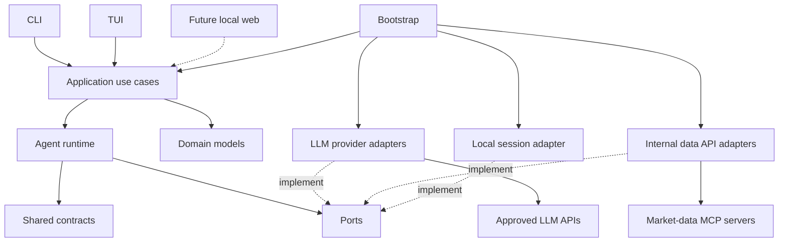
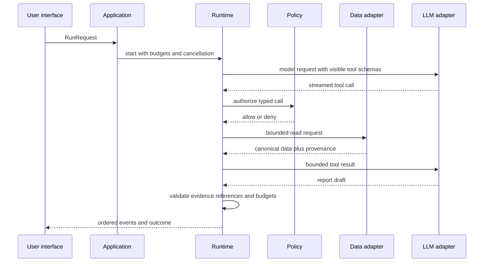

# Architecture

## Shape

The product begins as a modular monolith. A single process and package are easier to debug,
package, and evolve for a local user. Module boundaries preserve a future web interface without
introducing a server now.

Dependency direction is enforced: interfaces depend on application/bootstrap; application and
runtime use contracts, domain types, and ports; adapters implement ports; bootstrap selects concrete
adapters. Shared contracts and domain code never import UI, HTTP, database, or provider SDK modules.

## Trust boundaries

The local process, configuration, remote providers, internal APIs, and future MCP servers are
separate trust zones. News, API fields, tool output, and model output are untrusted data. Only code
policy can authorize a tool. Credentials are resolved immediately before adapter calls and are
redacted before an event or error is persisted.

## One research run

## Operational invariants

- Every accepted state change becomes an ordered event before another model step depends on it.
- Cancellation stops new tool dispatch, drains or terminates started work, and records the outcome.
- Parallel calls are limited and allowed only for tools declared safe to overlap.
- Retries are bounded, apply only to retryable failures, and respect the original budget.
- A replay reads stored results and never contacts an upstream service.
- Context compaction references durable originals; summaries cannot erase provenance.
